- [About this book](#about-this-book)
  - [Publication, trademark, and license notice](#publication-trademark-and-license-notice)
- [About IT Education Nepal](#about-it-education-nepal)
- [About the Author](#about-the-author)
- [How to use this book](#how-to-use-this-book)
  - [How the guidance changes](#how-the-guidance-changes)
  - [Use now, understand now, master later.](#use-now-understand-now-master-later)
  - [Evidence system](#evidence-system)
    - [Use three evidence labels](#use-three-evidence-labels)
    - [Troubleshooting record standard](#troubleshooting-record-standard)
  - [One self-check standard for every assignment](#one-self-check-standard-for-every-assignment)
  - [When you are stuck](#when-you-are-stuck)
    - [Evidence to Share When Asking for Help](#evidence-to-share-when-asking-for-help)
- [Report, validation, and learning teamwork](#report-validation-and-learning-teamwork)
- [Module 0: Day Zero and Getting Started](#module-0-day-zero-and-getting-started)
  - [Minimum setup](#minimum-setup)
  - [Quick readiness check](#quick-readiness-check)
  - [Install Cisco Packet Tracer](#install-cisco-packet-tracer)
    - [Learn More: Official Reference](#learn-more-official-reference)
  - [If installation is blocked](#if-installation-is-blocked)
  - [Wireshark is optional in Volume 1](#wireshark-is-optional-in-volume-1)
    - [Learn More: Official Reference](#learn-more-official-reference-1)
  - [If a command is not available](#if-a-command-is-not-available)
  - [Day Zero check](#day-zero-check)
  - [Module 0: Practical Labs](#module-0-practical-labs)
  - [Lab 0.1: Your Laptop Is a Network Client](#lab-01-your-laptop-is-a-network-client)
    - [Scenario](#scenario)
    - [Your Responsibility](#your-responsibility)
    - [Before you run the commands](#before-you-run-the-commands)
    - [Windows](#windows)
    - [macOS](#macos)
    - [Linux](#linux)
    - [What these commands prove](#what-these-commands-prove)
    - [Learn More: Official Reference](#learn-more-official-reference-2)
    - [Record Your Findings](#record-your-findings)
    - [Verification](#verification)
    - [Reflection](#reflection)
    - [Evidence to Save](#evidence-to-save)
  - [Lab 0.2: Build Your First Two-PC Network](#lab-02-build-your-first-two-pc-network)
    - [Scenario](#scenario-1)
    - [Network Requirement](#network-requirement)
    - [Build Tasks](#build-tasks)
    - [Switch Observation](#switch-observation)
    - [First Troubleshooting Exercise](#first-troubleshooting-exercise)
    - [Optional extension](#optional-extension)
    - [Verification](#verification-1)
    - [Reflection](#reflection-1)
    - [Evidence to Save](#evidence-to-save-1)
  - [Lab 0.3: Cisco CLI Comfort Ramp](#lab-03-cisco-cli-comfort-ramp)
    - [Scenario](#scenario-2)
    - [Required Device](#required-device)
    - [Practice Sequence](#practice-sequence)
    - [First CLI Error](#first-cli-error)
    - [Command Introduction](#command-introduction)
    - [Read show ip interface brief in this order.](#read-show-ip-interface-brief-in-this-order)
    - [Verification](#verification-2)
    - [Reflection](#reflection-2)
    - [Evidence to Save](#evidence-to-save-2)
  - [Module 0 Skills Check](#module-0-skills-check)
  - [Module 0: Troubleshooting Primer](#module-0-troubleshooting-primer)
  - [Mixed Review MR-0: Are You Ready for Module 1?](#mixed-review-mr-0-are-you-ready-for-module-1)
    - [Scenario](#scenario-3)
    - [Task 1: Endpoint Evidence](#task-1-endpoint-evidence)
    - [Task 2: Rebuild the Two-PC LAN Without Step-by-Step Help](#task-2-rebuild-the-two-pc-lan-without-step-by-step-help)
    - [Task 3: CLI Check](#task-3-cli-check)
    - [Task 4: Controlled Fault](#task-4-controlled-fault)
    - [Evidence to Save](#evidence-to-save-3)
  - [Module 0 Checkpoint](#module-0-checkpoint)
- [Module 1: Network Foundations](#module-1-network-foundations)
  - [Module purpose](#module-purpose)
  - [Module 1 Readiness Check](#module-1-readiness-check)
  - [Concept Primer 1A: What a Small LAN Is Doing](#concept-primer-1a-what-a-small-lan-is-doing)
  - [Concept Primer 1B: Physical State Before Logical State](#concept-primer-1b-physical-state-before-logical-state)
  - [Concept Primer 1C: Choose the Connection Before Testing IP](#concept-primer-1c-choose-the-connection-before-testing-ip)
  - [Lab 1.1: Build a Small-Office LAN and Choose the Correct Connections](#lab-11-build-a-small-office-lan-and-choose-the-correct-connections)
    - [Scenario](#scenario-4)
    - [Scope](#scope)
    - [Addressing](#addressing)
    - [Tasks](#tasks)
    - [Verification](#verification-3)
    - [Troubleshooting Prompt](#troubleshooting-prompt)
    - [Reflection](#reflection-3)
    - [Evidence to Save](#evidence-to-save-4)
  - [Lab 1.2: Cisco IOS Modes, Device Identity, Help, and Banner](#lab-12-cisco-ios-modes-device-identity-help-and-banner)
    - [Scenario](#scenario-5)
    - [Required End State](#required-end-state)
    - [CLI Path](#cli-path)
    - [First-use command table](#first-use-command-table)
    - [Tasks](#tasks-1)
    - [Verification](#verification-4)
    - [Error Practice](#error-practice)
    - [Reflection](#reflection-4)
    - [Evidence to Save](#evidence-to-save-5)
  - [Lab 1.3: Save, Reload, and Recover the Intended Configuration](#lab-13-save-reload-and-recover-the-intended-configuration)
    - [Scenario](#scenario-6)
    - [Required End State](#required-end-state-1)
    - [First-use commands](#first-use-commands)
    - [Tasks](#tasks-2)
    - [Troubleshooting / Safety Note](#troubleshooting--safety-note)
    - [Reflection](#reflection-5)
    - [Evidence to Save](#evidence-to-save-6)
    - [Learn More: Official Reference](#learn-more-official-reference-3)
  - [Lab 1.4: MAC Learning and ARP in Action](#lab-14-mac-learning-and-arp-in-action)
    - [Scenario](#scenario-7)
    - [Addressing](#addressing-1)
    - [Tasks](#tasks-3)
    - [Verification Commands](#verification-commands)
    - [Beginner observation note](#beginner-observation-note)
    - [Observation Questions](#observation-questions)
    - [Optional extension](#optional-extension-1)
    - [Evidence to Save](#evidence-to-save-7)
  - [Lab 1.5: Create and Interpret Three Interface States](#lab-15-create-and-interpret-three-interface-states)
    - [Why this lab works differently](#why-this-lab-works-differently)
    - [Build](#build)
    - [State A: Healthy interface](#state-a-healthy-interface)
    - [What to read first](#what-to-read-first)
    - [State B: Administrative shutdown](#state-b-administrative-shutdown)
    - [State C: Physical/lower-layer down](#state-c-physicallower-layer-down)
    - [Comparison worksheet](#comparison-worksheet)
    - [Counters](#counters)
    - [Optional extension](#optional-extension-2)
    - [Verification](#verification-5)
    - [Evidence to Save](#evidence-to-save-8)
  - [Lab 1.6: "Users Cannot Reach the Server": Ping and Traceroute Troubleshooting](#lab-16-users-cannot-reach-the-server-ping-and-traceroute-troubleshooting)
    - [Scenario](#scenario-8)
    - [Topology](#topology)
    - [Intended Correct Addressing](#intended-correct-addressing)
    - [Phase 1: Build and Prove the Healthy Path](#phase-1-build-and-prove-the-healthy-path)
    - [Router setup scaffold: use now, master later](#router-setup-scaffold-use-now-master-later)
    - [Phase 2: Introduce the Fault Yourself](#phase-2-introduce-the-fault-yourself)
    - [Within Scope](#within-scope)
    - [Outside Scope](#outside-scope)
    - [Hypothesis Log](#hypothesis-log)
    - [Suggested Testing Order](#suggested-testing-order)
    - [Verification](#verification-6)
    - [Reflection](#reflection-6)
    - [Evidence to Save](#evidence-to-save-9)
    - [Learn More: Official Reference](#learn-more-official-reference-4)
  - [Mixed Review MR-1: Small Office Foundation Check](#mixed-review-mr-1-small-office-foundation-check)
    - [Scenario](#scenario-9)
    - [Tasks](#tasks-4)
    - [Evidence to Save](#evidence-to-save-10)
  - [Module 1 Checkpoint](#module-1-checkpoint)
- [Module 2: IP Addressing and the Subnetting Mastery Track](#module-2-ip-addressing-and-the-subnetting-mastery-track)
  - [Module 2 Readiness Check](#module-2-readiness-check)
  - [Module 2 learning outcomes](#module-2-learning-outcomes)
  - [Concept Primer 2A: IPv4 addresses, masks, and prefixes](#concept-primer-2a-ipv4-addresses-masks-and-prefixes)
  - [Concept Primer 2B: Powers of two](#concept-primer-2b-powers-of-two)
  - [Concept Primer 2C: The block-size method](#concept-primer-2c-the-block-size-method)
  - [Lab 2.1: IPv4 Hosts, Masks, and Default Gateways](#lab-21-ipv4-hosts-masks-and-default-gateways)
    - [Scenario](#scenario-10)
    - [Addressing requirements](#addressing-requirements)
    - [Your tasks](#your-tasks)
    - [First-use command](#first-use-command)
    - [Verification](#verification-7)
    - [Reflection](#reflection-7)
    - [Evidence to Save](#evidence-to-save-11)
  - [Drill 2.2: Binary-to-Decimal and Subnet Mask Practice](#drill-22-binary-to-decimal-and-subnet-mask-practice)
    - [Part A: Powers of two](#part-a-powers-of-two)
    - [Part B: Prefix to dotted-decimal mask](#part-b-prefix-to-dotted-decimal-mask)
    - [Part C: Mask to prefix](#part-c-mask-to-prefix)
  - [Lab 2.3: Subnet a Branch Office with Equal-Size Subnets](#lab-23-subnet-a-branch-office-with-equal-size-subnets)
    - [Scenario](#scenario-11)
    - [Your task](#your-task)
    - [Design worksheet](#design-worksheet)
    - [Hint: use only if you are stuck](#hint-use-only-if-you-are-stuck)
    - [Verification](#verification-8)
    - [Evidence to Save](#evidence-to-save-12)
    - [Reflection](#reflection-8)
  - [Drill 2.4: Fast Subnet-Boundary Identification](#drill-24-fast-subnet-boundary-identification)
    - [Questions](#questions)
  - [Concept Primer 2D: A Worked VLSM Example](#concept-primer-2d-a-worked-vlsm-example)
    - [Step 1: Allocate Network A](#step-1-allocate-network-a)
    - [Step 2: Allocate Network B](#step-2-allocate-network-b)
    - [Step 3: Allocate Network C](#step-3-allocate-network-c)
  - [Concept Bridge 2E: Moving Beyond a /24](#concept-bridge-2e-moving-beyond-a-24)
    - [Useful size check](#useful-size-check)
    - [Read the assigned /22 as one block.](#read-the-assigned-22-as-one-block)
  - [Lab 2.5: VLSM Plan for a Growing Organization](#lab-25-vlsm-plan-for-a-growing-organization)
    - [Scenario](#scenario-12)
    - [Design rule](#design-rule)
    - [Your tasks](#your-tasks-1)
    - [VLSM worksheet](#vlsm-worksheet)
    - [Design checkpoint](#design-checkpoint)
    - [Verification](#verification-9)
    - [Optional extension](#optional-extension-3)
    - [Evidence to Save](#evidence-to-save-13)
    - [Reflection](#reflection-9)
  - [Concept Primer 2F: What You Need for IPv6 in This Volume](#concept-primer-2f-what-you-need-for-ipv6-in-this-volume)
    - [Learn More: Official Reference](#learn-more-official-reference-5)
  - [Lab 2.6: IPv6 Addressing, Link-Local Addresses, and SLAAC](#lab-26-ipv6-addressing-link-local-addresses-and-slaac)
    - [Scenario](#scenario-13)
    - [IPv6 prefix](#ipv6-prefix)
    - [Addressing requirement](#addressing-requirement)
    - [Your tasks](#your-tasks-2)
    - [First-use commands](#first-use-commands-1)
    - [Verification](#verification-10)
    - [Optional extension](#optional-extension-4)
    - [Reflection](#reflection-10)
    - [Evidence to Save](#evidence-to-save-14)
  - [Lab 2.7: Troubleshoot Dual-Stack Addressing Faults](#lab-27-troubleshoot-dual-stack-addressing-faults)
    - [Scenario](#scenario-14)
    - [Expected IPv4 network](#expected-ipv4-network)
    - [Expected IPv6 prefix](#expected-ipv6-prefix)
    - [Healthy addressing table](#healthy-addressing-table)
    - [Phase 1: Build and Verify the Healthy Network](#phase-1-build-and-verify-the-healthy-network)
    - [Phase 2: Introduce Two Faults Yourself](#phase-2-introduce-two-faults-yourself)
    - [Troubleshooting cycle](#troubleshooting-cycle)
    - [Verification targets](#verification-targets)
    - [Evidence to Save](#evidence-to-save-15)
    - [Reflection](#reflection-11)
  - [Mixed Review MR-2: Addressing Readiness Check](#mixed-review-mr-2-addressing-readiness-check)
    - [Review Scope](#review-scope)
    - [Scenario](#scenario-15)
    - [Part A: Quick subnet drill](#part-a-quick-subnet-drill)
    - [Part B: Endpoint build](#part-b-endpoint-build)
    - [Part C: CLI review](#part-c-cli-review)
    - [Part D: Troubleshooting](#part-d-troubleshooting)
    - [Part E: Reflection](#part-e-reflection)
  - [Module 2 Checkpoint](#module-2-checkpoint)
- [Module 3: Switching and Network Access](#module-3-switching-and-network-access)
  - [Concept Primer 3A: Management SVI Versus User Forwarding](#concept-primer-3a-management-svi-versus-user-forwarding)
  - [Lab 3.1: Give the Access Switch a Management Address](#lab-31-give-the-access-switch-a-management-address)
    - [Why this matters](#why-this-matters)
    - [Addressing plan](#addressing-plan)
    - [Part A: Confirm the existing network](#part-a-confirm-the-existing-network)
    - [Part B: Configure the management SVI](#part-b-configure-the-management-svi)
    - [Part C: Verify the management address](#part-c-verify-the-management-address)
    - [Part D: Discover R1 with CDP](#part-d-discover-r1-with-cdp)
    - [Part E: Compare LLDP when supported](#part-e-compare-lldp-when-supported)
    - [Part F: Save and verify](#part-f-save-and-verify)
    - [Evidence to Save](#evidence-to-save-16)
    - [Reflection](#reflection-12)
  - [Concept Primer 3B: VLANs, Access Ports, Voice VLANs, and Trunks](#concept-primer-3b-vlans-access-ports-voice-vlans-and-trunks)
  - [Lab 3.2: Build VLANs and Access Ports](#lab-32-build-vlans-and-access-ports)
    - [Scenario](#scenario-16)
    - [VLAN plan](#vlan-plan)
    - [Endpoint plan](#endpoint-plan)
    - [Part A: Create the VLANs](#part-a-create-the-vlans)
    - [What the command proves](#what-the-command-proves)
    - [Part B: Assign the administration ports](#part-b-assign-the-administration-ports)
    - [Part C: Assign the other endpoint ports](#part-c-assign-the-other-endpoint-ports)
    - [Part D: Configure the endpoint addresses](#part-d-configure-the-endpoint-addresses)
    - [Part E: Verify the VLAN state](#part-e-verify-the-vlan-state)
    - [Part F: Test expected communication](#part-f-test-expected-communication)
    - [Important lesson](#important-lesson)
    - [First-use command table](#first-use-command-table-1)
    - [Verification requirements](#verification-requirements)
    - [Reflection](#reflection-13)
    - [Evidence to Save](#evidence-to-save-17)
  - [Concept Primer 3C: Think in Port Roles, Not Just Device Types](#concept-primer-3c-think-in-port-roles-not-just-device-types)
  - [Lab 3.3: Configure Edge Ports for User, Voice, Printer, and IoT Devices](#lab-33-configure-edge-ports-for-user-voice-printer-and-iot-devices)
    - [Scenario](#scenario-17)
    - [Approved VLAN plan](#approved-vlan-plan)
    - [Port requirements](#port-requirements)
    - [Your scope](#your-scope)
    - [Task 1: Create the required VLANs](#task-1-create-the-required-vlans)
    - [Task 2: Configure the phone and PC port](#task-2-configure-the-phone-and-pc-port)
    - [Task 3: Configure the printer port](#task-3-configure-the-printer-port)
    - [Task 4: Configure the IoT port](#task-4-configure-the-iot-port)
    - [Verification](#verification-11)
    - [Platform note](#platform-note)
    - [Reflection](#reflection-14)
    - [Evidence to Save](#evidence-to-save-18)
  - [Concept Primer 3D: What an 802.1Q Trunk Is Doing](#concept-primer-3d-what-an-8021q-trunk-is-doing)
    - [Practical mental model](#practical-mental-model)
    - [What you will verify](#what-you-will-verify)
  - [Lab 3.4: Configure an 802.1Q Trunk](#lab-34-configure-an-8021q-trunk)
    - [Scenario](#scenario-18)
    - [VLANs that must cross the trunk](#vlans-that-must-cross-the-trunk)
    - [Addressing for verification](#addressing-for-verification)
    - [Part A: Confirm the VLANs](#part-a-confirm-the-vlans)
    - [Part B: Configure the trunk on SW1](#part-b-configure-the-trunk-on-sw1)
    - [Part C: Configure the trunk on SW2](#part-c-configure-the-trunk-on-sw2)
    - [Important command note](#important-command-note)
    - [Learn More: Official Reference](#learn-more-official-reference-6)
    - [Part D: Verify the trunk](#part-d-verify-the-trunk)
    - [Part E: Test same-VLAN communication across the trunk](#part-e-test-same-vlan-communication-across-the-trunk)
    - [Part F: Test different-VLAN communication](#part-f-test-different-vlan-communication)
    - [First-use command table](#first-use-command-table-2)
    - [Verification requirements](#verification-requirements-1)
    - [Reflection](#reflection-15)
    - [Evidence to Save](#evidence-to-save-19)
  - [Lab 3.5: Observe VLAN 20 Across an 802.1Q Trunk](#lab-35-observe-vlan-20-across-an-8021q-trunk)
    - [Scenario](#scenario-19)
    - [Part A: Confirm the Healthy Trunk First](#part-a-confirm-the-healthy-trunk-first)
    - [Part B: Enter Simulation Mode](#part-b-enter-simulation-mode)
    - [Part C: Follow the PDU Across the Trunk](#part-c-follow-the-pdu-across-the-trunk)
    - [Observation Worksheet](#observation-worksheet)
    - [Expected Outcome](#expected-outcome)
    - [Optional extension](#optional-extension-5)
    - [Reflection](#reflection-16)
    - [Verification](#verification-12)
    - [Evidence to Save](#evidence-to-save-20)
  - [Lab 3.6: Route Between VLANs with One Router Interface](#lab-36-route-between-vlans-with-one-router-interface)
    - [Why this matters](#why-this-matters-1)
    - [Existing VLAN plan](#existing-vlan-plan)
    - [Endpoint plan](#endpoint-plan-1)
    - [Topology Change](#topology-change)
    - [Part A: Prove the Switching Baseline Before You Add Routing](#part-a-prove-the-switching-baseline-before-you-add-routing)
    - [Part B: Connect R1 to SW1](#part-b-connect-r1-to-sw1)
    - [Expected Outcome](#expected-outcome-1)
    - [Part C: Prepare the Router Physical Interface](#part-c-prepare-the-router-physical-interface)
    - [Part D: Create the VLAN 10 Subinterface](#part-d-create-the-vlan-10-subinterface)
    - [Part E: Create the VLAN 20 Subinterface](#part-e-create-the-vlan-20-subinterface)
    - [Part F: Create the VLAN 30 Subinterface](#part-f-create-the-vlan-30-subinterface)
    - [Learning checkpoint: before endpoint gateways](#learning-checkpoint-before-endpoint-gateways)
    - [First-use command table](#first-use-command-table-3)
    - [Important command note](#important-command-note-1)
    - [Part G: Configure Endpoint Default Gateways](#part-g-configure-endpoint-default-gateways)
    - [Part H: Verify the Router Subinterfaces](#part-h-verify-the-router-subinterfaces)
    - [Part I: Verify Connected Routes](#part-i-verify-connected-routes)
    - [Part J: Prove Inter-VLAN Routing](#part-j-prove-inter-vlan-routing)
    - [Part K: Follow One Routed Packet](#part-k-follow-one-routed-packet)
    - [Verification Checklist](#verification-checklist)
    - [Evidence to Save](#evidence-to-save-21)
    - [Reflection](#reflection-17)
  - [Lab 3.7: Route Between VLANs on a Multilayer Switch](#lab-37-route-between-vlans-on-a-multilayer-switch)
    - [Why this matters](#why-this-matters-2)
    - [Change-Control Step](#change-control-step)
    - [Target Design](#target-design)
    - [VLAN and Gateway Plan](#vlan-and-gateway-plan)
    - [Endpoint plan](#endpoint-plan-2)
    - [Part A: Remove R1 from the Local Inter-VLAN Path](#part-a-remove-r1-from-the-local-inter-vlan-path)
    - [Part B: Create the VLANs on MLS1](#part-b-create-the-vlans-on-mls1)
    - [Part C: Configure the Trunk to SW2](#part-c-configure-the-trunk-to-sw2)
    - [Parts D--F: Configure the VLAN SVIs](#parts-d--f-configure-the-vlan-svis)
    - [VLAN 10](#vlan-10)
    - [VLAN 20](#vlan-20)
    - [VLAN 30](#vlan-30)
    - [First-use command table](#first-use-command-table-4)
    - [Part G: Observe Before `ip routing`](#part-g-observe-before-ip-routing)
    - [Part H: Enable Layer 3 Routing](#part-h-enable-layer-3-routing)
    - [Important Contrast with Lab 3.1](#important-contrast-with-lab-31)
    - [Part I: Verify SVI State](#part-i-verify-svi-state)
    - [If an SVI Is Down](#if-an-svi-is-down)
    - [Part J: Verify the Routing Table](#part-j-verify-the-routing-table)
    - [Part K: Prove Inter-VLAN Routing](#part-k-prove-inter-vlan-routing)
    - [Part L: Observe One Routed Path](#part-l-observe-one-routed-path)
    - [Part M: Compare the Two Inter-VLAN Designs](#part-m-compare-the-two-inter-vlan-designs)
    - [Verification Checklist](#verification-checklist-1)
    - [Evidence to Save](#evidence-to-save-22)
    - [Reflection](#reflection-18)
  - [Concept Bridge 3E: Read the STP Decision Before You Add Edge Protection](#concept-bridge-3e-read-the-stp-decision-before-you-add-edge-protection)
  - [Lab 3.8: Build a Redundant Layer 2 Topology Safely](#lab-38-build-a-redundant-layer-2-topology-safely)
    - [Why this matters](#why-this-matters-3)
    - [Target Topology](#target-topology)
    - [Part A: Prove the VLAN/Trunk Baseline](#part-a-prove-the-vlantrunk-baseline)
    - [Part B: Enable Rapid PVST+](#part-b-enable-rapid-pvst)
    - [Part C: Make SW1 the Preferred Root](#part-c-make-sw1-the-preferred-root)
    - [Record the Evidence](#record-the-evidence)
    - [Expected Outcome](#expected-outcome-2)
    - [Learning checkpoint: before PortFast and BPDU Guard](#learning-checkpoint-before-portfast-and-bpdu-guard)
    - [First-use command table](#first-use-command-table-5)
    - [Part D: Configure PortFast on Endpoint Ports Only](#part-d-configure-portfast-on-endpoint-ports-only)
    - [Safety Rule](#safety-rule)
    - [Part E: Verify an Edge Port](#part-e-verify-an-edge-port)
    - [Part F: Controlled BPDU Guard Test](#part-f-controlled-bpdu-guard-test)
    - [Recovery](#recovery)
    - [Platform Limitation Rule](#platform-limitation-rule)
    - [Other STP guards you must recognize.](#other-stp-guards-you-must-recognize)
    - [Verification Checklist](#verification-checklist-2)
    - [Evidence to Save](#evidence-to-save-23)
    - [Reflection](#reflection-19)
    - [Learn More: Official Reference](#learn-more-official-reference-7)
  - [Lab 3.9: Bundle Two Switch Links with LACP](#lab-39-bundle-two-switch-links-with-lacp)
    - [Why this matters](#why-this-matters-4)
    - [Target Topology](#target-topology-1)
    - [Part A: Verify the Starting State](#part-a-verify-the-starting-state)
    - [Part B: Configure Matching Member Interfaces](#part-b-configure-matching-member-interfaces)
    - [LACP Mode Rule](#lacp-mode-rule)
    - [Part C: Configure the Logical Port-Channel](#part-c-configure-the-logical-port-channel)
    - [First-use command table](#first-use-command-table-6)
    - [Part D: Verify the Bundle](#part-d-verify-the-bundle)
    - [Part E: Verify the Trunk](#part-e-verify-the-trunk)
    - [Part F: Verify Spanning Tree](#part-f-verify-spanning-tree)
    - [Part G: Verify Traffic](#part-g-verify-traffic)
    - [Verification Checklist](#verification-checklist-3)
    - [Evidence to Save](#evidence-to-save-24)
    - [Reflection](#reflection-20)
    - [Learn More: Official Reference](#learn-more-official-reference-8)
  - [Lab 3.10: Handle Three Switching Tickets Like a Junior Engineer](#lab-310-handle-three-switching-tickets-like-a-junior-engineer)
    - [Your Allowed Scope](#your-allowed-scope)
    - [Required Troubleshooting Cycle](#required-troubleshooting-cycle)
    - [Healthy Baseline](#healthy-baseline)
    - [Ticket 1: One Admin PC Lost Local Connectivity](#ticket-1-one-admin-pc-lost-local-connectivity)
    - [Create the Fault Yourself](#create-the-fault-yourself)
    - [Incoming Ticket](#incoming-ticket)
    - [Scope](#scope-1)
    - [Hypothesis Log](#hypothesis-log-1)
    - [Fixed State](#fixed-state)
    - [Ticket 2: Clinical VLAN Fails Across the EtherChannel](#ticket-2-clinical-vlan-fails-across-the-etherchannel)
    - [Restore and Prove the Baseline First](#restore-and-prove-the-baseline-first)
    - [Create the Fault Yourself](#create-the-fault-yourself-1)
    - [Incoming Ticket](#incoming-ticket-1)
    - [Scope](#scope-2)
    - [Hypothesis Log](#hypothesis-log-2)
    - [Fixed State](#fixed-state-1)
    - [Ticket 3: Know When to Escalate](#ticket-3-know-when-to-escalate)
    - [Decision](#decision)
    - [Escalation Evidence Record](#escalation-evidence-record)
    - [Ticket Closure Standard](#ticket-closure-standard)
    - [Evidence Priority Table](#evidence-priority-table)
    - [Optional `show logging`](#optional-show-logging)
    - [Evidence to Save](#evidence-to-save-25)
    - [Reflection](#reflection-21)
  - [Mixed Review MR-3: Metro NOC Switching Readiness](#mixed-review-mr-3-metro-noc-switching-readiness)
    - [Review Scope](#review-scope-1)
    - [Part A: Quick Knowledge Check](#part-a-quick-knowledge-check)
    - [Part B: Independent Build](#part-b-independent-build)
    - [VLAN plan](#vlan-plan-1)
    - [Devices](#devices)
    - [Design Requirements](#design-requirements)
    - [Part C: Build Your Verification Plan](#part-c-build-your-verification-plan)
    - [Minimum self-check command set: use after your first attempt](#minimum-self-check-command-set-use-after-your-first-attempt)
    - [Part D: STP Interpretation](#part-d-stp-interpretation)
    - [Part E: Self-Inflicted Fault](#part-e-self-inflicted-fault)
    - [Part F: Evidence to Share When Asking for Help](#part-f-evidence-to-share-when-asking-for-help)
    - [Part G: Evidence for Final Report and Portfolio](#part-g-evidence-for-final-report-and-portfolio)
  - [MR-3 Evidence to Save](#mr-3-evidence-to-save)
  - [Real-World Bridge: What a Junior Engineer Now Owns](#real-world-bridge-what-a-junior-engineer-now-owns)
  - [Final Volume 1 Report, Validation, and Global Learning Teamwork](#final-volume-1-report-validation-and-global-learning-teamwork)
    - [Complete the assignments first.](#complete-the-assignments-first)
    - [Recommended final report structure](#recommended-final-report-structure)
    - [Submit for validation](#submit-for-validation)
    - [Optional GitHub Publication and Contribution](#optional-github-publication-and-contribution)
    - [Use the project in your career portfolio.](#use-the-project-in-your-career-portfolio)
  - [Interview Bridge](#interview-bridge)
  - [Volume 1 Transition](#volume-1-transition)
- [Appendix A: IOS/CLI Error Message Glossary](#appendix-a-ioscli-error-message-glossary)
  - [Beginner Reference](#beginner-reference)
    - [How to Read the `^` Marker](#how-to-read-the--marker)
    - [Platform Evidence](#platform-evidence)
    - [Cross-References](#cross-references)
- [Appendix B: Volume 1 Command Reference](#appendix-b-volume-1-command-reference)
  - [Use This After You Understand the Labs](#use-this-after-you-understand-the-labs)
    - [Endpoint / Home Evidence](#endpoint--home-evidence)
    - [IOS Navigation and Configuration](#ios-navigation-and-configuration)
    - [Interface Evidence](#interface-evidence)
    - [MAC / VLAN / Trunk](#mac--vlan--trunk)
    - [CDP / LLDP](#cdp--lldp)
    - [Management SVI](#management-svi)
    - [Router-on-a-Stick](#router-on-a-stick)
    - [Multilayer Switch Routing](#multilayer-switch-routing)
    - [Rapid PVST+](#rapid-pvst)
    - [PortFast / BPDU Guard](#portfast--bpdu-guard)
    - [LACP EtherChannel](#lacp-etherchannel)
    - [Troubleshooting Core](#troubleshooting-core)
- [Appendix C: Volume 1 Interface-Name Translation](#appendix-c-volume-1-interface-name-translation)
  - [Read the Role Before Memorizing the Label](#read-the-role-before-memorizing-the-label)
    - [If your interface names differ](#if-your-interface-names-differ)
  - [Common Acronyms in Volume 1](#common-acronyms-in-volume-1)
- [Appendix D: Volume 1 Self-Check Key](#appendix-d-volume-1-self-check-key)
  - [Use After You Attempt the Lab](#use-after-you-attempt-the-lab)
  - [Module 0](#module-0)
  - [Module 1](#module-1)
  - [Module 2](#module-2)
    - [Drill 2.2 answers](#drill-22-answers)
    - [Drill 2.4 answers](#drill-24-answers)
    - [Key concepts](#key-concepts)
  - [Module 3](#module-3)
  - [MR-3 answers](#mr-3-answers)
- [Appendix E: Official Resources and Version Checks](#appendix-e-official-resources-and-version-checks)
  - [Selected technical references used in this volume](#selected-technical-references-used-in-this-volume)
    - [Publication, license, and trademark references](#publication-license-and-trademark-references)

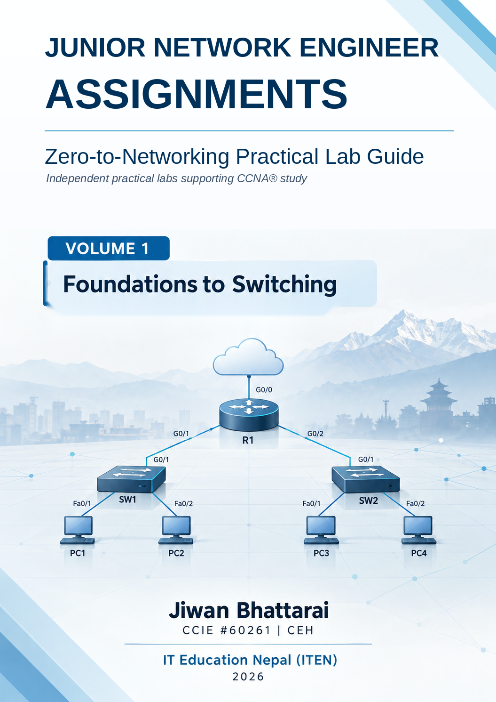

Junior Network Engineer Assignments

Zero-to-Networking Practical Lab Guide

Volume 1: Foundations to Switching

Jiwan Bhattarai, CCIE® No. 60261 \| CEH\
IT Education Nepal (ITEN)\
2026

# About this book

<div align="justify">

This book is for beginners, students, career-transition learners, help-desk/NOC aspirants, and junior engineers seeking practical networking experience.

</div>

The core rule is simple:

> **Build the network yourself, prove that it works, create the fault when instructed, troubleshoot from evidence, and keep a clear report of what you did.**

<div align="justify">

You do not need author-created .**pkt, .pka, or .pcapng** files for the core assignments.

This is an independent educational publication that supports hands-on networking study, including skills relevant to learners preparing for the CCNA® certification, but it is not official Cisco courseware.

</div>

## Publication, trademark, and license notice

<div align="justify">

This publication is published by IT Education Nepal (ITEN). It is neither sponsored, endorsed, approved, nor affiliated with Cisco Systems, Inc.

© 2026 IT Education Nepal. Except where otherwise identified, ITEN-authored text and ITEN-created original visual elements are licensed under the [Creative Commons Attribution 4.0 International License (CC BY 4.0)](https://creativecommons.org/licenses/by/4.0/). Cisco network topology icons and other third-party material are excluded from this license and remain subject to their owners' terms.

Cisco®, CCNA®, CCIE®, Cisco IOS®, and Cisco Networking Academy® are registered trademarks of Cisco Systems, Inc., and/or its affiliates, in the United States and certain other countries. Other product and company names are the property of their respective owners.

Cisco network topology icons in this book are used only in network diagrams and are kept in unmodified form under Cisco's published authorization for public use. Cisco corporate and certification logos are not used as book branding.

Edition and revision: Community Edition, Volume 1, v1.0 (October 2026). This revision improves editorial consistency, concept transitions, and platform notes; completion of the book is not a Cisco certification.

Validation and errata: Packet Tracer is the primary platform, but no complete student-execution pass has been claimed yet. Report a lab/page/step, expected and actual results, and sanitized evidence through ITEN channels or <https://github.com/ITEN-Non-Profit>

</div>

# About IT Education Nepal

**IT Education Nepal (ITEN), कम्प्युटर शिक्षा सबैका लागि (Computer education for all)**

<div align="justify">

IT Education Nepal is a volunteer-driven, nonprofit initiative that provides practical computer education to Nepali speakers worldwide. It was founded on the principle that technology literacy is a universal right and works to remove geographic, language, and financial barriers that keep many learners out of IT education.

Many learners finish formal study with strong theory but little practice in the skills the job actually requires. ITEN exists to close that gap.

</div>

**Let us learn and grow together. संगै सिकौं, संगै बढौं!**

| **Channel** | **Link** |
| --- | --- |
| Website | [iteducationnepal.org](https://iteducationnepal.org/) |
| YouTube | [youtube.com/@iteducationnepal](https://www.youtube.com/@iteducationnepal) |
| GitHub | [github.com/ITEN-Non-Profit](https://github.com/ITEN-Non-Profit) |
| LinkedIn | [linkedin.com/company/iteducationnepal](https://www.linkedin.com/company/iteducationnepal) |
| Facebook community | [facebook.com/groups/iteducationnepal](https://www.facebook.com/groups/iteducationnepal) |
| Telegram | [t.me/iteducationnepal](https://t.me/iteducationnepal) |

**Mission: 10,000 Skilled IT Engineers from Nepal to the World**

# About the Author

<div align="justify">

Jiwan Bhattarai holds the Cisco Certified Internetwork Expert (CCIE®) certification #60261 and the Certified Ethical Hacker (CEH) certification. He has worked in the international IT industry and mentors students and early-career engineers in technical skills and career growth.

He founded IT Education Nepal with one goal: to develop 10,000 skilled IT engineers from Nepal for the global market. His teaching combines technical practice with mindfulness, an approach he calls "**where technology meets tranquility**."

</div>

LinkedIn: [linkedin.com/in/jiwanbhattarai](https://www.linkedin.com/in/jiwanbhattarai)

# How to use this book

The learning path is:

> **Build → Verify → Observe → Troubleshoot → Document → Decide → Escalate**

<div align="justify">

Early assignments provide more guidance. Later assignments expect more independent work.

A practical way to work through a lab: first, read the scenario and required end state; next, identify the starting topology and addressing; then build and verify the healthy state before the fault exercise. If the result differs, review the evidence and platform note before making another change. Keep your evidence at the end.

</div>

## How the guidance changes

<div align="justify">

Volume 1 reduces support in stages so you practice choosing the next action rather than simply following commands.

Guided practice: the lab provides the sequence and introduces new commands.

Guided troubleshooting: the fault is known, but you must prove the cause before making any changes.

Mixed review: you build from requirements and choose more of the verification path yourself.

Volume 2 transition: later work can use blind tickets, where the fault is not revealed in advance.

</div>

## Use now, understand now, master later.

<div align="justify">

Sometimes a lab requires a command or device function before that topic is fully taught. When the book marks something as a scaffold, use it now, understand what it enables, and continue with the current objective. The deeper configuration and design work comes later in the planned learning flow.

Suggested study pace: allow roughly 30--40 hours of active practice for Volume 1, including mixed reviews, reflection, and documentation. For example, plan five to seven hours per week for six weeks. Beginners may need longer, especially for subnetting and troubleshooting; take the time needed to verify each checkpoint before advancing.

</div>

## Evidence system

For each assignment, keep only evidence that proves the result:

- your Packet Tracer file;
- one clear topology screenshot when useful;
- selected `show` output;
- successful or expected-failed tests;
- Simulation Mode evidence when required;
- troubleshooting notes;
- a short root-cause and verification statement.

<div align="justify">

Keep the evidence focused. Two or three items that prove the result are better than dozens of screenshots.

</div>

### Use three evidence labels

Use these labels consistently throughout the book:

<div align="justify">

**Evidence to Save:** keep the local working file and the minimum proof that shows the lab result, fault, recovery, or decision.

**Evidence for Final Report:** select only the strongest evidence from completed work. The final report is a curated summary, not a copy of every screenshot or command output.

**Evidence to Share When Asking for Help:** share only the evidence needed to understand the problem, and sanitize it before posting or sending it.

</div>

### Troubleshooting record standard

> During diagnosis, keep the working record in this order:
>
> **Symptom → Hypothesis → Test → Result → Next Step → Fix → Verify → Document**
>
> When a fault or ticket is resolved, summarize the closure in a concise form:
>
> **Symptom → Root Cause → Corrective Action → Verification → Final Status**

## One self-check standard for every assignment

<div align="justify">

Before you mark an assignment complete, answer the following four questions in your own words:

</div>

What was the required end state?

What command, test, or observation proves that end state?

If you made a change, what evidence justified it?

<div align="justify">

Can you explain why the final result is correct, including an expected failure if the design requires one?

</div>

| **Level** | **Meaning** |
| --- | --- |
| **Not yet** | The assignment is incomplete, or the evidence does not prove the result. |
| **Developing** | You completed most of the work but still need direct help. |
| **Competent** | You completed the assignment and can explain the important evidence. |
| **Professional behavior for this stage** | You worked independently, changed only what the evidence justified, documented the result, and can hand the work to another engineer. |

## When you are stuck

Use the Four-Tier Resolution Model:

1.  **Tier 1: Self-study:** read the requirement again and use the troubleshooting cycle.

2.  **Tier 2: Simplify First with AI:** ask for a simpler explanation or help identifying missing evidence, not the final answer.

3.  **Tier 3: ITEN community:** share a focused question with your own evidence.

4.  **Tier 4: Mentor escalation:** if a meaningful doubt remains after evidence-based self-study and community help, request mentor review through ITEN channels when volunteers are available.

### Evidence to Share When Asking for Help

Share the smallest useful evidence set. A good request typically includes:

a one-line symptom and expected result;

your first hypothesis and the tests already performed;

selected command output, a screenshot, or an error message;

what you changed, if anything;

the next decision or question you need help with.

> **Symptom → Hypothesis → Test → Result → Expected → Actual**

<div align="justify">

Sanitize before sharing: remove passwords, private keys, tokens, personal identifiers, real customer data, real hostnames or addresses that could expose a live environment, and other sensitive network information. Use fictional or redacted values whenever possible.

Community discussions are asynchronous. When volunteers are available, a typical response may take 3 to 7 days. This is a community support target, not a guaranteed SLA.

</div>

# Report, validation, and learning teamwork

> Complete the assignments in this volume and keep your Evidence to Save as you work. At the end, select the strongest items as Evidence for the Final Report rather than sending each screenshot separately.
>
> Share a sanitized Final Report through the ITEN learning community or social channels when you want feedback from mentors, senior network-engineer volunteers, or other experienced contributors.
>
> After validation and any requested corrections:

- keep the Final Report in your GitHub account;
- you are welcome to contribute a sanitized Final Report to an appropriate ITEN GitHub repository through your GitHub identity when that repository accepts learner contributions and you follow its contribution instructions;
- use your completed lab project as portfolio evidence in your CV, LinkedIn profile, or interview discussion.

<div align="justify">

Publishing or contributing your report to GitHub is optional and not required to complete this book.

A completed project demonstrates hands-on learning. It does not replace certification or professional experience, so describe it accurately.

A detailed final-report structure appears near the end of Volume 1.

</div>

# Module 0: Day Zero and Getting Started

<div align="justify">

Before the first lab, make sure your computer and workspace are ready.

</div>

## Minimum setup

| **Item** | **Guidance** |
| --- | --- |
| Computer | Windows, macOS, or 64-bit Linux supported by the current Cisco Packet Tracer installer |
| RAM | 4 GB practical minimum; 8 GB or more is better |
| Free space | Keep about 3 GB free for tools, screenshots, and lab files. |
| Install permission | Required for desktop applications |
| Internet | Needed for downloads, updates, and community support |

<div align="justify">

Cisco provides Packet Tracer for supported desktop systems on Windows, Linux/Ubuntu, and macOS. Use the official Resource Hub to review the current installer and system requirements before installing. This book assumes a desktop or laptop workflow.

</div>

## Quick readiness check

Create this folder:

```text
Junior_Network_Engineer_Labs/
└── Volume-1/
```

Then confirm that you can:

1.  create, rename, open, and save a text file;

2.  take and locate a screenshot;

3.  type these commands accurately in a text editor:

```text
show ip interface brief
show running-config
show mac address-table
```

4.  Answer these basic powers-of-two questions:

```text
2^2 = ?
2^4 = ?
2^8 = ?
```

Answers: `4`, `16`, `256`.

<div align="justify">

If one of these skills is challenging, practice it now. It is a preparation check, not a barrier.

</div>

## Install Cisco Packet Tracer

Use Cisco's official learning/download path:

- [Cisco Networking Academy: Getting Started with Cisco Packet Tracer](https://www.netacad.com/courses/getting-started-cisco-packet-tracer/1000)
- [Cisco Networking Academy: Packet Tracer downloads / Resource Hub](https://www.netacad.com/resources/lab-downloads)

<div align="justify">

Cisco's beginner Packet Tracer course provides interface guidance, while the official Resource Hub hosts the current downloads.

</div>

1.  Sign in or create the required Cisco learning account.

2.  Download the installer for your supported desktop operating system.

3.  Install and launch Packet Tracer.

4.  Create a blank project.

5.  Place one PC.

6.  Save it as:

```text
Volume-1/00-packet-tracer-test.pkt
```

7.  Close Packet Tracer and reopen the file.

<div align="justify">

If the file reopens with the PC still visible, your basic workspace is ready.

</div>

### Learn More: Official Reference

<div align="justify">

Use these official Cisco resources for guidance on the current installer and the Packet Tracer interface.

</div>

[Cisco Networking Academy: Getting Started with Cisco Packet Tracer](https://www.netacad.com/courses/getting-started-cisco-packet-tracer/1000)

[Cisco Networking Academy: Packet Tracer Resource Hub](https://www.netacad.com/resources/lab-downloads)

## If installation is blocked

<div align="justify">

Do not bypass school, workplace, or library security controls.

</div>

Use an authorized option:

- a campus or library computer lab;
- help from your institution's IT team;
- another supported personal computer;
- the ITEN community with your operating system, device limitation, and exact error message.

<div align="justify">

Do not use unofficial Packet Tracer installers or unauthorized IOS images.

</div>

## Wireshark is optional in Volume 1

<div align="justify">

The core Volume 1 assignments do not require an author-supplied packet capture.

Install Wireshark only if you want to complete the optional packet-capture extensions:

</div>

[Wireshark: Official Download](https://www.wireshark.org/download.html)

<div align="justify">

Capture only traffic and interfaces you are authorized to inspect. A Wireshark display filter changes what is shown on screen; it does not remove packets from the capture file.

</div>

### Learn More: Official Reference

<div align="justify">

Use the official guide when you need help with capture interfaces, packet details, or display filters.

</div>

[Wireshark: User's Guide](https://www.wireshark.org/docs/wsug_html/)

## If a command is not available

Device models and simulator releases can differ.

<div align="justify">

Treat the simulator and the device model as part of the evidence. If ? does not show the command or keyword you expect, record the model, interface name, Packet Tracer version, and the exact error before switching platforms. Production IOS/IOS XE devices can expose more commands or different interface names than the simulator.

</div>

Before assuming the book or device is wrong:

1.  read the IOS prompt;

2.  use `?`;

3.  confirm the device model;

4.  confirm the interface name;

5.  record the Packet Tracer version;

6.  copy the exact error message.

<div align="justify">

If you still need help, post that evidence with your ITEN question.

</div>

## Day Zero check

You are ready for the practical labs when:

- Packet Tracer launches;
- you can save and reopen a `.pkt` file;
- your `Volume-1` folder is ready;
- you can take screenshots;
- you know where to ask for help.

## Module 0: Practical Labs

<div align="justify">

The troubleshooting cycle introduced in this module becomes the standard method used throughout the book.

</div>

> **Symptom → Hypothesis → Test → Result → Next Step → Fix → Verify → Document**

## Lab 0.1: Your Laptop Is a Network Client

**Organization:** Metro NOC Services\
**Your role:** Network Support Trainee\
**Estimated time:** 30--45 minutes\
**Primary platform:** Your own Windows, macOS, or Linux computer\
**Job skill:** Collect basic endpoint network information\
**You will be able to:** Collect the active IPv4 address, default gateway, local-stack result, DNS result, and the first visible path evidence from your computer.\
**You need:** Day Zero setup complete; permission granted to use read-only commands on your own computer.

### Scenario

<div align="justify">

You have joined Metro NOC Services as a Network Support Trainee. Before you receive access to routers and switches, you must demonstrate that you can collect basic network evidence from an end-user computer.

</div>

### Your Responsibility

<div align="justify">

Use read-only network commands on your own computer. Identify the local IP address and default gateway. Test the local TCP/IP stack, local reachability, DNS, and the path to a remote destination.

</div>

Keep the router and managed-network settings unchanged.

<div align="justify">

**Production Note:** Read-only evidence collection is standard first-line support work. In a managed environment, change an adapter, gateway, DNS setting, VPN, or security control only when the ticket and your change authority permit it.

</div>

### Before you run the commands

<div align="justify">

Windows ping sends a small set of echo requests and then stops. On macOS and Linux, ping normally runs until you press Ctrl+C, so this lab uses -c 4 to send four requests and stop automatically.

If nslookup or traceroute is not installed on a minimal Linux system, do not install packages on a managed computer without permission. Record the missing command and use any evidence you can safely collect.

</div>

### Windows

```text
ipconfig
ping 127.0.0.1
ping <your-default-gateway>
nslookup example.com
tracert example.com
```

### macOS

```text
ifconfig
route -n get default
ping -c 4 127.0.0.1
ping -c 4 <your-default-gateway>
nslookup example.com
traceroute example.com
```

### Linux

```text
ip address
ip route
ping -c 4 127.0.0.1
ping -c 4 <your-default-gateway>
nslookup example.com
traceroute example.com
```

### What these commands prove

<div align="justify">

**Address command:** Find the active interface and its IPv4 address and prefix. Windows uses ipconfig, macOS uses ifconfig, and Linux uses ip address.

**Default-route command: find the router used for destinations outside the local subnet. On macOS, use route -n get default to find the gateway. On Linux, look for the line that starts with default via.**

**Loopback ping:** Pinging 127.0.0.1 checks the local TCP/IP stack. It does not prove that the cable, Wi-Fi, gateway, DNS, or the Internet is working.

**Gateway ping:** Tests whether the endpoint can reach its local router address. A failed reply is evidence, but a local firewall or policy can also affect ICMP traffic.

**nslookup:** Checks DNS name resolution. Record the returned address or the exact error. A successful lookup does not, by itself, prove that a web service is reachable.

**tracert / traceroute:** Shows the hops toward a destination. An asterisk or a timeout can mean that a hop did not respond to the probe; it does not, by itself, prove that the entire path is broken.

On macOS and Linux, the local manual pages are also useful: try man ifconfig, man route, man ip, or man traceroute when that command is present.

</div>

### Learn More: Official Reference

<div align="justify">

Use these Microsoft references if you want Windows command syntax and field-level details.

</div>

[Microsoft Learn: ipconfig](https://learn.microsoft.com/en-us/windows-server/administration/windows-commands/ipconfig)

[Microsoft Learn: nslookup](https://learn.microsoft.com/en-us/windows-server/administration/windows-commands/nslookup)

[Microsoft Learn: tracert](https://learn.microsoft.com/en-us/windows-server/administration/windows-commands/tracert)

### Record Your Findings

| **Item** | **Your Result** |
| --- | --- |
| Operating system |  |
| Active network interface |  |
| IPv4 address |  |
| Subnet mask/prefix |  |
| Default gateway |  |
| Connection type |  |

### Verification

Complete the lab only after you can record:

- the active IPv4 address;
- the default gateway;
- the loopback result;
- the gateway test result;
- the DNS lookup result;
- the first visible traceroute hop or a documented reason for the path not replying.

### Reflection

1.  Why does a successful ping to `127.0.0.1` not prove that the Internet works?

2.  What role does the default gateway perform?

### Evidence to Save

<div align="justify">

Save `lab-0.1-results.txt` with the operating system, connection type, IP address, gateway, loopback result, gateway ping result, DNS result, traceroute first hop, and one thing learned.

</div>

## Lab 0.2: Build Your First Two-PC Network

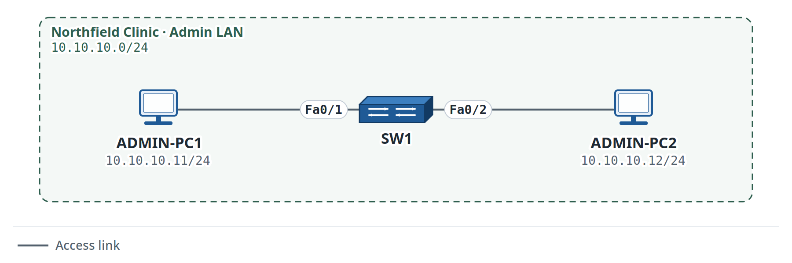

Figure 1. Lab 0.2: First Two-PC Network

**Organization:** Northfield Clinic\
**Your role:** Network Support Trainee\
**Estimated time:** 45--60 minutes\
**Primary platform:** Cisco Packet Tracer\
**Job skill:** Build, verify, and troubleshoot a basic LAN\
\
**You will be able to:** Build a two-PC switched LAN, verify local connectivity, and recover from one deliberate physical fault.\
**You need**: Day Zero setup complete; basic file handling. Troubleshooting method: Bottom-up

### Scenario

<div align="justify">

Northfield Clinic is preparing a small training area for two administrative employees. The two computers need to communicate only with each other. No router, server, Internet connection, VLAN design, or DHCP service is required yet.

</div>

### Network Requirement

**Network:** `10.10.10.0/24`

| **Device** | **Interface** | **IPv4 Address** | **Prefix** |
| --- | --- | --- | --- |
| ADMIN-PC1 | NIC | 10.10.10.11 | /24 |
| ADMIN-PC2 | NIC | 10.10.10.12 | /24 |
| SW1 | Not applicable | No management address required | Not applicable |

A default gateway is not required in this lab.

### Build Tasks

1.  Place one Cisco access switch.

2.  Place two PCs.

3.  Connect ADMIN-PC1 to SW1 Fa0/1.

4.  Connect ADMIN-PC2 to SW1 Fa0/2.

5.  Configure the assigned IPv4 addresses.

6.  Verify both directions with `ping`.

### Switch Observation

On SW1:

```text
enable
show mac address-table
```

<div align="justify">

Look for dynamically learned MAC addresses on the two access ports.

</div>

### First Troubleshooting Exercise

Disconnect ADMIN-PC2 from SW1.

| **Step** | **Your Observation** |
| --- | --- |
| Symptom |  |
| Hypothesis |  |
| Test |  |
| Result |  |
| Next step |  |

<div align="justify">

Reconnect the correct link, wait for the port to become active, then verify connectivity again.

**Engineer Habit:** After a deliberate fault, restore the exact healthy baseline and repeat the original test before saving the file. A partially restored lab can create false faults in the next exercise.

</div>

### Optional extension

<div align="justify">

Temporarily change ADMIN-PC2 to 10.10.20.12/24. Investigate why communication fails even though the physical link is operational. Restore the correct address when finished.

</div>

### Verification

Before submission:

- both switch links are operational;
- ADMIN-PC1 and ADMIN-PC2 use the assigned addresses;
- ping works in both directions;
- SW1 learns both endpoint MAC addresses;
- after the deliberate fault is corrected, the original ping works again.

### Reflection

1.  Why does this LAN not need a default gateway for PC-to-PC communication?

2.  Why is physical link state a useful first check before changing IP settings?

### Evidence to Save

<div align="justify">

Keep **lab-0.2.pkt**, one topology screenshot, proof of successful ping, and the completed troubleshooting table.

</div>

## Lab 0.3: Cisco CLI Comfort Ramp

**Organization:** Lakeside College\
**Your role:** Network Support Trainee\
**Estimated time:** 30--40 minutes\
**Primary platform:** Cisco Packet Tracer\
**Job skill:** Use basic IOS prompts and commands confidently\
**You will be able to:** Recognize Cisco IOS prompts, enter privileged EXEC mode, use context help, run basic show commands, and interpret a simple CLI error.\
**You need:** Day Zero setup complete; Packet Tracer opens successfully.

### Scenario

<div align="justify">

Lakeside College provides you with access to a training switch. The goal is to become comfortable with Cisco IOS prompts, help, command entry, and basic error messages.

</div>

### Required Device

One Cisco access switch.

### Practice Sequence

Use:

```text
?
show ?
show ip ?
enable
show ip interface brief
show running-config
```

<div align="justify">

Use tab completion and careful abbreviation only after understanding the full command.

</div>

### First CLI Error

Deliberately type:

```text
show ip banana
```

Observe an error similar to:

```text
% Invalid input detected at '^' marker.
```

<div align="justify">

Interpret the caret as feedback on where IOS stopped understanding the command.

See **Appendix: IOS/CLI Error Message Glossary** for this error and other common beginner messages.

**Engineer Habit:** Start with the prompt and show commands before entering configuration mode. In production, capture the current state first so you can explain what changed and, if the result is not as expected, reverse an approved change.

</div>

### Command Introduction

| **Command** | **Mode** | **Purpose** | **Verification** | **Common mistake** |
| --- | --- | --- | --- | --- |
| `enable` | User EXEC | Moves to privileged EXEC mode | Prompt changes from `>` to `#` | Attempting privileged commands from the wrong mode |
| `show ip interface brief` | Privileged EXEC | Shows a compact interface status summary | Interface/status table appears | Misspelling `interface` |
| `show running-config` | Privileged EXEC | Displays the active configuration | Configuration appears | Assuming viewing it changes the device |

### Read show ip interface brief in this order.

<div align="justify">

For now, focus on four fields: Interface, IP-Address, Status, and Protocol. up/up indicates that the interface and line protocol are operational. administratively down indicates that the interface is disabled by configuration. Lab 1.5 explores the interface-state combinations in more detail.

</div>

### Verification

Before submission, make sure that you can:

- recognise `Switch>` and `Switch#`;
- use `enable`;
- use `?` for context-sensitive help;
- run `show ip interface brief`;
- run `show running-config`;
- explain the meaning of the deliberate invalid-input error.

### Reflection

1.  Why is it useful when you do not remember a command?

2.  What visible difference indicates that you moved from User EXEC to Privileged EXEC mode?

### Evidence to Save

<div align="justify">

Create **lab-0.3-cli-practice.txt** and record the User EXEC prompt, the Privileged EXEC prompt, three commands practiced, one observed error message, what the error meant, and one thing you now feel more confident doing.

</div>

## Module 0 Skills Check

By the end of Module 0, you should be able to:

- manage your lab files;
- launch Packet Tracer;
- collect basic endpoint network information;
- use `ping` and basic path/name tests;
- build and verify a two-PC LAN;
- use the troubleshooting cycle;
- recognize basic Cisco IOS prompts, help, and errors.

## Module 0: Troubleshooting Primer

A failed `ping` is a symptom, not a root cause.

Use this cycle throughout the book:

> **Symptom → Hypothesis → Test → Result → Next Step → Fix → Verify → Document**

Start with the smallest useful question:

- Is the endpoint configured correctly?
- Is the local link working?
- Is the local network working?
- If the destination is remote, where does the path stop?

<div align="justify">

Change one confirmed cause at a time. After the change, repeat the original test.

**Reflection:** Before you change anything, separate what you observed from what you assumed. What evidence supports your next step?

When you ask the ITEN community for help, use the Evidence to Share When Asking for Help standard: attach only the minimum sanitized evidence that supports your question.

</div>

## Mixed Review MR-0: Are You Ready for Module 1?

**Estimated time:** 25--35 minutes\
**Primary platforms: Your own computer + Cisco Packet Tracer**

> **Network History: Metro NOC Services.** This training pod uses `10.50.10.0/24`. Later Metro NOC labs continue inside the `10.50.0.0/16` training range.

<div align="justify">

This is not a high-stakes test. The objective is to ensure you can perform the basic workflow independently before introducing more Cisco configuration.

Independent-review rule: make one honest attempt to meet the requirements before reopening the earlier labs. If you become stuck, write the first question or hypothesis you cannot answer, then use the earlier lab only as a reference for that gap.

</div>

### Scenario

<div align="justify">

You are still working as a Network Support Trainee. Your mentor gives you a brief readiness assignment before granting you access to the next training network.

</div>

You must demonstrate that you can:

- collect endpoint network information;
- build a tiny LAN;
- verify connectivity;
- use the Cisco CLI;
- record one troubleshooting hypothesis.

### Task 1: Endpoint Evidence

On your own computer, record:

- active connection type;
- IPv4 address;
- default gateway;
- result of `ping 127.0.0.1`.

<div align="justify">

Keep real public or sensitive network information out of public repositories. Use sanitized or fictional values.

</div>

### Task 2: Rebuild the Two-PC LAN Without Step-by-Step Help

In Packet Tracer, create one switch and two PCs.

Use:

**Network:** `10.50.10.0/24`

| **Device** | **IPv4 Address** |
| --- | --- |
| PC-A | 10.50.10.11/24 |
| PC-B | 10.50.10.12/24 |

<div align="justify">

Connect each PC to the switch via the appropriate access ports. Verify that PC-A can ping PC-B. No router is required.

</div>

### Task 3: CLI Check

On the switch:

1.  Identify the current prompt;

2.  Enter privileged EXEC mode;

3.  run `show ip interface brief`;

4.  run `show mac address-table`;

5.  Use ? at least once.

Record one thing each command helped you understand.

### Task 4: Controlled Fault

<div align="justify">

Temporarily disconnect PC-B and leave the fault in place long enough to observe it before repairing it.

</div>

| **Item** | **Your Answer** |
| --- | --- |
| Symptom |  |
| First hypothesis |  |
| Test |  |
| Result |  |
| Corrective action |  |
| Verification |  |

Reconnect PC-B and prove that communication works again.

### Evidence to Save

Keep:

- mr-0.pkt
- completed evidence table
- one successful ping screenshot
- one switch verification output
- completed troubleshooting table.

## Module 0 Checkpoint

Before Module 1, you should be able to:

- collect basic endpoint network information;
- build and verify a two-PC LAN;
- use basic Cisco IOS help and `show` commands;
- describe one symptom, one hypothesis, one test, and one verification result.

<div align="justify">

These are simple tasks, but the evidence-first habit will remain with you throughout the book.

</div>

# Module 1: Network Foundations

## Module purpose

<div align="justify">

Module 0 prepared the learner to use the lab environment. Module 1 begins formal work on network infrastructure.

</div>

The module develops seven habits that will be reused throughout the book:

1.  build only what the requirement asks for;

2.  verify physical connectivity before changing configuration;

3.  read the Cisco IOS prompt before typing;

4.  save configuration intentionally;

5.  use evidence from MAC/ARP behavior rather than guessing;

6.  interpret interface state before escalating;

7.  troubleshoot from the nearest known-good point toward the failure.

## Module 1 Readiness Check

Use this check before the first Module 1 lab.

1.  Can you create, save, and reopen a Packet Tracer file?

2.  Can you configure an IPv4 address on a Packet Tracer PC?

3.  Can you use `ping` to test a local host?

4.  Can you explain why two hosts in the same subnet do not need a router to communicate?

5.  Can you identify `Switch>` and `Switch#`?

6.  Can you use `enable`?

7.  Can you use `?` for context-sensitive help?

8.  Can you explain the troubleshooting cycle from symptom to verification?

9.  Can you distinguish a physical-link problem from an IP-address problem at a basic level?

10. Can you save a screenshot or text result as lab evidence?

<div align="justify">

If several answers are "no", review Module 0 before you continue.

The Self-Check Key near the end of this volume provides the formal answer/verification path; the learner's own evidence supports community or mentor help as needed.

</div>

## Concept Primer 1A: What a Small LAN Is Doing

A small Ethernet LAN usually contains:

- **end devices** such as PCs, printers, phones, or servers;
- **network interfaces** that connect devices to the network;
- **Ethernet links** such as copper or fiber;
- **switches** that forward Ethernet frames inside the LAN;
- **routers** when traffic must move between different IP networks.

<div align="justify">

For this module, focus on the path a packet must take and the evidence you can collect at each step. Protocol details can expand as the labs become more complex.

</div>

A practical beginner model is:

> **Endpoint → NIC → Cable/Link → Switch Port → Switch Forwarding → Destination**

<div align="justify">

Later modules extend the path through routers, VLANs, trunks, services, and security controls.

You have already verified that the correct devices and IP addresses are in place. Before wiring the first branch LAN, you also need to identify the type of link you are creating. That decision comes before any IP test.

</div>

## Concept Primer 1B: Physical State Before Logical State

A device can have a correct IP address and still fail because:

- the cable is disconnected;
- the wrong port is used;
- the far-end device is powered off;
- the interface is administratively shut down;
- speed/duplex or media conditions are wrong in a real environment.

Therefore, the first question is often:

> **Does a working path physically exist?**

<div align="justify">

Only after that should you move on to addressing, switching, and routing.

</div>

## Concept Primer 1C: Choose the Connection Before Testing IP

<div align="justify">

An Ethernet link connects two network interfaces. First, identify the two device types, the connector, and the interface names. In Packet Tracer, use copper Ethernet links for the PC-to-switch connections in Lab 1.1; do not use a console cable for ordinary Ethernet data traffic.

Traditional copper rule of thumb: a PC-to-switch or router-to-switch link normally uses a straight-through cable; a direct PC-to-PC or switch-to-switch link traditionally uses a crossover cable. Modern interfaces often support auto-MDIX and can work with either copper wiring arrangement. Packet Tracer models vary, so observe the link state rather than assuming a wrong cable will always fail.

Lab 1.1 connection choice: select copper straight-through for each PC-to-switch Ethernet link. If you use Packet Tracer's automatic connector, record which cable it chose. In Lab 1.5, you will deliberately examine an interface with no working link. This lets you separate cable/link evidence from IP configuration evidence.

</div>

## Lab 1.1: Build a Small-Office LAN and Choose the Correct Connections

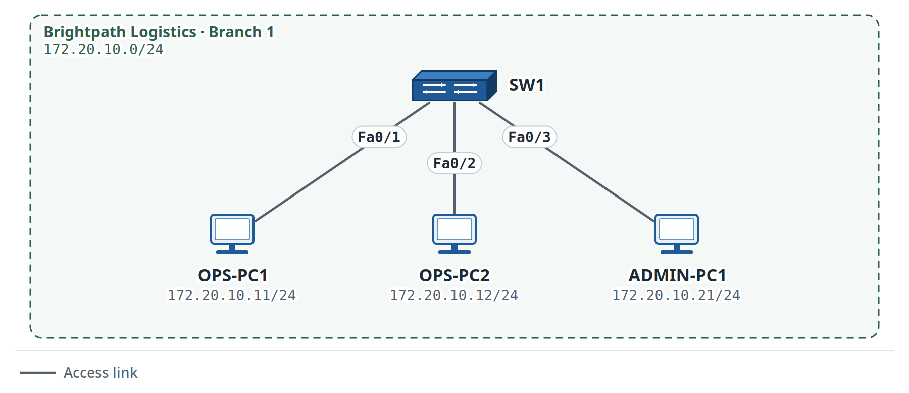

Figure 2. Lab 1.1: Small-Office LAN

**Organization:** Brightpath Logistics\
**Your role:** Junior Network Support Trainee\
**Estimated time:** 45--60 minutes\
**Primary platform:** Cisco Packet Tracer\
**Alternatives:** EVE-NG / GNS3 / Cisco CML / real equipment\
**Job skill:** Build and verify a simple switched LAN\
**You will be able to:** Build and verify a three-host switched LAN using the required links and addressing.\
**You need:** Lab 0.2 skills; basic IPv4 host configuration.

> **Network History: Brightpath Logistics.** This is the first Brightpath branch network in the book. Keep the `172.20.0.0/16` organization range and the branch device names for later labs.

### Scenario

<div align="justify">

Brightpath Logistics is opening a small branch workspace for three employees. The network administrator has delivered one access switch and three PCs. Your task is to connect the devices, configure the provided IP addresses, and verify that the local LAN works.

</div>

### Scope

#### Within your scope

- place and connect the three PCs and one switch;
- use the assigned switch ports;
- configure endpoint IPv4 addresses;
- verify link state and local communication.

#### Outside your scope

- no router configuration;
- no VLAN configuration;
- no DHCP;
- no Internet connectivity.

### Addressing

**Network:** `172.20.10.0/24`

| **Device** | **IPv4 Address** | **Switch Port** |
| --- | --- | --- |
| OPS-PC1 | 172.20.10.11/24 | Fa0/1 |
| OPS-PC2 | 172.20.10.12/24 | Fa0/2 |
| ADMIN-PC1 | 172.20.10.21/24 | Fa0/3 |

No default gateway is required for this lab.

<div align="justify">

**Lab Simplification:** This exercise intentionally uses a single flat LAN with static host addresses. A real branch can also include DHCP, a default gateway, security controls, monitoring, and redundant infrastructure; those services are outside this lab.

</div>

### Tasks

1.  Build the topology.

2.  Use the appropriate Ethernet connections.

3.  Configure the assigned IPv4 addresses.

4.  Confirm all three switch links become operational.

5.  Ping between every pair of PCs.

6.  Record one successful verification result.

### Verification

Minimum evidence:

- link state visible as operational;
- OPS-PC1 can ping OPS-PC2;
- OPS-PC1 can ping ADMIN-PC1;
- OPS-PC2 can ping ADMIN-PC1.

### Troubleshooting Prompt

If one PC cannot communicate:

1.  Check the physical/link path;

2.  Verify its IP address and mask;

3.  Compare it with a known-good PC;

4.  Change only what the evidence supports.

### Reflection

1.  Why is a router unnecessary in this lab?

2.  Why should all three links be checked before investigating IP addressing?

### Evidence to Save

- `lab-1.1.pkt`;
- one clean topology screenshot;
- addressing table;
- successful ping evidence;
- one-sentence completion note.

## Lab 1.2: Cisco IOS Modes, Device Identity, Help, and Banner

**Organization:** Lakeside College\
**Your role:** Network Support Trainee\
**Estimated time:** 45--60 minutes\
**Primary platform:** Cisco Packet Tracer\
**Alternatives:** EVE-NG / GNS3 / Cisco CML / real equipment\
**Job skill:** Enter configuration mode safely and apply basic device identity settings\
**You will be able to:** Navigate Cisco IOS modes, set device identity, use context-sensitive help, and verify the active configuration.\
**You need:** Lab 0.3 complete or equivalent CLI comfort.

> **Network History: Lakeside College.** This continues the training-switch work from Lab 0.3. The switch now receives its permanent training hostname.

### Scenario

<div align="justify">

Lakeside College is preparing the training switch you first opened in Lab 0.3. Before the switch is used in a classroom lab, the senior engineer asks you to configure a hostname and an administrative login banner.

You are not configuring VLANs, management IP addressing, or remote access yet.

</div>

### Required End State

The switch should use:

```text
Hostname: LC-TRAIN-SW1
Banner: Authorized access only.
```

### CLI Path

Start from User EXEC mode:

```text
Switch>
```

Enter Privileged EXEC mode:

```text
enable
```

Enter Global Configuration mode:

```text
configure terminal
```

The prompt should become similar to:

```text
Switch(config)#
```

### First-use command table

| **Command** | **Mode** | **What it does** | **How to verify** | **Common mistake** |
| --- | --- | --- | --- | --- |
| `enable` | User EXEC | Enters Privileged EXEC mode | Prompt changes to `#` | Confusing `>` and `#` |
| `configure terminal` | Privileged EXEC | Enters Global Configuration mode | Prompt shows `(config)#` | Trying configuration commands from EXEC mode |
| `hostname LC-TRAIN-SW1` | Global Configuration | Changes the device hostname | Prompt changes to `LC-TRAIN-SW1(config)#` | Adding spaces inside a hostname |
| `banner motd # Authorized access only.#` | Global Configuration | Creates a message-of-the-day banner | View running config or reconnect to CLI | Reusing the delimiter character inside the message |
| `end` | Configuration mode | Returns directly to Privileged EXEC mode | Prompt returns to `#` | Confusing `exit` and `end` behavior |

### Tasks

1.  Enter Privileged EXEC mode.

2.  Enter Global Configuration mode.

3.  Set the hostname to `LC-TRAIN-SW1`.

4.  Configure the required banner.

5.  Return to Privileged EXEC mode.

6.  Verify both settings.

### Verification

Use:

```text
show running-config
```

Find:

- `hostname LC-TRAIN-SW1`;
- the configured `banner motd` statement.

<div align="justify">

**Production Note:** A login banner is an administrative or legal notice. It does not authenticate users, encrypt sessions, or replace AAA, SSH, or other access controls.

</div>

### Error Practice

<div align="justify">

From the wrong mode, deliberately enter a configuration command and observe the IOS feedback. Then use the prompt and ? to correct your path.

See **Appendix: IOS/CLI Error Message Glossary** for common IOS error messages and a safe first response.

</div>

### Reflection

1.  Why does the IOS prompt matter before you type a command?

2.  Why is a hostname operationally useful when several devices exist?

### Evidence to Save

- `lab-1.2.pkt`;
- output showing the hostname and banner in the running configuration;
- one short note explaining which IOS modes you used.

## Lab 1.3: Save, Reload, and Recover the Intended Configuration

**Organization:** Metro NOC Services\
**Your role:** Junior Network Technician\
**Estimated time:** 45--60 minutes\
**Primary platform:** Cisco Packet Tracer\
**Alternatives:** EVE-NG / GNS3 / Cisco CML / real equipment\
**Job skill:** Understand the difference between running and startup configurations\
**You will be able to:** Explain the difference between the running and startup configurations, save an approved change, and verify persistence after a reload.\
**You need:** Lab 1.2 complete.

> **Continuing from Module 0:** You are now working on an internal Metro NOC Services training switch. This is a safe environment to practice saving and reloading configurations before you work on client devices.

### Scenario

<div align="justify">

Metro NOC Services is training a new support technician in configuration hygiene. The trainee changes an internal practice switch, confirms the change works, and then learns what happens when a working change is not saved.

Your task is to demonstrate that you understand the difference between the active running configuration and the saved startup configuration.

</div>

### Required End State

- hostname: `MNOC-TRAIN-SW1`;
- configuration saved to startup configuration;
- learner can compare running and startup configuration;
- learner can explain what happens to an unsaved change after reload.

### First-use commands

| **Command** | **Mode** | **Purpose** | **Verification** | **Common mistake** |
| --- | --- | --- | --- | --- |
| `copy running-config startup-config` | Privileged EXEC | Saves the active configuration for the next boot | `show startup-config` | Assuming configuration is saved automatically |
| `show startup-config` | Privileged EXEC | Displays the saved startup configuration | Compare with running config | Confusing it with active state |
| `reload` | Privileged EXEC | Restarts the device | Device reboots and returns to CLI | Reloading before saving required changes |

### Tasks

1.  Configure hostname `MNOC-TRAIN-SW1`.

2.  Verify it in the running configuration.

3.  Save the running configuration to the startup configuration.

4.  Verify the startup configuration.

5.  Change the hostname temporarily to `MNOC-TEMP`.

6.  Leave the temporary change unsaved.

7.  Compare the running configuration and the startup configuration.

8.  Reload the switch and decline to save the temporary change if prompted.

9.  Confirm that `MNOC-TRAIN-SW1` returns after boot.

<div align="justify">

**Engineer Habit:** Accepting a command is not the same as a successful change. Verify the intended service first, then save the approved state. If a production change could remove access, know the rollback path before you begin.

</div>

### Troubleshooting / Safety Note

<div align="justify">

If the device asks whether to save the modified configuration during reload, read the prompt carefully. The learning objective depends on not saving the temporary hostname.

</div>

### Reflection

1.  You changed the hostname to MNOC-TEMP and saw it in the running configuration, but MNOC-TRAIN-SW1 returned after a reload. What does this demonstrate about the running configuration versus the startup configuration?

2.  Before a planned reload, what evidence would you check to confirm that an approved change has been saved for the next boot?

### Evidence to Save

- `lab-1.3.pkt`;
- evidence of running configuration before save;
- evidence of startup configuration after save;
- final hostname after reload;
- a two-sentence explanation of running versus startup configuration.

### Learn More: Official Reference

<div align="justify">

Use this after the lab if you want Cisco's configuration-file terminology and the vendor explanation of saving the running configuration to the startup configuration.

</div>

[Cisco IOS Configuration Fundamentals Command Reference: saving configuration](https://www.cisco.com/c/en/us/td/docs/ios-xml/ios/fundamentals/command/cf_command_ref/C_commands.html)

## Lab 1.4: MAC Learning and ARP in Action

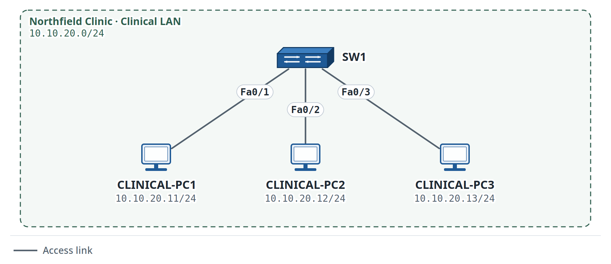

Figure 3. Lab 1.4: ARP and ICMP Observation

**Organization:** Northfield Clinic\
**Your role:** Network Support Trainee\
**Estimated time:** 45--60 minutes\
**Primary platform:** Cisco Packet Tracer Simulation Mode\
**Job skill:** Relate endpoint communication to ARP and switch MAC learning\
**You will be able to:** Explain how ARP, ICMP, the endpoint ARP table, and the switch MAC address table relate during local IPv4 communication.\
**You need:** Lab 1.1 skills; basic local IPv4 connectivity.

> **Continuing from Lab 0.2:** Northfield Clinic already has the Admin LAN at 10.10.10.0/24. This lab adds a separate Clinical LAN at 10.10.20.0/24 so you can observe how local Layer 2 communication works.

### Scenario

<div align="justify">

Northfield Clinic has added a clinical LAN alongside the administrative LAN in Lab 0.2. A senior engineer asks you to explain what happens before one PC can send IPv4 traffic to another local PC.

Focus on the sequence rather than memorizing every Ethernet or ARP field.

</div>

### Addressing

**Network:** `10.10.20.0/24`

| **Device** | **IPv4 Address** | **Port** |
| --- | --- | --- |
| CLINICAL-PC1 | 10.10.20.11/24 | Fa0/1 |
| CLINICAL-PC2 | 10.10.20.12/24 | Fa0/2 |
| CLINICAL-PC3 | 10.10.20.13/24 | Fa0/3 |

<div align="justify">

Build this Clinical LAN on a new access switch with three Clinical PCs. Keep it separate from the earlier Admin LAN switch; do not connect the two switches in this activity. The aim is to observe ARP and MAC learning within a single local subnet, not to introduce routing between the two subnets.

</div>

### Tasks

1.  Build the three-PC switched LAN.

2.  Verify basic link state.

3.  Open Packet Tracer Simulation Mode.

4.  Filter the event list to focus on ARP and ICMP where practical.

5.  Generate a ping from CLINICAL-PC1 to CLINICAL-PC2.

6.  Observe what occurs before the first ICMP exchange.

7.  Return to the switch and inspect the MAC address table.

8.  On a PC, inspect the ARP table if supported by the platform.

### Verification Commands

On the switch:

```text
show mac address-table
```

On a supported endpoint:

```text
arp -a
```

### Beginner observation note

<div align="justify">

The ARP table and the switch MAC address table may already contain entries from prior traffic. To observe the first exchange clearly, start from a clean lab state and generate the test traffic yourself. If an endpoint does not support arp -a, use Packet Tracer Simulation Mode and the switch MAC address table to complete the core objective.

Read the tables differently: the endpoint ARP table maps IPv4 addresses to MAC addresses, while the switch MAC address table maps learned MAC addresses to switch ports.

</div>

### Observation Questions

1.  Why does ARP occur before the first local IPv4 exchange when the destination MAC address is unknown?

2.  What information does the switch learn from incoming Ethernet frames?

3.  Why are the ARP table and the MAC address table not the same?

### Optional extension

<div align="justify">

If you have an authorized lab, generate the same ARP/ICMP exchange and capture your traffic in Wireshark. The Packet Tracer observation is the full core assignment.

</div>

### Evidence to Save

- `lab-1.4.pkt`;
- one Simulation Mode screenshot showing the ARP/ICMP sequence;
- `show mac address-table` evidence;
- answers to the three observation questions.

## Lab 1.5: Create and Interpret Three Interface States

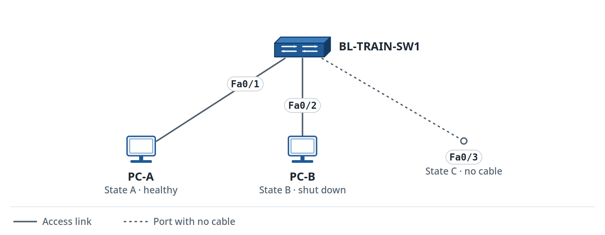

Figure 4. Lab 1.5: Interface-State Lab

**Organization:** Brightpath Logistics\
**Your role:** NOC Trainee\
**Estimated time:** 40--55 minutes\
**Primary platform:** Cisco Packet Tracer\
**Job skill:** Read interface state before changing configuration\
\
**You will be able to:** Create and distinguish among an administrative shutdown, a physical-link failure, and a healthy interface state.\
**You need:** Lab 0.3 CLI-reading skills and Concept Primer 1B.

> **Network History: Brightpath Logistics.** This lab uses an isolated training switch before you diagnose warehouse uplink problems.

### Why this lab works differently

You do not need an author-supplied output file.

You will create the interface states yourself.

<div align="justify">

This gives you direct evidence from the device you configured.

</div>

### Build

Place:

- one access switch named `BL-TRAIN-SW1`;
- two PCs named `PC-A` and `PC-B`.

Connect:

```text
PC-A -> Fa0/1
PC-B -> Fa0/2
```

Leave `Fa0/3` without a cable.

Wait until the connected links become operational.

### State A: Healthy interface

On the switch:

```text
show interfaces fastEthernet0/1
```

Record the first state line.

Also run:

```text
show interfaces status
```

### What to read first

<div align="justify">

Use show interfaces \<port\> to view the detailed state line and counters. show interfaces status provides a compact switch summary when the selected platform supports it. If that summary command is unavailable, stick with the detailed interface output rather than changing device models just for one command.

</div>

Record the status for Fa0/1.

### State B: Administrative shutdown

On the switch:

```text
configure terminal
interface fastEthernet0/2
 shutdown
end
```

Now run:

```text
show interfaces fastEthernet0/2
```

Look for the administrative-down state.

<div align="justify">

The key distinction is that the configuration disabled the interface.

</div>

After you record the evidence, restore the port:

<div align="justify">

**Production Note:** shutdown and no shutdown are service-affecting actions. Before cycling a production port, confirm the port owner, connected device, ticket scope, and maintenance approval, if required.

</div>

```text
configure terminal
interface fastEthernet0/2
 no shutdown
end
```

### State C: Physical/lower-layer down

Use the unused Fa0/3 port.

Ensure the port is not administratively shut down:

```text
configure terminal
interface fastEthernet0/3
 no shutdown
end
```

Leave Fa0/3 disconnected.

Run:

```text
show interfaces fastEthernet0/3
```

Record the state.

<div align="justify">

This condition differs from an administrative shutdown. The port is enabled, yet no physical link is active.

</div>

### Comparison worksheet

| **State** | **Interface** | **Important state text** | **Likely meaning** | **Safe next check** |
| --- | --- | --- | --- | --- |
| Healthy | Fa0/1 |  |  |  |
| Administrative shutdown | Fa0/2 |  |  |  |
| Physical/lower-layer down | Fa0/3 |  |  |  |

### Counters

On the healthy port, inspect:

```text
show interfaces fastEthernet0/1
```

<div align="justify">

Find the input/output packet counters and any error counters the platform displays.

A non-zero counter is not automatically a fault. Compare it with the symptom and the expected baseline.

</div>

Ask:

> 1\. Is the interface operational?
>
> 2\. Are errors increasing?
>
> 3\. Does the symptom match the counter?
>
> 4\. What evidence do I need before changing the configuration?

<div align="justify">

On real Ethernet equipment, a speed or duplex mismatch can cause poor throughput and rising error counters, even when the link appears up. These symptoms are not guaranteed to be reproducible in Packet Tracer. For this lab, identify the displayed speed, duplex, and errors where available; do not change production negotiation settings or invent a fault the simulator cannot show.

</div>

### Optional extension

<div align="justify">

If you have authorized spare Cisco equipment, repeat the three-state exercise and compare the real output with Packet Tracer. Never test on a production interface.

</div>

### Verification

You must be able to explain:

- why `administratively down` points to configuration state;
- why `down/down` can point to a physical or lower-layer problem;
- why an operational interface still needs counter and symptom interpretation.

### Evidence to Save

Keep locally:

- your completed comparison worksheet;
- selected output for all three interface states;
- one paragraph explaining the difference between administrative and physical failures;
- a short escalation note for a case that requires another team or physical access.

<div align="justify">

You have compared healthy, administratively disabled, and disconnected interfaces. The next lab builds on those observations and uses IP checks: first prove the physical path, then trace a routed packet toward the server. The router configuration is provided only as a setup scaffold.

</div>

## Lab 1.6: "Users Cannot Reach the Server": Ping and Traceroute Troubleshooting

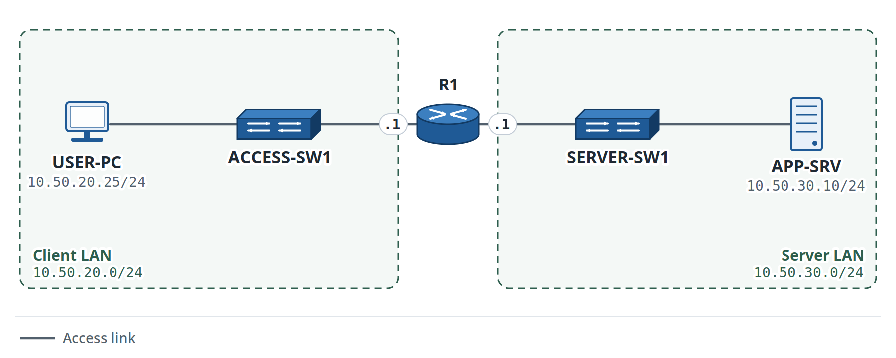

Figure 5. Lab 1.6: Client-to-Server Path

**Organization:** Metro NOC Services\
**Your role:** Network Support Trainee\
**Estimated time:** 45--60 minutes\
**Primary platform:** Cisco Packet Tracer\
**Alternatives:** EVE-NG / GNS3 / Cisco CML\
**Job skill:** Follow the path and isolate an endpoint configuration fault\
**You will be able to:** Follow the path from a client to a server, identify an endpoint gateway fault, correct only that fault, and document the result.\
You need: Lab 0.1 gateway concept and Labs 1.1--1.5 skills.

> **Continuing from MR-0:** You are still working in Metro NOC Services' training environment, but this time the exercise uses a routed client-to-server path and requires a formal troubleshooting report.

### Scenario

<div align="justify">

A customer reports that one user cannot reach an internal server, while other users can reach it normally.

You will build the full lab yourself. R1 is not assumed to be preconfigured. Because routing configuration is not the learning target yet, use the router setup scaffold in Phase 1 to establish a working path. After you establish a healthy baseline, treat the router as known-good infrastructure and troubleshoot the endpoint fault.

</div>

### Topology

Build this path:

```text
USER-PC -> ACCESS-SW1 -> R1 -> SERVER-SW1 -> APP-SRV
```

Use the Lab 1.6 figure and the addressing table below.

### Intended Correct Addressing

| **Device** | **Interface** | **IPv4 Address** |
| --- | --- | --- |
| USER-PC | NIC | 10.50.20.25/24 |
| R1 | Client-side interface | 10.50.20.1/24 |
| R1 | Server-side interface | 10.50.30.1/24 |
| APP-SRV | NIC | 10.50.30.10/24 |

Correct USER-PC default gateway: `10.50.20.1`.

### Phase 1: Build and Prove the Healthy Path

Build the topology from the figure and addressing table.

Configure:

```text
USER-PC  10.50.20.25/24   gateway 10.50.20.1
R1       10.50.20.1/24    client side
R1       10.50.30.1/24    server side
APP-SRV  10.50.30.10/24   gateway 10.50.30.1
```

### Router setup scaffold: use now, master later

<div align="justify">

Use the following example when R1 G0/0 connects to ACCESS-SW1 and R1 G0/1 connects to SERVER-SW1. If your router uses different interface names, replace the interfaces connected to those two switches.

</div>

```text
enable
configure terminal
interface gigabitEthernet0/0
 ip address 10.50.20.1 255.255.255.0
 no shutdown
exit
interface gigabitEthernet0/1
 ip address 10.50.30.1 255.255.255.0
 no shutdown
end
show ip interface brief
```

<div align="justify">

What these commands do: Each router interface receives an address from its directly connected network, and the no shutdown command enables the interface. This gives R1 a working routed path between the Client LAN and the Server LAN.

For this lab, you only need enough router configuration to make the path work. You will revisit router interfaces and inter-VLAN routing later in this volume, and routing is covered in more depth in Volume 2.

Before you create the endpoint fault, use show ip interface brief to confirm that both R1 interfaces have the intended IPv4 addresses and are operational.

</div>

Before you create the fault, prove:

```text
USER-PC -> 10.50.20.1       SUCCESS
USER-PC -> 10.50.30.10      SUCCESS
```

Save your healthy file.

### Phase 2: Introduce the Fault Yourself

On USER-PC, change the default gateway to:

```text
10.50.20.254
```

Keep all other settings unchanged.

<div align="justify">

Once the fault is in place, hide this instruction and troubleshoot from the symptom.

Treat the failed remote connectivity as the incoming ticket.

</div>

### Within Scope

- USER-PC addressing;
- endpoint verification;
- ping and traceroute testing.

### Outside Scope

- router configuration after the healthy baseline is proven;

<div align="justify">

**Mentor Note:** Known-good means verified for this ticket, not trusted forever. If later evidence points to the router or server side, stop changing the endpoint and update the scope or escalate with that evidence.

</div>

- switch redesign;
- server configuration unless evidence specifically points there.

### Hypothesis Log

| **\#** | **I think the cause is...** | **Test I ran** | **Result** | **Conclusion** |
| --- | --- | --- | --- | --- |
| 1 |  |  |  |  |
| 2 |  |  |  |  |

### Suggested Testing Order

Use a near-to-far test order:

1.  Inspect USER-PC addressing;

2.  Test local stack if needed;

3.  Test the default gateway;

4.  Test the server;

5.  Use traceroute after basic tests;

<div align="justify">

Platform command name: On a Packet Tracer PC or a Windows command prompt, use tracert \<destination\>. On Cisco IOS/IOS XE, macOS, and most Linux systems, use traceroute \<destination\>. Read the last responding hop alongside your ping results; a timeout at one hop does not automatically prove that the destination is unreachable.

</div>

6.  Compare the result with the expected path.

### Verification

After correction:

- USER-PC can reach `10.50.20.1`;
- USER-PC can reach `10.50.30.10`;
- traceroute shows the routed path through R1;
- the learner records the root cause and fix.

### Reflection

1.  Why is it useful to test the default gateway before blaming the server?

2.  Why should the router remain unchanged when the fault is on the endpoint?

### Evidence to Save

- your corrected Packet Tracer file;
- completed hypothesis log;
- successful ping evidence;
- traceroute evidence;
- root-cause statement;
- short ticket closure note.

### Learn More: Official Reference

<div align="justify">

Use this after Lab 1.6 if you want Cisco's Packet Tracer example comparing PC tracert with Cisco-device traceroute.

</div>

[Cisco Networking Academy: Use Ping and Traceroute to Test Network Connectivity](https://www.netacad.com/content/itn/1.0/courses/content/m13/en-US/assets/13.3.2-packet-tracer---use-ping-and-traceroute-to-test-network-connectivity---physical-mode.pdf)

## Mixed Review MR-1: Small Office Foundation Check

**Organization:** Metro NOC Services\
**Your role:** Junior Network Support Trainee\
**Estimated time:** 45--60 minutes\
**Primary platform:** Cisco Packet Tracer

> **Network History: Metro NOC Services.** This mixed review uses `10.50.40.0/24`, continuing the Metro training range established earlier in the book.

### Scenario

<div align="justify">

Metro NOC Services is preparing a three-user training pod for new support staff. Before a senior engineer proceeds with VLAN and routing work, you have been asked to validate the access-layer foundation and the basic device state.

Independent-review rule: plan the build and verification first. Work from the requirements rather than copying a previous configuration line by line. If you are blocked, identify the missing concept or evidence before returning to an earlier lab.

</div>

### Tasks

1.  Build one switch and three PCs using the `10.50.40.0/24` training network.

2.  Choose correct access connections.

3.  Choose and configure three valid, unique IPv4 host addresses from 10.50.40.0/24. The network address, broadcast address, and any duplicate address are invalid choices.

4.  Set the switch hostname to `MNOC-TRAIN-SW1`.

5.  Configure this training banner: Authorized access only.

6.  Save the switch configuration.

7.  Verify connectivity between all local PCs.

8.  Inspect the switch MAC address table.

9.  Record one ARP observation.

10. After the healthy network is verified, disconnect the cable from the third PC. Leave all IP settings unchanged.

11. Start from the symptom, complete the troubleshooting cycle, reconnect the correct cable, and verify the original test.

### Evidence to Save

- completed `.pkt` file;
- successful ping evidence;
- hostname/banner verification;
- saved configuration evidence;
- MAC address table evidence;
- troubleshooting hypothesis log;
- one-sentence root cause;
- one-sentence verification statement.

## Module 1 Checkpoint

<div align="justify">

You can now build and verify a small LAN, identify device states, save configurations, observe MAC/ARP behavior, read interface states, and troubleshoot a simple gateway or path problem.

Move to subnetting only when you can explain what your verification commands prove.

</div>

# Module 2: IP Addressing and the Subnetting Mastery Track

> **Module goal:** Build confidence in IPv4 addressing, subnetting, VLSM, IPv6, and dual-stack troubleshooting.

<div align="justify">

This module treats subnetting as a skill that improves with short, repeated practice.

Focus on identifying the network boundary, host range, and broadcast address rather than memorizing answer patterns.

</div>

The module uses this sequence:

> **Understand → Practise → Build → Practise Again → Design → Add IPv6 → Troubleshoot → Review**

## Module 2 Readiness Check

Use this check before you begin the subnetting track.

1.  Can you configure an IPv4 address on an endpoint?

2.  Can you identify a default gateway?

3.  Can you use `show ip interface brief`?

4.  Can you test a local gateway with `ping`?

5.  Do you know that an IPv4 address contains 32 bits?

6.  Can you calculate `2^4`, `2^5`, `2^6`, `2^7`, and `2^8`?

7.  If these powers of two are not yet comfortable, continue to Concept Primer 2B. It is a learning step, not a reason to stop the module.

8.  Can you explain, at a basic level, the difference between a host address and a network address?

9.  Can you follow a table without copying an example value into the wrong device?

10. Can you record a hypothesis before changing the configuration?

11. Can you verify a result instead of stopping after a command is accepted?

<div align="justify">

If several answers are "no," review Modules 0--1 and Drill 2.2 as needed.

The Self-Check Key near the end of this volume provides the formal answer/verification path; learners keep their own worksheets and topology files.

</div>

## Module 2 learning outcomes

By the end of this module, you will be able to:

- identify IPv4 network and host information;
- explain the purpose of a subnet mask and prefix length;
- calculate basic equal-size subnets;
- identify common subnet boundaries quickly;
- create a simple VLSM plan from host requirements;
- configure basic IPv6 addressing;
- identify link-local and global IPv6 addresses;
- use SLAAC in a small lab;
- troubleshoot simple IPv4 and IPv6 addressing faults;
- document an addressing plan clearly.

<div align="justify">

Module 1 determined whether a working physical and Ethernet path exists. Now Module 2 asks whether the IP addresses and masks place the endpoints in the correct networks. Continue using the same order: link first, addressing second, then test connectivity.

</div>

## Concept Primer 2A: IPv4 addresses, masks, and prefixes

An IPv4 address contains 32 bits.

We usually write these bits as four decimal numbers.

Example:

```text
192.168.10.25
```

<div align="justify">

A subnet mask tells a device which part of the address identifies the network.

</div>

Example:

```text
255.255.255.0
```

The same mask can be written as:

```text
/24
```

<div align="justify">

The `/24` means that the first 24 bits identify the network.

</div>

For this example:

```text
IP address:      192.168.10.25
Prefix:          /24
Network address: 192.168.10.0
Broadcast:       192.168.10.255
Usable hosts:    192.168.10.1 through 192.168.10.254
```

<div align="justify">

Reserve the network and broadcast addresses; assign only normal host addresses from the usable range.

</div>

## Concept Primer 2B: Powers of two

Subnetting uses powers of two often.

Learn these values:

| **Power** | **Value** |
| --- | --- |
| 2\^0 | 1 |
| 2\^1 | 2 |
| 2\^2 | 4 |
| 2\^3 | 8 |
| 2\^4 | 16 |
| 2\^5 | 32 |
| 2\^6 | 64 |
| 2\^7 | 128 |
| 2\^8 | 256 |

A common pattern in one IPv4 octet is:

```text
128 64 32 16 8 4 2 1
```

You will use these values many times.

## Concept Primer 2C: The block-size method

<div align="justify">

For many beginner subnetting tasks, the block-size method is fast and reliable.

Use this method when a subnet mask changes inside one octet.

</div>

Example:

```text
255.255.255.192
```

The interesting octet is:

```text
192
```

Calculate:

```text
256 - 192 = 64
```

The subnet boundaries are:

```text
0
64
128
192
```

For `192.168.10.70/26`, the address falls inside:

```text
192.168.10.64 - 192.168.10.127
```

Therefore:

```text
Network address: 192.168.10.64
First host:      192.168.10.65
Last host:       192.168.10.126
Broadcast:       192.168.10.127
```

You will practice this method repeatedly.

## Lab 2.1: IPv4 Hosts, Masks, and Default Gateways

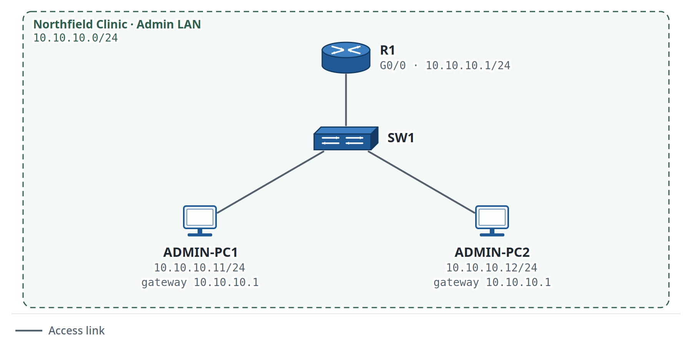

Figure 6. Lab 2.1: IPv4 Hosts and Default Gateway

**Organization:** Northfield Clinic\
**Your role:** Network Support Trainee\
**Estimated time:** 45--60 minutes\
**Primary platform:** Cisco Packet Tracer\
**Job skill:** Configure and verify IPv4 host addressing\
**You will be able to:** Configure IPv4 addresses and a default gateway, then prove local gateway and host connectivity.\
**You need:** Module 1 complete or equivalent basic Cisco CLI and LAN skills.

> **Continuing from Lab 0.2:** Reopen your saved Lab 0.2 Packet Tracer file. You are adding R1 to the same Northfield Clinic Admin LAN and setting **10.10.10.1** as the default gateway for ADMIN-PC1 and ADMIN-PC2.

### Scenario

<div align="justify">

Northfield Clinic is extending the administration network you built in Lab 0.2. The two existing administration PCs now require a router interface to serve as their default gateway.

The clinic has one router, one switch, and two reception PCs.

</div>

You receive the addressing plan from the senior engineer.

<div align="justify">

Your task is to configure the endpoints and the router interface.

</div>

Then prove that both PCs can reach the default gateway.

### Addressing requirements

**Network:** `10.10.10.0/24`

| **Device** | **Interface** | **IPv4 address** | **Prefix** | **Default gateway** |
| --- | --- | --- | --- | --- |
| R1 | G0/0 | 10.10.10.1 | /24 | Not applicable |
| ADMIN-PC1 | NIC | 10.10.10.11 | /24 | 10.10.10.1 |
| ADMIN-PC2 | NIC | 10.10.10.12 | /24 | 10.10.10.1 |

### Your tasks

1.  Build the topology.

2.  Configure `10.10.10.1/24` on R1 G0/0.

3.  Enable the router interface.

4.  Configure both PC addresses.

5.  Configure the default gateway on both PCs.

6.  Ping the gateway from each PC.

7.  Ping between the two PCs.

8.  Record the result.

<div align="justify">

**Production Note:** Changing an IP address, subnet mask, or default gateway can remove remote access to a device. On production equipment, confirm an alternate access path or rollback method before changing management addressing.

</div>

### First-use command

```text
interface gigabitEthernet0/0
```

**Mode:** Global configuration mode\
**Purpose:** Selects the router interface for configuration.

```text
ip address 10.10.10.1 255.255.255.0
```

**Mode:** Interface configuration mode\
**Purpose:** Assigns the IPv4 address and subnet mask.

```text
no shutdown
```

**Mode:** Interface configuration mode\
**Purpose:** Enables an administratively disabled interface.

### Verification

Use:

```text
show ip interface brief
```

Look for:

- G0/0 with `10.10.10.1`;
- interface status `up`;
- protocol status `up`.

Then ping:

```text
ping 10.10.10.1
```

from each PC.

### Reflection

1.  Why do both PCs use the same default gateway?

2.  Why must R1 G0/0 use an address from `10.10.10.0/24`?

### Evidence to Save

Keep:

- saved lab file
- topology screenshot
- show ip interface brief
- one successful gateway ping from each PC
- one sentence that explains the role of the default gateway.

## Drill 2.2: Binary-to-Decimal and Subnet Mask Practice

**Estimated time:** 10--15 minutes

Do these questions without a subnetting calculator.

### Part A: Powers of two

Fill in the missing values.

| **Expression** | **Your Answer** |
| --- | --- |
| 2\^1 |  |
| 2\^2 |  |
| 2\^3 |  |
| 2\^4 |  |
| 2\^5 |  |
| 2\^6 |  |
| 2\^7 |  |
| 2\^8 |  |

### Part B: Prefix to dotted-decimal mask

Write the subnet mask.

1.  `/24`

2.  `/25`

3.  `/26`

4.  `/27`

5.  `/28`

### Part C: Mask to prefix

Write the prefix.

1.  `255.255.255.0`

2.  `255.255.255.128`

3.  `255.255.255.192`

4.  `255.255.255.224`

5.  `255.255.255.240`

## Lab 2.3: Subnet a Branch Office with Equal-Size Subnets

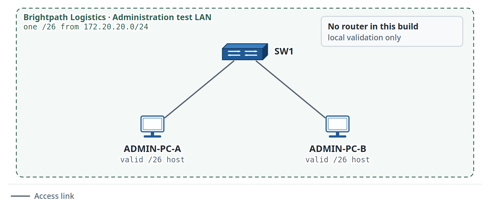

Figure 7. Lab 2.3: Equal-Size Subnet Validation

**Organization:** Brightpath Logistics\
**Your role:** Junior Network Support Trainee\
**Estimated time:** 60--75 minutes\
**Primary platform:** Paper/worksheet + Cisco Packet Tracer\
**Job skill:** Divide one network into equal-size subnets\
**You will be able to:** Divide one /24 into four equal /26 subnets, document every range, and validate one subnet in a local switched LAN.\
**You need:** Concept Primers 2A--2C and Drill 2.2.

> **Network History: Brightpath Logistics.** Brightpath uses the `172.20.0.0/16` organization range. This branch receives `172.20.20.0/24` for subnetting practice.

### Scenario

Brightpath Logistics has a new branch office.

The company gives you this address block:

```text
172.20.20.0/24
```

The branch needs four equal-size networks:

- Administration;
- Warehouse;
- Operations;
- Spare network for future use.

Each network must support at least 50 host addresses.

### Your task

1.  Calculate the new prefix.

2.  Find the four subnet network addresses.

3.  Find each broadcast address.

4.  Find the usable host range for each subnet.

5.  Assign one subnet to each department.

6.  Build the **Administration** subnet as one local switched LAN with one switch and two PCs.

7.  Use two valid host addresses from the Administration subnet.

8.  This validation build needs only the local switched network; leave routing and a default gateway out of the design.

9.  Prove that the two PCs can communicate locally.

### Design worksheet

| **Department** | **Network** | **Prefix** | **First host** | **Last host** | **Broadcast** |
| --- | --- | --- | --- | --- | --- |
| Administration |  |  |  |  |  |
| Warehouse |  |  |  |  |  |
| Operations |  |  |  |  |  |
| Spare |  |  |  |  |  |

### Hint: use only if you are stuck

<div align="justify">

A `/26` supports 62 usable host addresses. Decide whether that meets the requirement before checking the appendix.

</div>

### Verification

The design is complete only when:

- all four `/26` networks are correct;
- no ranges overlap;
- every network supports at least 50 usable hosts;
- the Administration test LAN uses two valid host addresses from its assigned subnet;
- the two Administration PCs can ping each other.

### Evidence to Save

<div align="justify">

Keep the completed subnet table, the Packet Tracer file for the Administration test LAN, and a successful local ping.

</div>

### Reflection

1.  Why is `/27` too small for a requirement of at least 50 hosts?

2.  Why must every subnet use a different network address?

## Drill 2.4: Fast Subnet-Boundary Identification

**Estimated time:** 10--15 minutes

Accuracy comes first.

Speed comes later.

<div align="justify">

For each prefix, write the block size and subnet boundaries inside one octet.

</div>

### Questions

1.  `/25`

2.  `/26`

3.  `/27`

4.  `/28`

5.  `/29`

Then identify the network address for each host.

6.  `192.168.10.70/26`

7.  `192.168.10.199/26`

8.  `10.10.5.35/27`

9.  `10.10.5.150/27`

10. `172.20.8.222/28`

<div align="justify">

Check your answers in **Appendix: Volume 1 Self-Check Key** after you complete the drill.

</div>

## Concept Primer 2D: A Worked VLSM Example

<div align="justify">

VLSM uses different prefix lengths for networks with varying host requirements.

</div>

Use the largest requirement first.

Example address block:

```text
192.0.2.0/24
```

Example requirements:

| **Network** | **Minimum hosts** |
| --- | --- |
| A | 100 |
| B | 50 |
| C | 20 |

### Step 1: Allocate Network A

100 hosts need at least 126 usable addresses.

Use:

```text
192.0.2.0/25
```

This subnet provides:

```text
Network:    192.0.2.0
First host: 192.0.2.1
Last host:  192.0.2.126
Broadcast:  192.0.2.127
```

### Step 2: Allocate Network B

The next available address is `192.0.2.128`.

50 hosts fit inside a `/26`.

Use:

```text
192.0.2.128/26
```

This subnet provides:

```text
Network:    192.0.2.128
First host: 192.0.2.129
Last host:  192.0.2.190
Broadcast:  192.0.2.191
```

### Step 3: Allocate Network C

The next available address is `192.0.2.192`.

20 hosts fit inside a `/27`.

Use:

```text
192.0.2.192/27
```

This subnet provides:

```text
Network:    192.0.2.192
First host: 192.0.2.193
Last host:  192.0.2.222
Broadcast:  192.0.2.223
```

The remaining addresses start at `192.0.2.224`.

Use this method:

> **Largest requirement → correct prefix → next available boundary → next requirement**

<div align="justify">

Use these addresses only for the worked example. Lab 2.5 uses a different block.

</div>

## Concept Bridge 2E: Moving Beyond a /24

<div align="justify">

Until now, most subnetting examples have modified the last octet of a /24. Lab 2.5 starts with a larger 192.168.40.0/22 block, so a subnet can span more than one /24-sized range.

Keep the same VLSM method: start with the largest host requirement, choose the smallest prefix that fits it, then move to the next valid network boundary.

</div>

### Useful size check

```text
/24 = 256 total addresses = 254 usable hosts
/23 = 512 total addresses = 510 usable hosts
/22 = 1024 total addresses = 1022 usable hosts
```

<div align="justify">

A requirement for more than 254 usable hosts cannot fit within a single /24. A /23 is the next larger common subnet size and provides 510 usable host addresses.

</div>

### Read the assigned /22 as one block.

> For this lab, 192.168.40.0/22 covers addresses from 192.168.40.0 through 192.168.43.255. Every VLSM subnet you create must stay within that block and must not overlap another subnet.
>
> You do not need a new VLSM formula. Use the same sequence from Concept Primer 2D, but pay attention when the next valid boundary moves into the next third octet.
>
> Largest requirement → smallest prefix that fits → next valid boundary → next requirement

<div align="justify">

Now continue to Lab 2.5 and calculate the actual allocations yourself.

</div>

## Lab 2.5: VLSM Plan for a Growing Organization

**Organization**: Lakeside College\
**Your** **role**: Network Support Technician\
**Estimated time:** 75--90 minutes\
**Primary platform:** Paper/worksheet\
**Job skill:** Create a VLSM plan from different host requirements\
**You will be able to:** Create a non-overlapping VLSM plan that meets four host requirements inside the assigned /22.\
**You need:** Lab 2.3, Drill 2.4, Concept Primer 2D, and Concept Bridge 2E.

> **Network History: Lakeside College.** This is the college's main IPv4 planning block. Keep all allocations inside `192.168.40.0/22`.

### Scenario

Lakeside College is adding four networks.

The college owns this block for the lab:

```text
192.168.40.0/22
```

The departments need different numbers of host addresses.

| **Department** | **Minimum hosts** |
| --- | --- |
| Student Labs | 300 |
| Staff | 120 |
| Administration | 60 |
| Network Management | 20 |

<div align="justify">

You are given four host requirements and must fit them efficiently into the assigned block.

</div>

### Design rule

Allocate the largest subnet first.

<div align="justify">

Then allocate the next-largest subnet from the next available boundary.

</div>

Continue until every requirement has a subnet.

### Your tasks

1.  Calculate a prefix for each host requirement.

2.  Allocate the largest subnet first.

3.  Record each network address.

4.  Record each usable host range.

5.  Record each broadcast address.

6.  Make sure that no subnets overlap.

7.  Make sure that every subnet stays inside `192.168.40.0/22`.

8.  Save the completed addressing table.

<div align="justify">

**Engineer Habit:** Treat an addressing plan as a controlled design record. Before deployment, document each network, prefix, usable range, gateway, and reserved addresses, and confirm that no allocations overlap.

</div>

### VLSM worksheet

| **Department** | **Hosts** | **Prefix** | **Network** | **First host** | **Last host** | **Broadcast** |
| --- | --- | --- | --- | --- | --- | --- |
| Student Labs | 300 |  |  |  |  |  |
| Staff | 120 |  |  |  |  |  |
| Administration | 60 |  |  |  |  |  |
| Network Management | 20 |  |  |  |  |  |

### Design checkpoint

Before you treat the addressing plan as complete, answer:

- Does each subnet provide enough usable host addresses?
- Do any ranges overlap?
- Does every subnet remain inside `192.168.40.0/22`?

### Verification

Your VLSM plan is valid only when:

- every subnet has enough usable host addresses;
- no two subnets overlap;
- every network boundary matches its prefix;
- every allocated address remains inside `192.168.40.0/22`.

<div align="justify">

Use a subnet calculator only **after** you finish the manual design.

</div>

### Optional extension

<div align="justify">

Validate one of your VLSM subnets with two PCs in Packet Tracer. Add routing only if the assignment requires it.

</div>

### Evidence to Save

<div align="justify">

Keep the completed VLSM worksheet and a short note that explains why you allocated the largest requirement first.

</div>

### Reflection

1.  Why does VLSM start with the largest host requirement?

2.  Why is using `/24` for every department wasteful in this scenario?

<div align="justify">

Your VLSM work has focused on IPv4 network boundaries. IPv6 changes the address format, but not the habit of identifying a prefix, checking the assigned gateway information, and proving reachability. The next primer gives only the IPv6 knowledge needed for Labs 2.6 and 2.7.

</div>

## Concept Primer 2F: What You Need for IPv6 in This Volume

<div align="justify">

IPv6 looks different from IPv4, but the verification habit stays the same: identify the local prefix, identify the addresses in use, and prove reachability with evidence.

</div>

For the next two labs, focus on four ideas:

<div align="justify">

A /64 identifies the IPv6 LAN prefix used in these exercises.

The book uses 2001:db8::/32 documentation addresses as the global-address examples in the lab.

An IPv6-enabled interface also has a link-local address, normally from fe80::/10, for communication on the local link.

With SLAAC, hosts use Router Advertisements to learn the local prefix and default-router information, then form their own IPv6 address.

Use now: /64, global-address example, link-local address, SLAAC, and IPv6 ping. Master later: deeper Neighbor Discovery behavior and larger IPv6 design.

Beginner verification rule: an automatically formed host address can have a different interface identifier than another learner's output. A different host suffix in a screenshot can still be correct. Verify that the address is in the assigned /64, the router interface is up, a link-local address exists, and IPv6 reachability works.

</div>

### Learn More: Official Reference

<div align="justify">

Use these when you want the vendor/standards explanation of Router Advertisements, SLAAC, link-local addressing, and the 2001:db8::/32 documentation prefix.

</div>

[Cisco: IPv6 Addressing and Basic Connectivity](https://www.cisco.com/c/en/us/td/docs/ios/ipv6/configuration/guide/ipv6-xe-16-book-cat8000/m_ip6-addrg-bsc-con.html)

[RFC Editor: RFC 3849: IPv6 Address Prefix Reserved for Documentation](https://www.rfc-editor.org/info/rfc3849/)

## Lab 2.6: IPv6 Addressing, Link-Local Addresses, and SLAAC

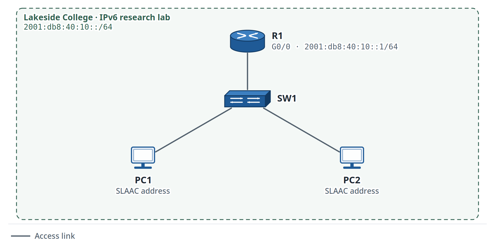

Figure 8. Lab 2.6: IPv6 and SLAAC

**Organization:** Lakeside College\
**Your role:** Junior Network Technician\
**Estimated time:** 60--75 minutes\
**Primary platform:** Cisco Packet Tracer\
**Job skill:** Configure and verify basic IPv6 addressing\
**You will be able to:** Configure an IPv6 /64 on a router, use SLAAC on hosts, identify link-local addressing, and prove local IPv6 connectivity.\
**You need:** Lab 2.1 skills; basic prefix understanding; Concept Primer 2F.

> **Network History: Lakeside College.** This lab adds IPv6 to the college environment. Lakeside uses the documentation prefix block `2001:db8:40::/48` for book examples.

### Scenario

<div align="justify">

Lakeside College plans to test IPv6 in a small research lab before wider deployment.

</div>

You receive one IPv6 prefix for the research lab.

<div align="justify">

Your task is to configure the router and confirm that two hosts can obtain usable IPv6 addresses.

</div>

### IPv6 prefix

Use:

```text
2001:db8:40:10::/64
```

`2001:db8::/32` is reserved for documentation and examples.

<div align="justify">

**Lab Simplification:** This lab focuses on basic SLAAC reachability. Production IPv6 design can also include Router Advertisement policy, DHCPv6 choices, first-hop security, DNS, filtering, and monitoring; those topics are intentionally outside Volume 1.

</div>

### Addressing requirement

| **Device** | **Interface** | **IPv6 address** |
| --- | --- | --- |
| R1 | G0/0 | `2001:db8:40:10::1/64` |
| PC1 | NIC | SLAAC |
| PC2 | NIC | SLAAC |

### Your tasks

1.  Build one router, one switch, and two hosts.

2.  Enable IPv6 routing on R1.

3.  Configure `2001:db8:40:10::1/64` on R1 G0/0.

4.  Enable the router interface.

5.  Configure both PCs for automatic IPv6 addressing.

6.  Record the global IPv6 address on each PC.

7.  Record the link-local address on R1.

8.  Ping the router from each PC.

9.  Ping between the two PCs.

### First-use commands

```text
ipv6 unicast-routing
```

**Mode:** Global configuration mode\
**Purpose:** Enables IPv6 packet forwarding on the router.

```text
ipv6 address 2001:db8:40:10::1/64
```

**Mode:** Interface configuration mode\
**Purpose:** Assigns the global IPv6 address.

<div align="justify">

If the PC has no usable IPv6 address after the router interface and Router Advertisements are configured, check the router first. On some Packet Tracer releases, selecting Auto Config again on the PC may trigger address formation. Record the version and any changes. Do not treat this as a substitute for verifying that Router Advertisements and the /64 are correct.

</div>

### Verification

Use:

```text
show ipv6 interface brief
```

Confirm that G0/0 has:

- the configured global IPv6 address;
- a link-local address;
- an operational state.

<div align="justify">

If a PC does not obtain an address from 2001:db8:40:10::/64, first verify that R1 G0/0 is up, the /64 address is correct, and ipv6 unicast-routing is enabled. A manually configured host address can mask the SLAAC problem, so keep the host in automatic mode while you diagnose it.

</div>

### Optional extension

<div align="justify">

If you have an authorized capture environment, generate your own IPv6 Neighbor Discovery traffic and inspect it with Wireshark.

</div>

### Reflection

1.  Why does a router interface need a link-local address?

2.  A PC has a link-local address but no address from 2001:db8:40:10::/64. What should you check before manually assigning a global IPv6 address?

### Evidence to Save

Keep:

- the saved lab file
- show ipv6 interface brief
- one successful host-to-router IPv6 ping
- one successful host-to-host IPv6 ping
- the recorded link-local address from R1.

## Lab 2.7: Troubleshoot Dual-Stack Addressing Faults

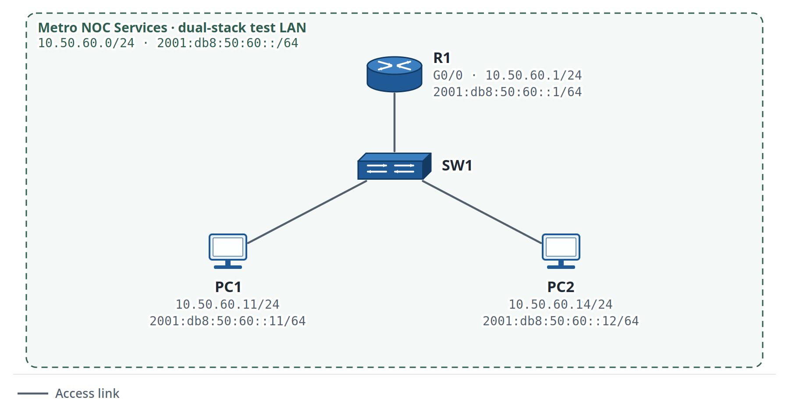

Figure 9. Lab 2.7: Dual-Stack Troubleshooting

**Organization:** Metro NOC Services\
**Your role:** Network Support Technician\
**Estimated time:** 60--75 minutes\
**Primary platform:** Cisco Packet Tracer\
**Job skill:** Isolate simple IPv4 and IPv6 addressing faults\
**You will be able to:** Use a hypothesis log to isolate separate IPv4 and IPv6 addressing faults and prove both protocol stacks after correction.\
**You need:** Labs 2.1 and 2.6.

> **Continuing from earlier Metro NOC training labs:** This internal dual-stack network uses `10.50.60.0/24` and the documentation prefix `2001:db8:50:60::/64`.

### Scenario

<div align="justify">

Metro NOC Services uses an internal dual-stack training network to practice isolating IPv4 and IPv6 faults.

</div>

One user reports that IPv4 works but IPv6 does not.

A second user reports the opposite.

The physical links are up.

<div align="justify">

You are responsible only for endpoint and local-router addressing.

</div>

You must not redesign the network.

### Expected IPv4 network

```text
10.50.60.0/24
```

### Expected IPv6 prefix

```text
2001:db8:50:60::/64
```

### Healthy addressing table

| **Device** | **IPv4** | **IPv4 gateway** | **IPv6** |
| --- | --- | --- | --- |
| R1 G0/0 | `10.50.60.1/24` | Not applicable | `2001:db8:50:60::1/64` |
| PC1 | `10.50.60.11/24` | `10.50.60.1` | `2001:db8:50:60::11/64` |
| PC2 | 10.50.60.14/24 | `10.50.60.1` | `2001:db8:50:60::12/64` |

<div align="justify">

Use the router's IPv6 information required by your selected Packet Tracer endpoint settings.

</div>

### Phase 1: Build and Verify the Healthy Network

<div align="justify">

Build the dual-stack topology from the printed addressing table.

</div>

Before you create any fault, prove:

- IPv4 local connectivity works;
- IPv6 local connectivity works;
- the default gateway is correct;
- both endpoints use the expected `/24` and `/64` prefixes.

Save your own working file.

### Phase 2: Introduce Two Faults Yourself

Create the faults exactly as written.

#### Fault A: IPv6

On PC1, change the IPv6 address from:

```text
2001:db8:50:60::11/64
```

to:

```text
2001:db8:50:61::11/64
```

Keep the IPv4 settings unchanged.

#### Fault B: IPv4

On PC2, change the IPv4 subnet mask from:

```text
255.255.255.0
```

to:

```text
255.255.255.252
```

Keep the IPv6 settings unchanged.

Keep the router unchanged.

<div align="justify">

**Engineer Habit:** When IPv4 and IPv6 fail differently, troubleshoot each stack using its own evidence. Change one stack at a time so you can tell which action actually fixed the symptom.

After injecting both faults, hide these instructions and work from the reported symptoms and evidence.

Run the troubleshooting cycle from the reported symptoms and prove each cause with evidence before you repair it.

</div>

### Troubleshooting cycle

<div align="justify">

Complete the hypothesis log before you change configuration.

</div>

| **\#** | **I think the cause is...** | **Test I ran** | **Result** | **Conclusion** |
| --- | --- | --- | --- | --- |
| 1 |  |  |  |  |
| 2 |  |  |  |  |

### Verification targets

You must prove:

- IPv4 local connectivity;
- IPv6 local connectivity;
- correct IPv4 prefix;
- correct IPv6 prefix;
- correct default gateway information where required.

### Evidence to Save

Keep:

- corrected lab file
- completed hypothesis log
- one IPv4 verification result
- one IPv6 verification result
- root-cause statement
- corrective action
- final status.

### Reflection

1.  Why can IPv4 work while IPv6 fails on the same physical link?

2.  Why should you compare the assigned prefix before changing the router?

## Mixed Review MR-2: Addressing Readiness Check

**Estimated time:** 45--60 minutes\
**Primary platform:** Cisco Packet Tracer

> **Network History: Metro NOC Services.** This review uses `10.50.50.0/24`, continuing the Metro training range.

### Review Scope

<div align="justify">

MR-2 mixes subnetting with earlier **CLI and basic switching** skills.

Independent-review rule: complete the subnet calculation from your own worksheet first. Use earlier labs only after you have written what you think the next configuration or verification step should be.

VLAN configuration begins in Module 3, so this review does not test VLAN commands.

</div>

### Scenario

Metro NOC Services receives a small branch build request.

<div align="justify">

The branch needs three IP networks now and one additional equal-size subnet reserved for future use. One access switch is available.

The trainee must complete the addressing work before the switching team adds VLANs in the next module.

</div>

### Part A: Quick subnet drill

Given:

```text
10.50.50.0/24
```

Create four equal-size subnets.

Record:

- prefix;
- network addresses;
- usable ranges;
- broadcast addresses.

### Part B: Endpoint build

Use the first subnet.

Configure:

- one router interface;
- one access switch;
- two PCs.

Use the first usable address for the router.

Use two additional host addresses for the PCs.

### Part C: CLI review

On the router:

```text
show ip interface brief
```

On the switch:

```text
show mac address-table
```

Explain what each command proves.

### Part D: Troubleshooting

<div align="justify">

After the first `/26` network is working, change one PC from a valid address in `10.50.50.0/26` to:

</div>

```text
10.50.50.70/26
```

Keep the router and the other PC unchanged.

<div align="justify">

Now troubleshoot the failed local communication. Prove the cause at the subnet boundary before you correct the address.

</div>

### Part E: Reflection

1.  Why is subnetting a design task before it becomes a configuration task?

2.  Why is an address that looks valid sometimes still wrong for a given subnet?

## Module 2 Checkpoint

Before Module 3, make sure that you can:

- convert common `/24` to `/29` prefixes and masks;
- find subnet boundaries and usable host ranges;
- create equal-size subnets and a basic VLSM plan;
- configure IPv4 and IPv6 addressing;
- identify global and link-local IPv6 addresses;
- isolate an addressing fault without changing unrelated switch configuration.

# Module 3: Switching and Network Access

<div align="justify">

Module 3 moves from basic LAN operation into VLANs, trunks, inter-VLAN routing, spanning tree, EtherChannel, and switching tickets.

You can now assign addresses and predict whether two hosts are in the same network. Switching adds a new question: which VLAN and switch port carry each host's traffic? You will build that local path before introducing trunks or routed VLAN gateways.

</div>

By the end of this module, you will be able to:

- configure and verify VLANs and trunks;
- manage a switch with an SVI;
- use CDP/LLDP to confirm neighbors;
- route between VLANs with router-on-a-stick and a multilayer switch;
- interpret Rapid PVST+ root and port roles;
- apply PortFast and BPDU Guard to approved edge ports;
- build and verify an LACP EtherChannel;
- troubleshoot switching faults and recognize when to escalate.

<div align="justify">

Packet Tracer is the core platform. Use other emulators or real equipment only when you have authorized access.

</div>

## Concept Primer 3A: Management SVI Versus User Forwarding

<div align="justify">

A Layer 2 switch can forward Ethernet frames without having an IP address of its own. The switch needs an IP address only when you want to reach the switch itself for management.

</div>

In this volume, keep these roles separate:

Switch ports forward user frames at Layer 2.

<div align="justify">

A management SVI is a virtual IP interface associated with a VLAN and represents the switch as a manageable IP endpoint.

On a Layer 2 switch, ip default-gateway is used for the switch\'s own management traffic when the management destination is outside the local subnet.

A management SVI does not, by itself, make the switch route traffic between VLANs.

</div>

> Use now: configure and reach the management SVI. Master later: Lab 3.7 shows how a multilayer switch uses SVIs together with IP routing to route between VLANs.

## Lab 3.1: Give the Access Switch a Management Address

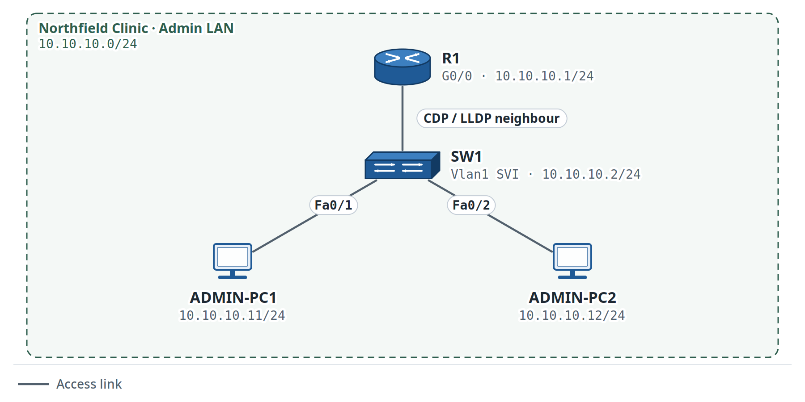

Figure 10. Lab 3.1: Switch Management SVI and Discovery

Organization: Northfield Clinic\
Your role: Network Support Trainee\
Estimated time: 45--60 minutes\
Primary platform: Cisco Packet Tracer\
Job skill: Configure a management SVI and identify a directly connected network device\
\
You will be able to: Configure a reachable switch management address, verify it, identify R1 with CDP, and compare LLDP when the selected device supports it.\
You need: Your saved Lab 2.1 Northfield Clinic topology; Concept Primer 3A.

> **Continuing from Lab 2.1:** R1 already uses `10.10.10.1/24`, ADMIN-PC1 uses `10.10.10.11/24`, and ADMIN-PC2 uses `10.10.10.12/24`.

<div align="justify">

This lab establishes a reachable switch management IP address and uses discovery commands. Ping to the SVI proves the management interface is reachable; it does not prove that secure remote login is configured. Local-user authentication and SSH hardening are taught later in Volume 2.

</div>

### Why this matters

<div align="justify">

A Layer 2 switch can forward Ethernet frames without an IP address.

A management SVI gives administrators an IP endpoint for monitoring and remote management.

**Lab Simplification:** VLAN 1 is used here only to keep the first management SVI lab simple. Production networks often use a dedicated management VLAN and controlled remote access, per the organization\'s design and security policy.

</div>

### Addressing plan

| **Device** | **Interface** | **IPv4 address/prefix** | **Purpose** |
| --- | --- | --- | --- |
| R1 | G0/0 | `10.10.10.1/24` | Default gateway |
| SW1 | VLAN 1 SVI | `10.10.10.2/24` | Switch management |
| ADMIN-PC1 | NIC | `10.10.10.11/24` | Test endpoint |
| ADMIN-PC2 | NIC | `10.10.10.12/24` | Test endpoint |

### Part A: Confirm the existing network

From ADMIN-PC1:

```text
ping 10.10.10.1
ping 10.10.10.12
```

Both tests must succeed before you change SW1.

### Part B: Configure the management SVI

On SW1:

```text
enable
configure terminal

interface vlan 1
 ip address 10.10.10.2 255.255.255.0
 no shutdown
exit

ip default-gateway 10.10.10.1
end
```

| **Command** | **Purpose** | **Verify with** |
| --- | --- | --- |
| `interface vlan 1` | Enters the VLAN 1 SVI | `show ip interface brief` |
| `ip address 10.10.10.2 255.255.255.0` | Sets the management IPv4 address | `show ip interface brief` |
| `no shutdown` | Enables the SVI administratively | `show ip interface brief` |
| `ip default-gateway 10.10.10.1` | Sets the management gateway on this Layer 2 switch | `show running-config` |

<div align="justify">

An SVI can remain down when its VLAN has no active Layer 2 port. In this lab, VLAN 1 already has active ports from the earlier build.

</div>

### Part C: Verify the management address

Run:

```text
show ip interface brief
```

Confirm that `VLAN 1` uses `10.10.10.2`.

Then, from ADMIN-PC1:

```text
ping 10.10.10.2
```

The ping must succeed.

### Part D: Discover R1 with CDP

On SW1:

```text
show cdp neighbors
show cdp neighbors detail
```

Record:

- neighbor device ID;
- local interface;
- neighbor capability;
- remote port ID.

<div align="justify">

The exact holdtime can vary. Focus on the device and interface relationship.

For a beginner check, match the local interface on SW1 with the remote port reported for R1. CDP and LLDP output can include extra capability codes or timers on real IOS/IOS XE; those extra fields are not required evidence for this lab.

</div>

### Part E: Compare LLDP when supported

LLDP is standards-based neighbor discovery.

Try:

```text
configure terminal
lldp run
end
show lldp neighbors
```

<div align="justify">

If the selected Packet Tracer device does not support LLDP, record the limitation and complete the CDP objective. Stay with the selected device model; one unsupported command is evidence of a platform limitation, not a reason to rebuild the lab.

</div>

### Part F: Save and verify

```text
copy running-config startup-config
```

The lab is complete when:

- SW1 uses `10.10.10.2/24` on `Vlan1`;
- ADMIN-PC1 can ping SW1;
- `show cdp neighbors` identifies R1;
- LLDP is observed when supported, or the limitation is documented;
- the configuration is saved.

### Evidence to Save

Keep:

- your updated Packet Tracer file;
- `show ip interface brief`;
- `show cdp neighbors`;
- one successful ping to `10.10.10.2`;
- LLDP output or the documented platform limitation.

### Reflection

1.  Why can a Layer 2 switch forward traffic without a management IP?

2.  If SW1 still forwards local frames but ADMIN-PC1 cannot ping 10.10.10.2, what management SVI evidence would you check before rebuilding the switch configuration?

## Concept Primer 3B: VLANs, Access Ports, Voice VLANs, and Trunks

<div align="justify">

**VLAN:** separates one physical switching environment into separate Layer 2 broadcast domains.

**Access port:** connects an endpoint to one intended data VLAN.

**Voice VLAN:** allows a phone and attached user device to use separate logical VLAN roles on one access location.

**802.1Q trunk:** carries traffic for several VLANs between network devices while preserving VLAN identity.

A trunk does not route between VLANs. Inter-VLAN communication requires a Layer 3 gateway.

Learning sequence: Lab 3.2 builds VLANs and access ports, Lab 3.3 adds edge-device roles, Lab 3.4 adds the trunk, and Labs 3.6--3.7 add Layer 3 routing between VLANs.

</div>

## Lab 3.2: Build VLANs and Access Ports

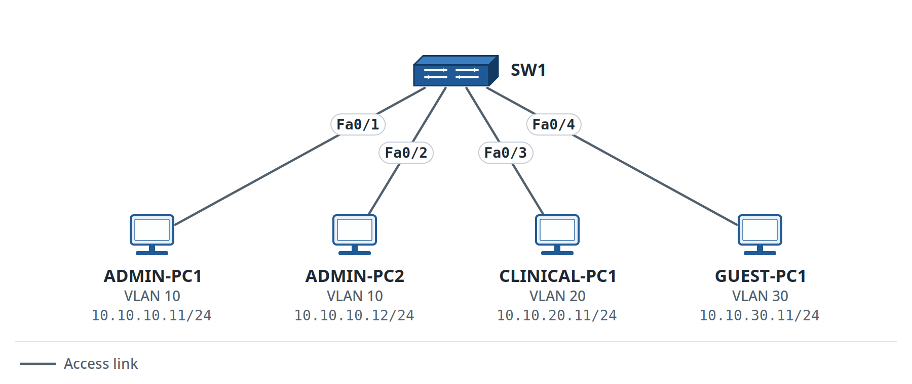

Figure 11. Lab 3.2: VLANs and Access Ports

Organization: Northfield Clinic\
Your role: Network Support Trainee\
Estimated time: 60 minutes\
Primary platform: Cisco Packet Tracer\
Job skill: Create VLANs, assign access ports, and verify Layer 2 separation\
You will be able to: Create VLANs, assign access ports, prove same-VLAN communication, and recognize expected cross-VLAN isolation.\
You need: Module 2 complete; Lab 3.1; Concept Primer 3B.

> **Continuing from Labs 0.2, 1.4, and 2.1:** This is the same Northfield Clinic network. The Admin LAN becomes VLAN 10, the Clinical LAN becomes VLAN 20, and the clinic adds Guest VLAN 30.

### Scenario

<div align="justify">

Northfield Clinic is separating three groups that currently share one access switch.

</div>

The clinic wants separate Layer 2 networks for:

- Administration;
- Clinical staff;
- Guest devices.

<div align="justify">

The VLAN plan is already approved; your job is to create the VLANs and assign the correct access ports.

You must create the VLANs and assign the correct switch ports.

</div>

Keep this lab at Layer 2; inter-VLAN routing comes later.

<div align="justify">

**Production Note:** Changing an access VLAN can immediately move a user\'s device into a different Layer 2 network. Confirm the port, endpoint owner, approved VLAN, and expected addressing before the change, then verify service afterward.

</div>

### VLAN plan

| **VLAN** | **Name** | **Purpose** |
| --- | --- | --- |
| 10 | ADMIN | Administration |
| 20 | CLINICAL | Clinical staff |
| 30 | GUEST | Guest devices |

### Endpoint plan

| **Device** | **Switch port** | **VLAN** | **IPv4 address** |
| --- | --- | --- | --- |
| ADMIN-PC1 | Fa0/1 | 10 | 10.10.10.11/24 |
| ADMIN-PC2 | Fa0/2 | 10 | 10.10.10.12/24 |
| CLINICAL-PC1 | Fa0/3 | 20 | 10.10.20.11/24 |
| GUEST-PC1 | Fa0/4 | 30 | 10.10.30.11/24 |

No default gateway is required for this lab.

### Part A: Create the VLANs

Enter global configuration mode.

Create VLAN 10:

```text
vlan 10
name ADMIN
```

Create VLAN 20:

```text
vlan 20
name CLINICAL
```

Create VLAN 30:

```text
vlan 30
name GUEST
```

Return to privileged EXEC mode.

Use:

```text
show vlan brief
```

### What the command proves

`show vlan brief` shows:

- VLAN IDs;
- VLAN names;
- access ports assigned to each VLAN.

<div align="justify">

At this point, the new VLANs exist, but the user ports are not assigned yet.

</div>

### Part B: Assign the administration ports

Configure Fa0/1:

```text
interface fastEthernet0/1
switchport mode access
switchport access vlan 10
```

Configure Fa0/2 in the same way.

### Part C: Assign the other endpoint ports

Configure:

- Fa0/3 as an access port in VLAN 20;
- Fa0/4 as an access port in VLAN 30.

### Part D: Configure the endpoint addresses

Use the addressing table.

Leave the default gateway blank in this lab.

### Part E: Verify the VLAN state

Run:

```text
show vlan brief
```

Expected port placement:

- Fa0/1 and Fa0/2 in VLAN 10;
- Fa0/3 in VLAN 20;
- Fa0/4 in VLAN 30.

### Part F: Test expected communication

From ADMIN-PC1:

```text
ping 10.10.10.12
```

This ping must succeed.

Then try:

```text
ping 10.10.20.11
```

This ping is expected to fail.

### Important lesson

A failed cross-VLAN ping is not a fault in this lab.

<div align="justify">

The network has no Layer 3 device that routes between VLAN 10 and VLAN 20.

</div>

The failure is correct behavior.

<div align="justify">

Expected isolation is part of the design, so leave it in place.

</div>

### First-use command table

| **Command** | **Mode** | **What it does** | **How to verify** | **Common mistake** |
| --- | --- | --- | --- | --- |
| `vlan 10` | Global configuration | Creates VLAN 10 or enters its VLAN configuration mode | `show vlan brief` | Creating the VLAN but never assigning a port |
| `name ADMIN` | VLAN configuration | Gives VLAN 10 a readable name | `show vlan brief` | Using inconsistent names |
| `switchport mode access` | Interface configuration | Sets the port as a Layer 2 access port | `show interfaces switchport` | Applying the command to the wrong interface |
| `switchport access vlan 10` | Interface configuration | Assigns the access port to VLAN 10 | `show vlan brief` | Assigning the wrong VLAN |

### Verification requirements

Keep evidence that proves:

- VLANs 10, 20, and 30 exist;
- the correct ports belong to each VLAN;
- ADMIN-PC1 can reach ADMIN-PC2;
- ADMIN-PC1 cannot reach CLINICAL-PC1 without routing.

### Reflection

1.  Why can the two administration PCs communicate?

2.  Why does the cross-VLAN ping fail?

### Evidence to Save

Keep:

- lab-3.2.pkt
- topology screenshot
- show vlan brief
- successful same-VLAN ping
- failed cross-VLAN ping
- two short reflection answers.

## Concept Primer 3C: Think in Port Roles, Not Just Device Types

<div align="justify">

An access switch port should match the approved service for that location. The important question is not only "what device is connected?" but "what network role is this port supposed to provide?"

</div>

For this lab:

<div align="justify">

A normal user, printer, or IoT endpoint uses one assigned access VLAN.

A phone with an attached PC can use one data VLAN for the PC and a separate voice VLAN for the phone on the same access location.

The VLAN assignment is a switch-side access decision; it does not automatically provide DHCP, routing, call control, or other services.

</div>

> Use now: apply the approved VLAN role to the edge port. Master later: the services and security policies behind those VLANs are separate design topics.

## Lab 3.3: Configure Edge Ports for User, Voice, Printer, and IoT Devices

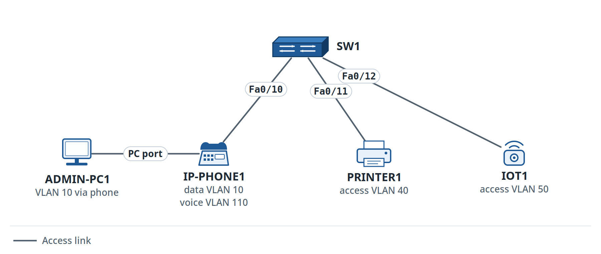

Figure 12. Lab 3.3: Edge-Port Roles

Organization: Northfield Clinic\
Your role: Network Support Technician\
Estimated time: 60--75 minutes\
Primary platform: Cisco Packet Tracer\
Job skill: Apply the correct VLAN role to different edge devices\
You will be able to: Apply approved data, voice, printer, and IoT VLAN roles to edge ports without changing out-of-scope uplinks or services.\
You need: Lab 3.2; Concept Primer 3C.

> **Network History: Northfield Clinic.** This lab keeps VLANs 10, 20, and 30 from Lab 3.2 and adds VLANs 40, 50, and 110 for new edge-device roles.

### Scenario

Northfield Clinic is expanding the access layer.

The clinic now has:

- an administrator with an IP phone and a connected PC;
- a shared network printer;
- a simple facilities IoT device.

The VLAN plan is already approved.

You must configure only the assigned edge ports.

<div align="justify">

Keep the scope to edge-port VLAN roles; routing, DHCP, and call-control services come later.

</div>

### Approved VLAN plan

| **VLAN** | **Name** | **Endpoint role** |
| --- | --- | --- |
| 10 | ADMIN | Administrator data |
| 40 | PRINTERS | Shared printers |
| 50 | IOT | Facilities IoT |
| 110 | VOICE | IP phone voice traffic |

### Port requirements

| **Switch port** | **Connected device** | **Data/access VLAN** | **Voice VLAN** |
| --- | --- | --- | --- |
| Fa0/10 | IP phone + attached PC | 10 | 110 |
| Fa0/11 | Printer | 40 | None |
| Fa0/12 | IoT endpoint | 50 | None |

### Your scope

You can change:

- VLAN creation;
- Fa0/10, Fa0/11, and Fa0/12;
- endpoint placement in the lab.

You must not change:

- uplink ports;
- routing;
- DHCP;
- voice call-control services.

### Task 1: Create the required VLANs

<div align="justify">

Create VLANs 10, 40, 50, and 110 if they do not already exist.

</div>

Use the approved names.

### Task 2: Configure the phone and PC port

Configure Fa0/10 with:

```text
switchport mode access
switchport access vlan 10
switchport voice vlan 110
```

The access VLAN carries the attached PC's data traffic.

The voice VLAN identifies the phone's voice traffic.

### Task 3: Configure the printer port

Configure Fa0/11 as an access port in VLAN 40.

### Task 4: Configure the IoT port

Configure Fa0/12 as an access port in VLAN 50.

### Verification

Use:

```text
show vlan brief
```

Then inspect Fa0/10:

```text
show interfaces fastEthernet0/10 switchport
```

The exact output depends on the platform.

Record evidence for:

- access VLAN 10;
- voice VLAN 110;
- printer VLAN 40;
- IoT VLAN 50.

### Platform note

<div align="justify">

Packet Tracer can represent the core switch-side voice VLAN configuration.

This exercise proves the switch-side VLAN role only; it is not evidence of a complete enterprise voice service.

A working phone system also depends on services outside this lab.

</div>

### Reflection

1.  Why can one edge port use a data VLAN and a voice VLAN?

2.  Why is a printer normally placed in a defined access VLAN instead of an arbitrary port?

### Evidence to Save

Keep:

- saved lab file
- show vlan brief
- Fa0/10 switchport output
- one short scope statement that lists what you did not change.

<div align="justify">

The previous lab assigned individual endpoint ports to VLANs. A trunk solves a different problem: it carries several VLANs between network devices. You must therefore verify the VLANs and their port membership before asking whether the trunk transports their frames.

</div>

## Concept Primer 3D: What an 802.1Q Trunk Is Doing

<div align="justify">

An access port normally carries one intended endpoint VLAN. A trunk is used when one link between network devices must carry traffic for several VLANs.

IEEE 802.1Q adds VLAN information to Ethernet frames as they cross the trunk so the receiving switch can keep the traffic associated with the correct VLAN.

In Lab 3.4, the link between SW1 and SW2 must carry VLANs 10, 20, and 30. The trunk extends those Layer 2 VLANs between the switches; it does not route traffic between them.

</div>

### Practical mental model

> Access port: one endpoint VLAN\
> 802.1Q trunk: several VLANs across one shared link\
> Layer 3 gateway: communication between different VLANs

### What you will verify

the required VLANs exist on both switches;

both ends of the inter-switch link operate as a trunk;

VLANs 10, 20, and 30 are allowed across the trunk;

same-VLAN hosts can communicate across the two switches;

cross-VLAN traffic still needs a Layer 3 gateway.

<div align="justify">

This exercise focuses on normal tagged VLAN traffic. Native-VLAN design comes later.

</div>

## Lab 3.4: Configure an 802.1Q Trunk

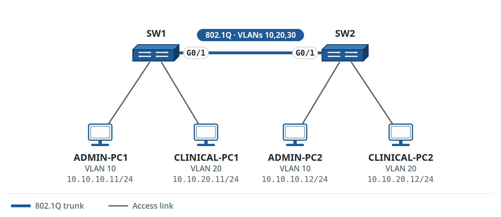

Figure 13. Lab 3.4: 802.1Q Trunk

**Organization:** Northfield Clinic\
**Your role:** Network Support Trainee\
**Estimated time:** 60 minutes\
**Primary platform:** Cisco Packet Tracer\
**Job skill:** Carry several VLANs between two switches\
**You will be able to:** Configure and verify an 802.1Q trunk that carries VLANs 10, 20, and 30 between two switches.\
**You need:** Labs 3.2--3.3; Concept Primer 3D.

> **Network History: Northfield Clinic.** This lab keeps the VLAN plan from Labs 3.2--3.3 and adds SW2. The trunk extends VLANs 10, 20, and 30 between the two access switches.

### Scenario

Northfield Clinic has added a second access switch.

<div align="justify">

Administration, Clinical, and Guest users now connect to both switches.

One physical switch-to-switch link must carry all three VLANs.

Your task is to extend VLANs 10, 20, and 30 between the two switches over an 802.1Q trunk.

</div>

Inter-VLAN routing is still outside this lab.

### VLANs that must cross the trunk

```text
10,20,30
```

### Addressing for verification

| **Device** | **Switch** | **VLAN** | **IPv4 address** |
| --- | --- | --- | --- |
| ADMIN-PC1 | SW1 | 10 | 10.10.10.11/24 |
| ADMIN-PC2 | SW2 | 10 | 10.10.10.12/24 |
| CLINICAL-PC1 | SW1 | 20 | 10.10.20.11/24 |
| CLINICAL-PC2 | SW2 | 20 | 10.10.20.12/24 |

### Part A: Confirm the VLANs

<div align="justify">

Before you configure the trunk, make sure that VLANs 10, 20, and 30 exist on both switches.

</div>

Use:

```text
show vlan brief
```

### Part B: Configure the trunk on SW1

On SW1 G0/1:

```text
interface gigabitEthernet0/1
switchport mode trunk
switchport trunk allowed vlan 10,20,30
```

### Part C: Configure the trunk on SW2

Apply the matching trunk configuration to SW2 G0/1.

<div align="justify">

**Production Note:** An allowed-VLAN change on a trunk can affect many users at once. Compare both ends, record the current allowed list, make the smallest approved change, and keep the previous list available for rollback.

</div>

### Important command note

<div align="justify">

Use the following command only when the selected platform supports and requires it:

</div>

```text
switchport trunk encapsulation dot1q
```

Otherwise, keep the trunk configuration as shown above.

<div align="justify">

Many access-switch platforms use 802.1Q without that separate command.

Use only commands supported by the device model you selected for this lab.

</div>

### Learn More: Official Reference

<div align="justify">

Use this after the lab for Cisco's vendor-level trunk, allowed-VLAN, and verification details.

</div>

[Cisco: VLAN Configuration Guide: Configure VLAN Trunking](https://www.cisco.com/c/en/us/td/docs/switches/lan/c9000/lyr2-fwd/vlan/vlan-configuration-guide/configure-vlan-trunks.html)

### Part D: Verify the trunk

Run:

```text
show interfaces trunk
```

Check:

- trunk status;
- trunking protocol;
- allowed VLAN list;
- VLANs that are active on the trunk.

### Part E: Test same-VLAN communication across the trunk

From ADMIN-PC1:

```text
ping 10.10.10.12
```

The ping must succeed.

From CLINICAL-PC1:

```text
ping 10.10.20.12
```

The ping must also succeed.

### Part F: Test different-VLAN communication

From ADMIN-PC1:

```text
ping 10.10.20.12
```

The ping is expected to fail.

The trunk carries the VLANs.

The trunk does not route between them.

### First-use command table

| **Command** | **Mode** | **What it does** | **How to verify** | **Common mistake** |
| --- | --- | --- | --- | --- |
| `switchport mode trunk` | Interface configuration | Links carry multiple VLANs | `show interfaces trunk` | Configuring only one end |
| `switchport trunk allowed vlan 10,20,30` | Interface configuration | Limits the trunk to the listed VLANs | `show interfaces trunk` | Leaving a required VLAN out of the list |
| `show interfaces trunk` | Privileged EXEC | Shows trunk state and VLAN information | Read trunk status and VLAN lists | Reading `show vlan brief` as proof that the trunk works |

### Verification requirements

You must prove:

- both ends operate as trunks;
- VLANs 10, 20, and 30 are allowed;
- VLAN 10 works across the two switches;
- VLAN 20 works across the two switches;
- traffic does not route between VLANs.

### Reflection

1.  Why must the trunk be configured correctly on both switches?

2.  What happens if VLAN 20 is missing from the allowed list on one end?

### Evidence to Save

Keep:

- lab-3.4.pkt
- topology screenshot
- show interfaces trunk from both switches
- one successful VLAN 10 cross-switch ping
- one successful VLAN 20 cross-switch ping
- one expected failed cross-VLAN ping.

## Lab 3.5: Observe VLAN 20 Across an 802.1Q Trunk

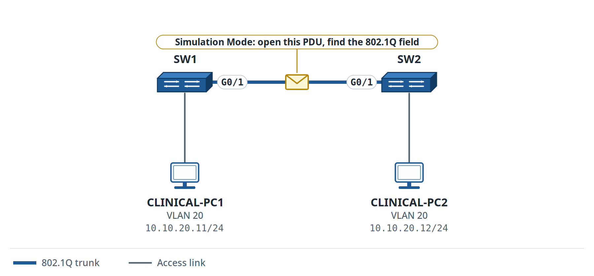

Figure 14. Lab 3.5: VLAN 20 Simulation Observation

**Organization:** Northfield Clinic\
**Your role:** Network Support Technician\
**Estimated time:** 30--45 minutes\
**Primary platform:** Cisco Packet Tracer Simulation Mode\
**Job skill:** Connect trunk configuration with the VLAN information carried in a Layer 2 frame\
\
**You will be able to:** Generate VLAN 20 traffic across the trunk, inspect the PDU in Simulation Mode, and identify the VLAN information that preserves VLAN membership across the link.\
**You need:** Lab 3.4 completed and saved.

> **Continuing from Lab 3.4:** Reopen **your own saved two-switch trunk topology**. You will use the same Northfield Clinic VLAN 20 hosts and observe traffic on the trunk you configured yourself.

### Scenario

<div align="justify">

Now connect the trunk configuration to what actually happens to traffic crossing the link.

You already proved that VLAN 20 communication works across SW1 and SW2.

</div>

Now you will watch that traffic in Packet Tracer.

### Part A: Confirm the Healthy Trunk First

Before Simulation Mode, verify:

```text
show interfaces trunk
```

Confirm:

- G0/1 is trunking on both switches;
- VLAN 20 is allowed;
- CLINICAL-PC1 can ping CLINICAL-PC2.

Start the observation only after the healthy design works.

### Part B: Enter Simulation Mode

1.  Change Packet Tracer from **Realtime** to **Simulation**.

2.  Clear or reset the visible event list if old events are present.

3.  Keep the event filters focused on ARP and ICMP when possible.

4.  From CLINICAL-PC1, generate traffic to CLINICAL-PC2.

Use:

```text
ping 10.10.20.12
```

### Part C: Follow the PDU Across the Trunk

Step through the events until the frame crosses:

```text
SW1 G0/1 <-> SW2 G0/1
```

Open the PDU details.

Look at the Layer 2 information Packet Tracer provides.

<div align="justify">

Record the field or field group that identifies VLAN 20 or 802.1Q trunk handling on your selected Packet Tracer release.

For this first observation, focus on the VLAN identity and traffic path rather than memorizing every bit of the 802.1Q header.

</div>

### Observation Worksheet

| **Item** | **Your observation** |
| --- | --- |
| Source host |  |
| Destination host |  |
| Trunk link |  |
| VLAN observed |  |
| Protocol being carried |  |
| What proves the frame belongs to VLAN 20? |  |

### Expected Outcome

Your exact Packet Tracer PDU display can vary by release.

Focus on these fields:

- the traffic crosses the configured trunk;
- the traffic remains associated with VLAN 20;
- the Layer 2 information shows the VLAN/trunk context provided by the simulator;
- the ping succeeds between the two VLAN 20 hosts.

Ignore exact timestamps and event numbers.

### Optional extension

<div align="justify">

In an authorized GNS3, EVE-NG, CML, or real lab, capture your own VLAN 20 trunk traffic in Wireshark and filter with `vlan.id == 20`.

vlan.id == 20 is a Wireshark display filter: it narrows what you see after capture. Capture filters and display filters use different syntax, so do not copy this expression into the capture-filter field.

</div>

### Reflection

1.  Why does the trunk need to preserve VLAN identity between switches?

2.  Why does this observation not mean that the VLAN tag performs routing?

### Verification

Before submission:

- `show interfaces trunk` proves VLAN 20 is allowed;
- the VLAN 20 ping succeeds;
- your Simulation Mode evidence shows the PDU crossing the trunk;
- you can explain how the observation connects to the trunk configuration.

### Evidence to Save

Keep:

- the completed observation worksheet;
- one Simulation Mode screenshot showing the trunk event;
- the relevant `show interfaces trunk` output;
- one successful VLAN 20 ping;
- a two-sentence explanation of what preserved VLAN identity across the trunk.

<div align="justify">

Lab 3.4 proved that a trunk carries multiple VLANs, while Lab 3.5 let you trace VLAN traffic across it. Neither step alone provides hosts in different IP networks with a Layer 3 path. Lab 3.6 adds that missing function with router subinterfaces.

</div>

## Lab 3.6: Route Between VLANs with One Router Interface

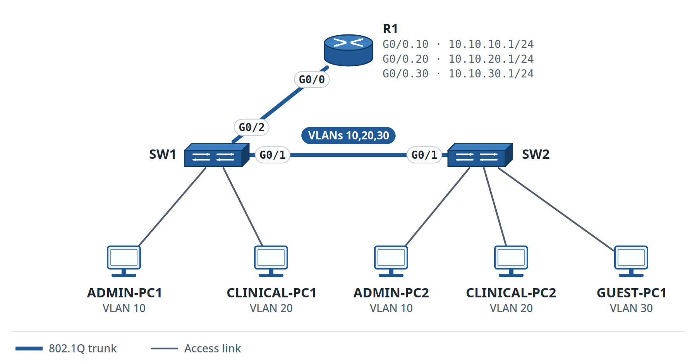

Figure 15. Lab 3.6: Router-on-a-Stick

**Organization:** Northfield Clinic\
**Your role:** Network Support Technician\
**Estimated time:** 75--90 minutes\
**Primary platform:** Cisco Packet Tracer\
**Job skill:** Configure router subinterfaces and an 802.1Q trunk so hosts in different VLANs can communicate via a router\
\
**You will be able to:** Configure router-on-a-stick for VLANs 10, 20, and 30, set the correct gateways, and verify inter-VLAN routing.\
**You need:** Labs 3.2--3.5 completed, especially the VLAN and trunk topology in Lab 3.4.

> **Continuing from Lab 3.4:** Reopen **your own saved Northfield Clinic trunk topology**. SW1 and SW2 already carry VLANs 10, 20, and 30 on G0/1. You are now adding R1 to SW1 so the three VLANs can communicate at Layer 3.

### Why this matters

A trunk can carry multiple VLANs between switches.

It cannot route traffic between VLANs.

<div align="justify">

In this lab, one physical router interface carries traffic for multiple VLANs by using **subinterfaces**.

</div>

Each subinterface:

- represents one VLAN;
- uses 802.1Q encapsulation;
- provides the default gateway address for that VLAN.

This design is commonly called **router-on-a-stick**.

### Existing VLAN plan

| **VLAN** | **Name** | **IPv4 network** | **Default gateway** |
| --- | --- | --- | --- |
| 10 | ADMIN | `10.10.10.0/24` | `10.10.10.1` |
| 20 | CLINICAL | `10.10.20.0/24` | `10.10.20.1` |
| 30 | GUEST | `10.10.30.0/24` | `10.10.30.1` |

### Endpoint plan

Keep the addresses you already used where possible.

| **Device** | **Switch** | **VLAN** | **IPv4 address** | **Default gateway** |
| --- | --- | --- | --- | --- |
| ADMIN-PC1 | SW1 | 10 | `10.10.10.11/24` | `10.10.10.1` |
| ADMIN-PC2 | SW2 | 10 | `10.10.10.12/24` | `10.10.10.1` |
| CLINICAL-PC1 | SW1 | 20 | `10.10.20.11/24` | `10.10.20.1` |
| CLINICAL-PC2 | SW2 | 20 | `10.10.20.12/24` | `10.10.20.1` |
| GUEST-PC1 | SW2 | 30 | `10.10.30.11/24` | `10.10.30.1` |

<div align="justify">

If GUEST-PC1 is not already present, add one PC to an unused SW2 access port and place that port in VLAN 30.

</div>

### Topology Change

Keep the existing trunk:

```text
SW1 G0/1 <-> SW2 G0/1
```

Add:

```text
SW1 G0/2 <-> R1 G0/0
```

The SW1-to-R1 link must become an 802.1Q trunk carrying VLANs:

```text
10,20,30
```

Leave R1 G0/0 without a directly assigned IPv4 address.

The IPv4 gateway addresses belong on the subinterfaces.

### Part A: Prove the Switching Baseline Before You Add Routing

On SW1 and SW2:

```text
show vlan brief
show interfaces trunk
```

Confirm:

- VLANs 10, 20, and 30 exist;
- SW1 G0/1 and SW2 G0/1 form the existing trunk;
- VLANs 10, 20, and 30 are allowed.

Then test same-VLAN communication.

From ADMIN-PC1:

```text
ping 10.10.10.12
```

From CLINICAL-PC1:

```text
ping 10.10.20.12
```

Both tests must succeed.

Now test across VLANs:

```text
ADMIN-PC1 -> 10.10.20.11
```

<div align="justify">

This test is expected to fail **before** router-on-a-stick is configured.

</div>

That failure is your baseline.

<div align="justify">

**Engineer Habit:** Before changing router-on-a-stick, capture the trunk state, subinterface addresses, encapsulation, and a working test. If one VLAN fails, prove whether the problem is on the access port, trunk, or matching router subinterface before touching the other VLANs.

Leave the fault in place for now; first collect the evidence.

</div>

### Part B: Connect R1 to SW1

Connect:

```text
SW1 G0/2 <-> R1 G0/0
```

On SW1:

```text
configure terminal

interface gigabitEthernet0/2
 switchport mode trunk
 switchport trunk allowed vlan 10,20,30
 no shutdown
end
```

Verify:

```text
show interfaces trunk
```

### Expected Outcome

SW1 now has two trunk links:

- G0/1 toward SW2;
- G0/2 toward R1.

The exact output spacing can vary.

Focus on these fields:

- both required interfaces operate as trunks;
- VLANs 10, 20, and 30 are allowed on the required links.

### Part C: Prepare the Router Physical Interface

On R1:

```text
enable
configure terminal

interface gigabitEthernet0/0
 no ip address
 no shutdown
exit
```

<div align="justify">

The physical interface stays unnumbered; place 10.10.10.1, 10.10.20.1, and 10.10.30.1 on the matching subinterfaces only.

</div>

The physical link carries the tagged frames.

The subinterfaces provide the Layer 3 gateway addresses.

### Part D: Create the VLAN 10 Subinterface

On R1:

```text
interface gigabitEthernet0/0.10
 encapsulation dot1Q 10
 ip address 10.10.10.1 255.255.255.0
exit
```

This subinterface represents VLAN 10.

### Part E: Create the VLAN 20 Subinterface

```text
interface gigabitEthernet0/0.20
 encapsulation dot1Q 20
 ip address 10.10.20.1 255.255.255.0
exit
```

This subinterface represents VLAN 20.

### Part F: Create the VLAN 30 Subinterface

```text
interface gigabitEthernet0/0.30
 encapsulation dot1Q 30
 ip address 10.10.30.1 255.255.255.0
exit

end
```

This subinterface represents VLAN 30.

### Learning checkpoint: before endpoint gateways

<div align="justify">

Before you continue, explain why R1 G0/0 has no IPv4 gateway address and why the .10, .20, and .30 subinterfaces use different 802.1Q VLAN IDs. If you cannot explain both, review Parts C--F before testing inter-VLAN routing.

</div>

### First-use command table

| **Command** | **Mode** | **What it does** | **How to verify** | **Common mistake** |
| --- | --- | --- | --- | --- |
| `interface g0/0.10` | Global configuration | Creates or enters subinterface `.10` | `show ip interface brief` | Putting the VLAN gateway on the physical parent interface |
| `encapsulation dot1Q 10` | Subinterface configuration | Associates the subinterface with VLAN 10 using 802.1Q | `show running-config interface g0/0.10` or the platform-supported equivalent | Using the wrong VLAN ID |
| `ip address 10.10.10.1 255.255.255.0` | Subinterface configuration | Makes the subinterface the VLAN 10 IPv4 gateway | `show ip interface brief` | Reusing an endpoint address |
| `no ip address` | Physical-interface configuration | Keeps the parent interface from owning one of the VLAN gateway addresses | `show running-config interface g0/0` | Leaving an old physical-interface IP in place |
| `no shutdown` | Physical-interface configuration | Enables the physical router link | `show ip interface brief` | Enabling subinterfaces while the physical parent remains shut down |

### Important command note

<div align="justify">

Use the printed encapsulation commands as written; the native keyword is outside the scope of this lab.

</div>

VLANs 10, 20, and 30 use standard tagged subinterfaces.

Native-VLAN design is a separate topic.

### Part G: Configure Endpoint Default Gateways

Configure or confirm:

```text
VLAN 10 hosts -> 10.10.10.1
VLAN 20 hosts -> 10.10.20.1
VLAN 30 hosts -> 10.10.30.1
```

<div align="justify">

Keep the endpoint IPv4 addresses as printed unless your build shows a mismatch.

</div>

### Part H: Verify the Router Subinterfaces

On R1:

```text
show ip interface brief
```

Confirm that the output contains:

```text
GigabitEthernet0/0.10   10.10.10.1
GigabitEthernet0/0.20   10.10.20.1
GigabitEthernet0/0.30   10.10.30.1
```

The exact status wording can vary slightly by platform.

Focus on these fields:

- all three subinterfaces exist;
- each subinterface has the correct IPv4 address;
- the physical parent is enabled;
- the subinterfaces become operational when the trunk and VLAN path are healthy.

### Part I: Verify Connected Routes

On R1:

```text
show ip route
```

Confirm that R1 has connected routes for:

```text
10.10.10.0/24
10.10.20.0/24
10.10.30.0/24
```

<div align="justify">

On Cisco IOS and IOS XE, local /32 host routes for configured IPv4 interface addresses may appear in the routing table. Packet Tracer output can vary by device model and release.

Route-table spacing may also vary. Compare the routes and next-hop information, not the exact spacing.

</div>

The three connected /24 networks are the key evidence.

### Part J: Prove Inter-VLAN Routing

Test from ADMIN-PC1:

```text
ping 10.10.20.11
ping 10.10.30.11
```

Test from CLINICAL-PC2:

```text
ping 10.10.10.12
```

All tests must pass after router-on-a-stick is working.

<div align="justify">

Then repeat the VLAN test to prove that the original switching function still works.

</div>

### Part K: Follow One Routed Packet

Use Packet Tracer Simulation Mode.

From ADMIN-PC1, generate a ping to:

```text
10.10.20.11
```

Follow the PDU.

Record the path:

```text
ADMIN-PC1
-> SW1
-> R1
-> SW1
-> CLINICAL-PC1
```

<div align="justify">

If the destination host is on SW2 in your build, include SW2 in the path.

</div>

What matters here:

> The VLAN 10 frame reaches R1. R1 strips the incoming Layer 2 header, examines the destination IP address, and makes a Layer 3 routing decision. It then encapsulates the packet in a new Layer 2 frame for VLAN 20 and forwards it through the VLAN 20 subinterface toward the destination.

<div align="justify">

The router is not simply passing the trunk tag unchanged; it is routing the Layer 3 packet and creating new Layer 2 framing for the outgoing VLAN.

</div>

### Verification Checklist

The lab is complete when all of these are true:

- VLANs 10, 20, and 30 still exist;
- SW1--SW2 trunk remains healthy;
- SW1--R1 is a trunk carrying VLANs 10, 20, and 30;
- R1 G0/0 has no IPv4 gateway address directly assigned;
- R1 has subinterfaces `.10`, `.20`, and `.30`;
- each subinterface uses the matching 802.1Q VLAN ID;
- each VLAN has the correct `.1` gateway;
- R1 has connected routes to all three `/24` networks;
- same-VLAN communication still works;
- cross-VLAN communication now works;
- Simulation Mode shows the routed path through R1.

### Evidence to Save

Keep locally:

- your own updated Packet Tracer topology;
- a screenshot of the final topology;
- `show interfaces trunk` from SW1;
- `show ip interface brief` from R1;
- the three relevant connected routes from `show ip route`;
- one successful VLAN 10 → VLAN 20 ping;
- one successful VLAN 10 → VLAN 30 ping;
- one Simulation Mode screenshot showing a packet passing through R1;
- a short explanation of why the trunk alone could not provide inter-VLAN communication.

### Reflection

1.  Why could VLAN 10 and VLAN 20 not communicate when the trunk was working but R1 was absent?

2.  Why does each router subinterface need its own `encapsulation dot1Q` VLAN ID?

## Lab 3.7: Route Between VLANs on a Multilayer Switch

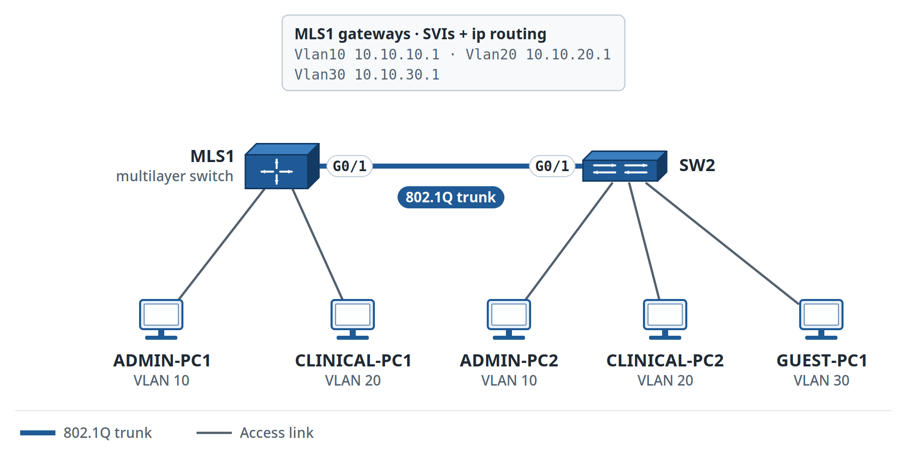

Figure 16. Lab 3.7: Multilayer-Switch Inter-VLAN Routing

**Organization:** Northfield Clinic\
**Your role:** Network Support Technician\
**Estimated time:** 75--90 minutes\
**Primary platform:** Cisco Packet Tracer with a multilayer switch that supports SVIs and `IP routing`\
**Job skill:** Configure Layer 3 switch SVIs so a multilayer switch can act as the default gateway for several VLANs\
\
**You will be able to:** Configure SVI gateways, enable Layer 3 routing, verify connected routes, and compare this design with router-on-a-stick.\
You need Labs 3.2--3.6 completed.

> **Continuing from Lab 3.6:** Before you make any changes, save a copy of your working Northfield Clinic router-on-a-stick lab. In this lab, the clinic tests a second inter-VLAN design: the VLAN gateways move from R1 subinterfaces to a multilayer switch.

### Why this matters

<div align="justify">

Lab 3.6 used one router physical interface with three subinterfaces.

Here you solve the same local routing problem with a different Layer 3 device.

A **multilayer switch** can switch Ethernet frames within a VLAN, host an SVI for each VLAN, and route IPv4 traffic between VLAN interfaces when Layer 3 routing is enabled.

</div>

The device performing the gateway function has changed.

### Change-Control Step

Before editing the working Lab 3.6 topology:

1.  Save the current file;

2.  use **Save As**;

3.  create a new copy for Lab 3.7.

Suggested filename:

```text
northfield-lab-3.7-l3-switch-routing.pkt
```

<div align="justify">

Use Save As and preserve Lab 3.6; you need both designs later for comparison.

</div>

### Target Design

Use:

```text
MLS1
SW2
ADMIN-PC1
ADMIN-PC2
CLINICAL-PC1
CLINICAL-PC2
GUEST-PC1
```

`MLS1` must be a Packet Tracer multilayer switch model that supports:

```text
interface vlan
ip routing
```

<div align="justify">

If **switchport mode trunk** is rejected, use ? to check whether the selected model requires an explicit 802.1Q encapsulation command (**switchport trunk encapsulation dot1q)** before entering trunk mode.

Record the device model and the exact command output. Use only authorized platform images; the lab does not require an unofficial IOS image.

Keep SW2 as the Layer 2 access switch from the earlier topology.

</div>

Use:

```text
MLS1 G0/1 <-> SW2 G0/1
```

as the 802.1Q trunk.

<div align="justify">

If your selected multilayer switch model uses different interface names, keep the design intent and record the actual interface names.

</div>

### VLAN and Gateway Plan

| **VLAN** | **Name** | **IPv4 network** | **Gateway SVI** |
| --- | --- | --- | --- |
| 10 | ADMIN | `10.10.10.0/24` | `10.10.10.1/24` |
| 20 | CLINICAL | `10.10.20.0/24` | `10.10.20.1/24` |
| 30 | GUEST | `10.10.30.0/24` | `10.10.30.1/24` |

<div align="justify">

The endpoint gateway addresses stay the same as Lab 3.6. What changes is **which device owns them**.

</div>

### Endpoint plan

| **Device** | **VLAN** | **IPv4 address** | **Default gateway** |
| --- | --- | --- | --- |
| ADMIN-PC1 | 10 | `10.10.10.11/24` | `10.10.10.1` |
| ADMIN-PC2 | 10 | `10.10.10.12/24` | `10.10.10.1` |
| CLINICAL-PC1 | 20 | `10.10.20.11/24` | `10.10.20.1` |
| CLINICAL-PC2 | 20 | `10.10.20.12/24` | `10.10.20.1` |
| GUEST-PC1 | 30 | `10.10.30.11/24` | `10.10.30.1` |

### Part A: Remove R1 from the Local Inter-VLAN Path

In the Lab 3.7 copy:

1.  disconnect R1 from the local VLAN trunk;

2.  keep the R1 configuration in the Lab 3.6 file for comparison;

3.  Use MLS1 as the local Layer 3 gateway device.

<div align="justify">

Only one device should own each .1 gateway address during this migration. Remove R1 from the local path before MLS1 uses those addresses.

**Production Note:** A gateway migration can cause duplicate IP addresses or an outage if the old and new Layer 3 gateways are active simultaneously. Isolate the old path, verify the new SVIs and routes, and maintain a defined rollback point.

</div>

### Part B: Create the VLANs on MLS1

```text
enable
configure terminal

vlan 10
 name ADMIN

vlan 20
 name CLINICAL

vlan 30
 name GUEST

end
```

Verify:

```text
show vlan brief
```

<div align="justify">

Before you configure the trunk, reconnect the local endpoints that were attached to SW1 in Lab 3.6. Connect ADMIN-PC1 to an available MLS1 access port and assign that port to VLAN 10. Connect CLINICAL-PC1 to an available MLS1 access port and assign that port to VLAN 20. Retain the existing endpoint VLAN assignments on SW2. Interface names may vary by multilayer switch model.

</div>

```text
configure terminal
interface <ADMIN-PC1-port>
 switchport mode access
 switchport access vlan 10
 no shutdown
exit
interface <CLINICAL-PC1-port>
 switchport mode access
 switchport access vlan 20
 no shutdown
end
```

<div align="justify">

Before you continue to the trunk and SVI configuration, verify the local access-port VLAN membership using show vlan brief.

</div>

### Part C: Configure the Trunk to SW2

On MLS1:

```text
configure terminal

interface gigabitEthernet0/1
 switchport mode trunk
 switchport trunk allowed vlan 10,20,30
 no shutdown

end
```

Keep the matching SW2 trunk from the earlier lab.

Verify on both switches:

```text
show interfaces trunk
```

<div align="justify">

Confirm that the MLS1--SW2 link is configured as a trunk and that VLANs 10, 20, and 30 are allowed.

</div>

### Parts D--F: Configure the VLAN SVIs

### VLAN 10

```text
configure terminal
interface vlan 10
 ip address 10.10.10.1 255.255.255.0
 no shutdown
exit
```

### VLAN 20

```text
interface vlan 20
 ip address 10.10.20.1 255.255.255.0
 no shutdown
exit
```

### VLAN 30

```text
interface vlan 30
 ip address 10.10.30.1 255.255.255.0
 no shutdown
exit
end
```

### First-use command table

| **Command** | **Mode** | **What it does** | **How to verify** | **Common mistake** |
| --- | --- | --- | --- | --- |
| `interface vlan 10` | Global configuration | Creates or enters the VLAN 10 SVI | `show ip interface brief` | Confusing the SVI with an access port |
| `ip address 10.10.10.1 255.255.255.0` | SVI configuration | Assigns the VLAN 10 gateway | `show ip interface brief` | Giving the SVI an address already used by another active device |
| `no shutdown` | SVI configuration | Enables the SVI administratively | `show ip interface brief` | Expecting it to be up when the VLAN has no active Layer 2 path |
| `ip routing` | Global configuration | Enables IPv4 routing between Layer 3 interfaces on the multilayer switch | `show ip route` plus end-to-end ping | Forgetting that SVIs alone do not prove routing is enabled |

### Part G: Observe Before `ip routing`

Inspect:

```text
show ip interface brief
show ip route
```

Now test:

```text
ADMIN-PC1 -> 10.10.20.11
```

Record the result.

<div align="justify">

The exact intermediate behavior may vary by platform. The required end state is that Layer 3 forwarding is enabled and verified.

</div>

### Part H: Enable Layer 3 Routing

On MLS1:

```text
configure terminal
ip routing
end
```

### Important Contrast with Lab 3.1

In Lab 3.1, SW1 was operating as a Layer 2 switch and used:

```text
ip default-gateway
```

for the switch's own management traffic.

<div align="justify">

In this lab, MLS1 serves as a Layer 3 router between networks. The routing table is the primary forwarding reference.

ip default-gateway supports management traffic on a Layer 2 switch; it does not enable inter-VLAN routing.

</div>

### Part I: Verify SVI State

```text
show ip interface brief
```

Confirm:

```text
Vlan10   10.10.10.1
Vlan20   10.10.20.1
Vlan30   10.10.30.1
```

<div align="justify">

Confirm that all three SVIs exist, each uses the correct .1 address, and each becomes operational when the VLAN has an active Layer 2 path.

</div>

### If an SVI Is Down

Check:

1.  Does the VLAN exist?

2.  Is at least one required port or trunk path active for that VLAN?

3.  Is the SVI administratively enabled?

4.  Is the VLAN allowed on the relevant trunk?

Use evidence before deleting or rebuilding anything.

### Part J: Verify the Routing Table

```text
show ip route
```

Confirm connected routes for:

```text
10.10.10.0/24
10.10.20.0/24
10.10.30.0/24
```

<div align="justify">

Local `/32` routes can also appear. The three connected VLAN networks are the required evidence.

</div>

### Part K: Prove Inter-VLAN Routing

From ADMIN-PC1:

```text
ping 10.10.20.11
ping 10.10.30.11
```

From CLINICAL-PC2:

```text
ping 10.10.10.12
```

All required tests must succeed.

<div align="justify">

Then repeat ADMIN-PC1 → ADMIN-PC2 to prove same-VLAN switching still works.

</div>

### Part L: Observe One Routed Path

Use Packet Tracer Simulation Mode.

Generate:

```text
ADMIN-PC2 -> CLINICAL-PC1
```

A typical path is:

```text
ADMIN-PC2
-> SW2
-> MLS1
-> CLINICAL-PC1
```

<div align="justify">

If the destination host is on SW2, the traffic can return through SW2 after MLS1 makes the Layer 3 decision.

The key evidence is that MLS1 makes the routing decision between VLAN 10 and VLAN 20.

</div>

### Part M: Compare the Two Inter-VLAN Designs

| **Question** | **Lab 3.6: Router-on-a-Stick** | **Lab 3.7: Multilayer Switch** |
| --- | --- | --- |
| Which device owns the VLAN 10 gateway? |  |  |
| Where is the VLAN 20 gateway configured? |  |  |
| What carries several VLANs toward the routing device? |  |  |
| What command enables Layer 3 routing on the multilayer switch? | N/A |  |
| Does the design depend on router subinterfaces? |  |  |
| Which device's routing table contains the three connected VLAN networks? |  |  |

<div align="justify">

Treat the two designs as alternatives, not as a winner-take-all comparison. The right choice depends on the network, hardware, scale, cost, and operational requirements.

</div>

### Verification Checklist

The lab is complete when:

- VLANs 10, 20, and 30 exist on MLS1;
- the MLS1--SW2 trunk carries VLANs 10, 20, and 30;
- MLS1 owns `10.10.10.1`, `10.10.20.1`, and `10.10.30.1` on SVIs;
- R1 is no longer using those gateway addresses in the Lab 3.7 topology;
- `IP routing` is enabled;
- `show ip interface brief` proves the required SVI addresses;
- `show ip route` shows the three connected VLAN networks;
- same-VLAN communication still works;
- inter-VLAN communication works;
- Simulation Mode shows MLS1 in the routed path;
- the Lab 3.6 versus Lab 3.7 comparison table is complete.

### Evidence to Save

Keep locally:

- your own Lab 3.7 Packet Tracer file;
- final topology screenshot;
- `show vlan brief`;
- `show interfaces trunk`;
- `show ip interface brief`;
- the three connected routes from `show ip route`;
- one successful VLAN 10 → VLAN 20 ping;
- one successful VLAN 10 → VLAN 30 ping;
- one Simulation Mode screenshot;
- completed Lab 3.6 versus Lab 3.7 comparison table;
- one paragraph explaining the architectural difference between router-on-a-stick and multilayer switch routing.

### Reflection

1.  Why is an SVI different from a physical access port?

2.  Why can an SVI remain down even when its configuration looks correct?

<div align="justify">

The multilayer switch now routes between VLANs. When you introduce redundant switch links, you also risk creating a Layer 2 loop. The next bridge explains why spanning tree may leave a healthy redundant connection in a non-forwarding state.

</div>

## Concept Bridge 3E: Read the STP Decision Before You Add Edge Protection

<div align="justify">

A redundant Layer 2 path is useful only when the network prevents a switching loop. In this lab, first understand the forwarding decision; then add protection to endpoint-facing ports.

</div>

Use this small mental model:

<div align="justify">

Root bridge: the reference switch for the spanning-tree calculation.

Root port: the best path toward the root on a non-root switch.

Designated port: the forwarding port selected for a Layer 2 segment.

Alternate/discarding path: a healthy redundant path that is not forwarding because STP prevents a loop.

Edge port: a port expected to connect to an endpoint, where PortFast and BPDU Guard can be appropriate.

</div>

> Volume 1 focuses on identifying the root, the forwarding path, one non-forwarding redundant path, and the difference between an inter-switch link and an endpoint edge port.

## Lab 3.8: Build a Redundant Layer 2 Topology Safely

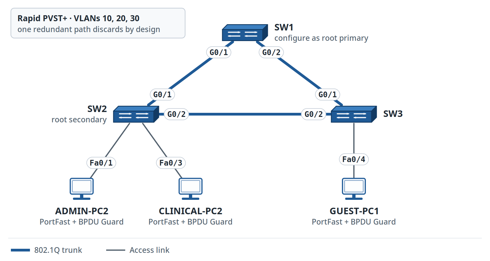

Figure 17. Lab 3.8: Rapid PVST+ Redundant Topology

**Organization:** Northfield Clinic\
**Your role:** Network Support Technician**\
Estimated time:** 90--105 minutes**\
Primary platform:** Cisco Packet Tracer\
**Job skill:** Build a redundant switched topology, verify Rapid PVST+ root/port roles, and protect endpoint ports with PortFast and BPDU Guard\
**\
You will be able to:** Explain why a redundant Layer 2 path requires spanning tree, make SW1 the preferred root, identify forwarding and alternate/discarding paths, configure PortFast and BPDU Guard only on edge ports, and distinguish expected STP blocking from a fault.\
You need: Labs 3.2--3.7 completed and Concept Bridge 3E. Keep your earlier Lab 3.4 file so you can reuse the VLAN/trunk design without the routing changes.

> **Continuing from Lab 3.4:** Reopen your saved Northfield Clinic VLAN/trunk topology and use Save As. This lab returns to a Layer 2 switching focus. You will add SW3 and a redundant path so spanning tree has a real decision to make.

### Why this matters

Redundant links improve availability.

<div align="justify">

At Layer 2, uncontrolled redundancy can also create switching loops, duplicate frames, and MAC-table instability.

Rapid PVST+ prevents those loops by selecting a loop-free forwarding topology per VLAN.

A non-forwarding port can be **correct protection**, not a broken link.

</div>

### Target Topology

Build a triangle:

```text
        SW1
       /   \
      /     \
    SW2-----SW3
```

Use trunk links between all three switches.

Suggested ports:

```text
SW1 G0/1 <-> SW2 G0/1
SW1 G0/2 <-> SW3 G0/1
SW2 G0/2 <-> SW3 G0/2
```

<div align="justify">

If your selected switch model uses different interface names, keep the same logical design and document the actual interfaces.

</div>

Keep VLANs:

```text
10 ADMIN
20 CLINICAL
30 GUEST
```

### Part A: Prove the VLAN/Trunk Baseline

On each switch:

```text
show vlan brief
show interfaces trunk
```

<div align="justify">

Confirm VLANs 10, 20, and 30 exist and that all three inter-switch links are trunks.

Keep endpoint security out of this baseline step; first prove the VLAN and trunk states.

</div>

### Part B: Enable Rapid PVST+

On SW1, SW2, and SW3:

```text
configure terminal
spanning-tree mode rapid-pvst
end
```

Verify:

```text
show spanning-tree summary
```

The exact summary text can vary.

<div align="justify">

The field that matters is that the switch is using Rapid PVST+ or the selected platform's rapid per-VLAN spanning-tree mode.

</div>

### Part C: Make SW1 the Preferred Root

On SW1:

```text
configure terminal
spanning-tree vlan 10,20,30 root primary
end
```

On SW2:

```text
configure terminal
spanning-tree vlan 10,20,30 root secondary
end
```

Now inspect VLAN 10:

```text
show spanning-tree vlan 10
```

Repeat for VLANs 20 and 30.

<div align="justify">

Packet Tracer command support may differ from IOS/IOS XE. If spanning-tree vlan 10,20,30 root primary is rejected, apply spanning-tree vlan 10 root primary, then repeat for VLANs 20 and 30. Verify which switch is the root for each VLAN instead of assuming the command was accepted.

</div>

### Record the Evidence

| **VLAN** | **Root bridge** | **This switch's root port** | **Alternate/discarding port observed** | **Notes** |
| --- | --- | --- | --- | --- |
| 10 |  |  |  |  |
| 20 |  |  |  |  |
| 30 |  |  |  |  |

### Expected Outcome

- The exact port chosen as the alternate path can vary based on interface cost and bridge ID.
- Focus on these fields:
- SW1 is the root for the tested VLANs;
- non-root switches have a root port toward the best path to SW1;
- one redundant path is prevented from forwarding in each looped Layer 2 topology;
- the blocked/discarding path is not automatically a fault.

### Learning checkpoint: before PortFast and BPDU Guard

<div align="justify">

Pause here until you can identify the root bridge, the root port on at least one non-root switch, and one redundant path that STP intentionally does not forward. Save the working file before you add edge-port protection.

</div>

### First-use command table

| **Command** | **Mode** | **What it does** | **How to verify** | **Common mistake** |
| --- | --- | --- | --- | --- |
| `spanning-tree mode rapid-pvst` | Global configuration | Selects Rapid PVST+ | `show spanning-tree summary` | Assuming every platform uses the same default |
| `spanning-tree vlan 10,20,30 root primary` | Global configuration | Makes the switch the preferred root for the listed VLANs | `show spanning-tree vlan 10` | Setting root priority without documenting the intended root |
| `spanning-tree portfast` | Interface configuration | Lets an approved edge port move quickly to forwarding | `show spanning-tree interface <port> detail` | Enabling it on an inter-switch trunk |
| `spanning-tree bpduguard enable` | Interface configuration | Protects an approved edge port if BPDUs appear | Interface/status/log evidence | Enabling protection without knowing which ports are truly edge ports |

### Part D: Configure PortFast on Endpoint Ports Only

Choose endpoint access ports, for example:

```text
SW2 Fa0/1 -> ADMIN-PC2
SW2 Fa0/3 -> CLINICAL-PC2
SW3 Fa0/4 -> GUEST-PC1
```

On each approved endpoint port:

```text
configure terminal

interface fastEthernet0/1
 spanning-tree portfast
 spanning-tree bpduguard enable
exit
```

Repeat only for the endpoint ports you actually use.

### Safety Rule

<div align="justify">

Keep PortFast disabled on the SW1--SW2, SW1--SW3, and SW2--SW3 inter-switch trunks; reserve it for approved edge ports.

PortFast is intended for ports where you expect an endpoint, not another switch.

**Production Note:** PortFast should be enabled only on approved edge ports, not on normal switch-to-switch links. BPDU Guard can intentionally disable a protected port when BPDUs are detected; investigate the cause before simply re-enabling it.

</div>

### Part E: Verify an Edge Port

Use:

```text
show spanning-tree interface fastEthernet0/1 detail
```

or the closest supported command on your selected platform.

<div align="justify">

If the interface-detail form is unavailable, use show spanning-tree vlan 10 and locate the same port in that VLAN's interface listing. Verify the operational role/state rather than relying on an unsupported field.

Confirm the port is treated as an edge/PortFast port when the platform displays that field.

Then verify the connected endpoint still has normal connectivity within its VLAN.

</div>

### Part F: Controlled BPDU Guard Test

Use one **spare endpoint port** only.

1.  Configure the spare port as an access port.

2.  Enable PortFast and BPDU Guard.

3.  Prove the port works with a normal PC first.

4.  Disconnect the PC.

5.  Temporarily connect a spare switch to that protected edge port.

<div align="justify">

If the selected Packet Tracer model fully implements BPDU Guard, the protected port should stop forwarding and may appear err-disabled or otherwise disabled by protection.

</div>

Record what your platform shows.

<div align="justify">

If this Packet Tracer model does not disable the port, no err-disabled state exists to recover from. Disconnect the spare switch, restore the normal endpoint connection, record the simulator limitation, and verify that the endpoint still works. If the port did disable, follow the recovery steps below.

</div>

### Recovery

Before recovery:

1.  disconnect the spare switch from the edge port;

2.  confirm that the port should again connect only to an endpoint.

Then use:

```text
configure terminal
interface <protected-port>
 shutdown
 no shutdown
end
```

Verify the endpoint can communicate again.

### Platform Limitation Rule

<div align="justify">

If the selected Packet Tracer release does not clearly show BPDU Guard enforcement, do not fabricate output.

When reading show spanning-tree vlan \<id\>, first focus on the root/bridge identity, each port\'s role, and whether the port is forwarding or discarding. Exact timers, bridge IDs, port numbers, and some role labels can vary by platform and topology.

Cisco IOS and IOS XE syntax varies by platform: some platforms use spanning-tree portfast, while others expose or store the PortFast edge form. Packet Tracer access-switch models may show the shorter syntax used in this lab. Use the syntax supported by your selected model and verify the resulting port behavior rather than copying a command from a different platform.

Record the limitation and complete the configuration and STP verification objectives for PortFast.

</div>

### Other STP guards you must recognize.

<div align="justify">

Cisco's published CCNA® exam topics include Root Guard, Loop Guard, and BPDU Guard for Rapid PVST+ operations. Check the [official CCNA certification page](https://www.cisco.com/site/us/en/learn/training-certifications/certifications/enterprise/ccna/index.html) for the exam version you are preparing for.

</div>

| **Feature** | **Typical use** | **Interface command** |
| --- | --- | --- |
| **BPDU Guard** | Protect an approved edge port if a switch/bridge sends BPDUs | `spanning-tree bpduguard enable` |
| **Root Guard** | Stop a downstream port from becoming a path to an unexpected root bridge | `spanning-tree guard root` |
| **Loop Guard** | Protect against a blocked/redundant path moving to forwarding when expected BPDUs disappear | `spanning-tree guard loop` |

<div align="justify">

This exercise actively tests BPDU Guard. For Root Guard and Loop Guard, learn the purpose and command here; deeper campus practice comes later.

</div>

### Verification Checklist

The lab is complete when:

- all three switches use Rapid PVST+;
- SW1 is the preferred root bridge for VLANs 10, 20, and 30;
- you can identify the root port on a non-root switch;
- you can identify one redundant path that is not forwarding traffic;
- endpoint ports use PortFast only where appropriate;
- endpoint ports use BPDU Guard where configured;
- a blocked or discarding STP path is correctly interpreted as loop prevention;
- the optional, controlled BPDU Guard test is documented honestly for your platform.

### Evidence to Save

Keep locally:

- your own Lab 3.8 Packet Tracer file;
- final redundant-topology screenshot;
- `show spanning-tree summary`;
- `show spanning-tree vlan 10`;
- completed root/port-role table;
- one edge-port verification;
- BPDU Guard test evidence or a documented platform limitation;
- a short explanation of why an STP non-forwarding port is not automatically a fault.

### Reflection

1.  Why can a redundant physical link be healthy even though STP does not forward user traffic over it?

2.  Why should the intended root bridge be documented rather than left to chance?

### Learn More: Official Reference

<div align="justify">

Use these after Lab 3.8 if you want Cisco's full spanning-tree and edge-port protection behavior.

</div>

[Cisco: Spanning Tree Protocol Configuration Guide](https://www.cisco.com/c/en/us/td/docs/switches/lan/c9000/lyr2-fwd/stp/stp-configuration-guide/m-stp.html)

[Cisco: Optional Spanning-Tree Features: PortFast and BPDU Guard](https://www.cisco.com/c/en/us/td/docs/switches/lan/catalyst9200/software/release/17-15/configuration_guide/lyr2/b_1715_lyr2_9200_cg/configuring_optional_spanning_tree_features.html)

<div align="justify">

In Lab 3.8, spanning tree protected the topology when multiple physical paths were present. EtherChannel now combines two compatible links into a single logical path. Watch both layers of evidence: LACP must bundle the members, and spanning tree should recognize the Port-Channel.

</div>

## Lab 3.9: Bundle Two Switch Links with LACP

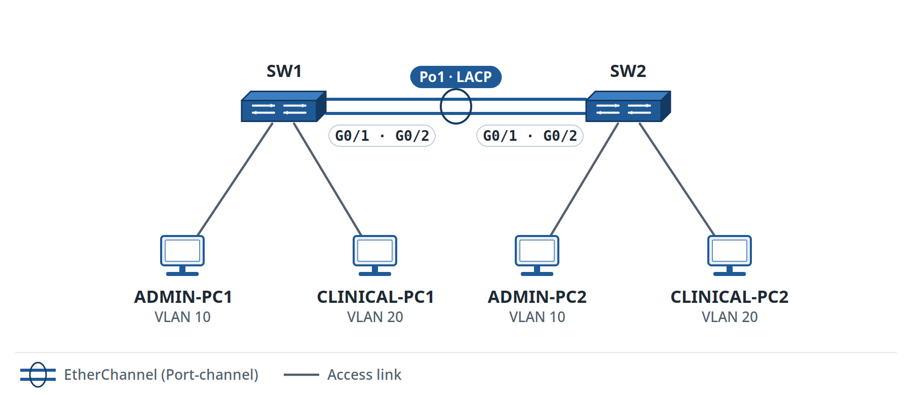

Figure 18. Lab 3.9: LACP EtherChannel

**Organization:** Northfield Clinic\
**Your role:** Network Support Technician\
**Estimated time:** 75--90 minutes\
**Primary platform:** Cisco Packet Tracer\
**Job skill:** Configure and verify a Layer 2 LACP EtherChannel between switches\
\
**You will be able to:** Build an LACP Port-Channel, verify both member links, and explain how STP treats the bundle.\
**You need:** VLAN/trunk skills from Labs 3.2--3.5 and spanning-tree awareness from Lab 3.8.

> **Continuing from Northfield Clinic:** Use **Save As** on a clean two-switch Northfield VLAN topology. In this lab, SW1 and SW2 will use two parallel physical links to form a single logical LACP EtherChannel.

### Why this matters

<div align="justify">

A single trunk can become a bandwidth or availability bottleneck.

EtherChannel combines compatible physical links into a single logical interface.

</div>

LACP provides a standards-based negotiation method.

<div align="justify">

The physical member links still exist, but switching and spanning tree can treat the bundle as a single logical Port-Channel.

</div>

### Target Topology

Use:

```text
SW1 G0/1 <-> SW2 G0/1
SW1 G0/2 <-> SW2 G0/2
```

These two links will become:

```text
Port-Channel 1
```

Keep VLANs:

```text
10 ADMIN
20 CLINICAL
30 GUEST
```

<div align="justify">

Keep at least one host in VLAN 10 and one host in VLAN 20 on each side so you can prove traffic crosses the bundle.

</div>

### Part A: Verify the Starting State

Before creating the EtherChannel:

```text
show vlan brief
show interfaces trunk
show spanning-tree vlan 10
```

Record the current trunk and spanning-tree state.

<div align="justify">

If the two parallel links are already connected before bundling, spanning tree can place one physical link in a non-forwarding state to prevent a loop.

</div>

That is expected.

### Part B: Configure Matching Member Interfaces

On SW1:

```text
configure terminal

interface range gigabitEthernet0/1 - 2
 shutdown
 switchport mode trunk
 channel-group 1 mode active
 no shutdown

end
```

On SW2:

```text
configure terminal

interface range gigabitEthernet0/1 - 2
 shutdown
 switchport mode trunk
 channel-group 1 mode passive
 no shutdown

end
```

### LACP Mode Rule

- `active` initiates LACP negotiation.
- `passive` responds to LACP.
- active + passive can form.
- passive + passive does not initiate a channel.

<div align="justify">

This build uses active on SW1 and passive on SW2 so that you can see both LACP modes in a single working design.

</div>

### Part C: Configure the Logical Port-Channel

On SW1:

```text
configure terminal

interface port-channel 1
 switchport mode trunk
 switchport trunk allowed vlan 10,20,30
 no shutdown

end
```

<div align="justify">

Repeat the same trunk/allowed-VLAN intent on SW2 Port-Channel 1.

Keep the VLAN and trunk policy on the logical Port-Channel; individual members should not have conflicting settings.

**Engineer Habit:** Treat the Port-Channel as the logical service. Keep member settings compatible, apply the trunk policy to the Port-Channel, and verify both the logical bundle and each member after a change.

</div>

### First-use command table

| **Command** | **Mode** | **What it does** | **How to verify** | **Common mistake** |
| --- | --- | --- | --- | --- |
| `interface range g0/1 - 2` | Global configuration | Selects both physical member links | `show running-config` / interface output | Selecting different members on each switch |
| `channel-group 1 mode active` | Interface range | Adds members to LACP channel 1 and actively negotiates | `show etherchannel summary` | Mixing incompatible modes/protocols |
| `channel-group 1 mode passive` | Interface range | Adds members and waits/responds to LACP | `show etherchannel summary` | Using passive on both ends and expecting negotiation |
| `interface port-channel 1` | Global configuration | Enters the logical bundle | `show etherchannel summary` | Configuring only one member instead of the logical interface |
| `switchport trunk allowed vlan 10,20,30` | Port-Channel interface | Defines the VLANs carried by the logical trunk | `show interfaces trunk` | Giving members inconsistent allowed-VLAN lists |

### Part D: Verify the Bundle

On both switches:

```text
show etherchannel summary
```

Look for:

- `Po1`;
- LACP as the protocol where shown;
- both member interfaces bundled in the Port-Channel.

A common healthy IOS-style display can show:

```text
Po1(SU)
```

and member interfaces with a bundled indicator such as:

```text
(P)
```

The exact flags and spacing can vary by platform.

<div align="justify">

Compare the operational meaning of the EtherChannel flags rather than comparing exact letter strings.

</div>

The evidence that matters is:

- Port-Channel 1 exists;
- LACP formed;
- both intended members are participating.

### Part E: Verify the Trunk

Run:

```text
show interfaces trunk
```

Confirm the logical Port-Channel carries:

```text
10,20,30
```

The platform can also list physical members.

The logical Port-Channel is the important design object.

### Part F: Verify Spanning Tree

Run:

```text
show spanning-tree vlan 10
```

<div align="justify">

Record how the EtherChannel appears in the spanning-tree output.

</div>

Expected concept:

> STP treats the working EtherChannel as one logical path rather than two independent parallel Layer 2 links.

<div align="justify">

Once the links are bundled, STP treats the Port-Channel as the logical path. A healthy member is not expected to block simply because the bundle contains two cables.

</div>

### Part G: Verify Traffic

Test same-VLAN traffic across the switches.

Examples:

```text
ADMIN-PC1 -> ADMIN-PC2
CLINICAL-PC1 -> CLINICAL-PC2
```

Both must succeed.

<div align="justify">

Controlled one-link test: start only after both links have formed a healthy Port-Channel. Disconnect one of the two physical member cables (not both).

Repeat the VLAN ping and check whether Po1 remains operational through the remaining member. The result depends on the supported platform and bundle state; do not assume success without evidence.

</div>

Record the before-and-after member states using:

```text
show etherchannel summary
```

<div align="justify">

Interpret Po1 and each member separately. During the one-link test, expect one member to be unavailable; the other may keep Po1 operational. If the platform behaves differently, capture that evidence and explain the result.

Reconnect the member cable. Re-run show etherchannel summary and both pings; prove the original two-member healthy state returns.

</div>

### Verification Checklist

The lab is complete when:

- Port-Channel 1 exists on both switches;
- LACP is used;
- SW1 uses active mode and SW2 uses passive mode;
- both intended physical links join the bundle;
- Po1 carries VLANs 10, 20, and 30;
- STP sees the logical Port-Channel;
- same-VLAN traffic crosses the bundle;
- you record the effect of one member link being temporarily disconnected.

### Evidence to Save

Keep locally:

- your own Lab 3.9 Packet Tracer file;
- final topology screenshot;
- `show etherchannel summary` from both switches;
- `show interfaces trunk`;
- `show spanning-tree vlan 10`;
- one successful VLAN 10 cross-switch ping;
- one successful VLAN 20 cross-switch ping;
- before/after EtherChannel evidence from the temporary one-member test;
- a short explanation of active versus passive LACP.

### Reflection

1.  Why can two independent parallel trunks create a loop while two members of one EtherChannel do not act as two independent STP paths?

2.  What is the difference between LACP active and passive?

### Learn More: Official Reference

<div align="justify">

Use this after Lab 3.9 to review Cisco's vendor-level LACP active/passive rules, member compatibility, and EtherChannel behavior.

</div>

[Cisco: EtherChannel Configuration Guide: LACP and EtherChannels](https://www.cisco.com/c/en/us/td/docs/switches/lan/c9000/lyr2-fwd/etherchannel/etherchannel-configuration-guide/etherchannels.html)

## Lab 3.10: Handle Three Switching Tickets Like a Junior Engineer

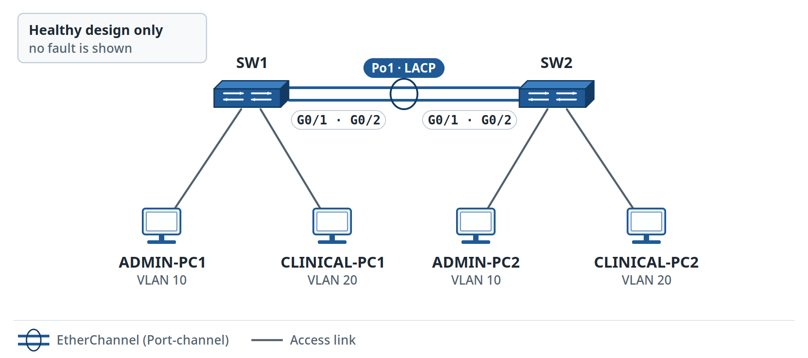

Figure 19. Lab 3.10: Switching Ticket Topology

**Organization:** Northfield Clinic\
**Your role:** Junior Network Engineer supporting the clinic through Metro NOC Services\
**Estimated time:** 105--120 minutes\
**Primary platform:** Cisco Packet Tracer\
**Job skill:** Troubleshoot VLAN/access-port and EtherChannel/trunk faults from symptoms, then recognize when a problem is outside the switching scope and escalate with evidence.\
\
**You will be able to:** Isolate two switching faults with supporting evidence, avoid unrelated changes, and professionally escalate an out-of-scope problem.\
**You need:** A known-good copy of Lab 3.9.

> **Continuing from Lab 3.9:** Reopen your own healthy Northfield Clinic EtherChannel topology and use Save As. Prove the healthy state before each ticket. Introduce only the printed fault for that ticket, troubleshoot it, restore the network, and verify the baseline again before moving to the next ticket.

### Your Allowed Scope

You can modify:

- Northfield Clinic access-switch VLAN membership;
- switch trunks;
- Port-Channel 1;
- endpoint settings used in this training lab.

You cannot modify:

- ISP equipment;
- the clinic firewall/security policy;
- external application servers;
- an upstream device that the ticket explicitly says is owned by another team.

<div align="justify">

Never make an out-of-scope change just because you know a command that might bypass the symptom.

</div>

### Required Troubleshooting Cycle

Use this exact sequence for Tickets 1 and 2:

> **Symptom → Hypothesis → Test → Result → Next Step → Fix → Verify → Document**

Use a new hypothesis row before each meaningful change.

<div align="justify">

**Reflection:** When several symptoms appear at once, what helps you stick to the evidence instead of changing several things at once?

</div>

### Healthy Baseline

Before Ticket 1:

```text
show vlan brief
show interfaces trunk
show etherchannel summary
```

Prove:

- VLANs 10, 20, and 30 are present;
- Po1 is operational with both members;
- required VLANs cross Po1;
- ADMIN-PC1 reaches ADMIN-PC2;
- CLINICAL-PC1 reaches CLINICAL-PC2.

Save the healthy file.

### Ticket 1: One Admin PC Lost Local Connectivity

### Create the Fault Yourself

<div align="justify">

On the SW2 access port connected to `ADMIN-PC2`, change the access VLAN from VLAN 10 to VLAN 20.

</div>

Example:

```text
configure terminal
interface fastEthernet0/1
 switchport access vlan 20
end
```

Keep ADMIN-PC2's IPv4 address unchanged.

<div align="justify">

Once the fault is in place, hide this instruction and troubleshoot from the symptom.

</div>

### Incoming Ticket

> ADMIN-PC1 can no longer reach ADMIN-PC2. No other users have reported a site-wide outage.

### Scope

You own the access-switch configuration.

<div align="justify">

Keep the Port-Channel and router/gateway settings unchanged unless the evidence points there.

</div>

### Hypothesis Log

| **\#** | **Hypothesis** | **Test** | **Result** | **Next step** |
| --- | --- | --- | --- | --- |
| 1 |  |  |  |  |
| 2 |  |  |  |  |
| 3 | Optional |  |  |  |

Useful evidence:

```text
show vlan brief
show interfaces <access-port> switchport
show mac address-table
ping
```

### Fixed State

ADMIN-PC2's switch port must return to:

```text
VLAN 10
```

Verify the original ADMIN-PC1--ADMIN-PC2 test.

### Ticket 2: Clinical VLAN Fails Across the EtherChannel

### Restore and Prove the Baseline First

Before injecting the next fault:

- Ticket 1 is fixed;
- Po1 has both members;
- VLAN 10 and VLAN 20 both work across the switches.

### Create the Fault Yourself

<div align="justify">

On **one switch's Port-Channel 1**, change the allowed-VLAN list so VLAN 20 is missing:

</div>

```text
interface port-channel 1
 switchport trunk allowed vlan 10,30
```

Keep the physical member links unchanged.

<div align="justify">

Once the fault is in place, hide this instruction and troubleshoot from the symptom.

</div>

### Incoming Ticket

> Admin traffic still crosses between the switches, but Clinical devices on opposite switches cannot reach each other. VLAN 30 remains allowed on the Port-Channel.

### Scope

You own the clinic switching configuration.

<div align="justify">

A single-VLAN failure does not justify dismantling EtherChannel. Check the VLAN and trunk evidence first.

</div>

### Hypothesis Log

| **\#** | **Hypothesis** | **Test** | **Result** | **Next step** |
| --- | --- | --- | --- | --- |
| 1 |  |  |  |  |
| 2 |  |  |  |  |
| 3 | Optional |  |  |  |

Useful evidence:

```text
show interfaces trunk
show etherchannel summary
show vlan brief
show spanning-tree vlan 20
ping
```

### Fixed State

Port-Channel 1 must allow:

```text
10,20,30
```

Verify:

- Clinical cross-switch communication;
- Admin communication still works;
- Po1 still has both members.

### Ticket 3: Know When to Escalate

This is an **Interpret and Escalate** scenario.

<div align="justify">

Use the supplied evidence as the ticket; no additional configuration fault is needed.

This ticket changes the context. The firewall, WAN, and external application are outside your Lab 3.9 two-switch topology. Treat the following lines as evidence already collected from a wider production path.

</div>

Provided operational evidence from the wider clinic environment:

```text
ADMIN-PC1 -> ADMIN-PC2            SUCCESS
CLINICAL-PC1 -> CLINICAL-PC2      SUCCESS
ADMIN-PC1 -> local VLAN gateway   SUCCESS
CLINICAL-PC1 -> local gateway     SUCCESS
show etherchannel summary         Po1 operational
show interfaces trunk             required VLANs allowed
```

<div align="justify">

But users cannot reach an external clinical application beyond the clinic firewall.

</div>

The ticket states:

- the security team manages the firewall;
- another operations team manages the upstream WAN;
- your change window covers access switching only.

### Decision

<div align="justify">

The local switching evidence is healthy, so avoid speculative changes to VLANs, STP, EtherChannel, or gateway settings. Escalate with the evidence instead.

</div>

Your local evidence says the switching service is healthy.

Prepare an escalation.

<div align="justify">

**Mentor Note:** Escalation is part of the job when the evidence reaches another team's boundary. Hand off what you proved, what you left unchanged, who owns the next layer, and the evidence the receiving engineer needs.

</div>

### Escalation Evidence Record

Symptom:\
\_\_\_\_\_\_\_\_\_\_\_\_\_\_\_\_\_\_\_\_\_\_\_\_\_\_\_\_\_\_\_\_

Affected users/service:\
\_\_\_\_\_\_\_\_\_\_\_\_\_\_\_\_\_\_\_\_\_\_\_\_\_\_\_\_\_\_\_\_

Local tests completed:\
\_\_\_\_\_\_\_\_\_\_\_\_\_\_\_\_\_\_\_\_\_\_\_\_\_\_\_\_\_\_\_\_

Relevant local evidence:\
\_\_\_\_\_\_\_\_\_\_\_\_\_\_\_\_\_\_\_\_\_\_\_\_\_\_\_\_\_\_\_\_

What works:\
\_\_\_\_\_\_\_\_\_\_\_\_\_\_\_\_\_\_\_\_\_\_\_\_\_\_\_\_\_\_\_\_

What still fails:\
\_\_\_\_\_\_\_\_\_\_\_\_\_\_\_\_\_\_\_\_\_\_\_\_\_\_\_\_\_\_\_\_

Scope/ownership boundary:\
\_\_\_\_\_\_\_\_\_\_\_\_\_\_\_\_\_\_\_\_\_\_\_\_\_\_\_\_\_\_\_\_

Receiving team / suspected next layer:\
\_\_\_\_\_\_\_\_\_\_\_\_\_\_\_\_\_\_\_\_\_\_\_\_\_\_\_\_\_\_\_\_

Requested next action and attachments:\
\_\_\_\_\_\_\_\_\_\_\_\_\_\_\_\_\_\_\_\_\_\_\_\_\_\_\_\_\_\_\_\_

### Ticket Closure Standard

For Tickets 1 and 2, your closure note must contain:

1.  symptom;

2.  confirmed root cause;

3.  corrective action;

4.  verification;

5.  final service status.

<div align="justify">

For Ticket 3, your escalation must contain enough evidence that the receiving engineer does not need to ask:

</div>

> "Did you already check the local network?"

### Evidence Priority Table

| **Symptom pattern** | **Strong first evidence** |
| --- | --- |
| One endpoint in a VLAN fails. | Access port VLAN, link state, endpoint addressing |
| One VLAN fails across a trunk/Port-Channel. | Allowed VLANs, VLAN existence, STP for that VLAN |
| All VLANs fail across EtherChannel. | EtherChannel summary, trunk state, member interfaces |
| Local switching and gateways work, but remote app fails | Escalate toward the next layer/team with local evidence |

### Optional `show logging`

<div align="justify">

If the selected platform supports useful logs for the event you are investigating:

</div>

```text
show logging
```

Use logs as supporting evidence.

<div align="justify">

If Packet Tracer generates no log message, record that limitation. Never invent output.

</div>

### Evidence to Save

Keep locally:

- your own healthy baseline file;
- your own Ticket 1 and Ticket 2 troubleshooting evidence;
- both completed hypothesis logs;
- Ticket 1 root-cause and closure note;
- Ticket 2 root-cause and closure note;
- Ticket 3 escalation record;
- selected `show vlan brief`, `show interfaces trunk`, and `show etherchannel summary` evidence;
- one paragraph explaining why Ticket 3 must be escalated instead of "fixed" by changing the switches.

### Reflection

1.  Why was an access-port check more useful than changing EtherChannel in Ticket 1?

2.  What symptom in Ticket 2 suggested a VLAN-specific problem rather than total Port-Channel failure?

## Mixed Review MR-3: Metro NOC Switching Readiness

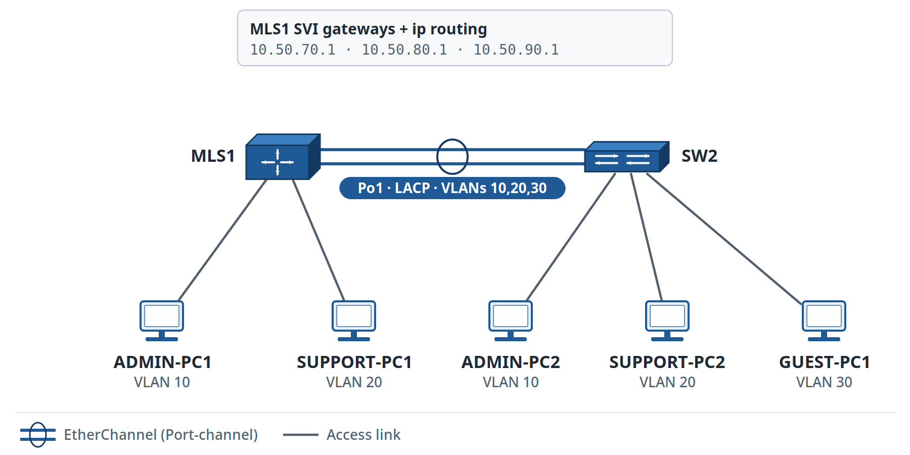

Figure 20. MR-3: Metro NOC Switching Readiness

**Primary platform:** Cisco Packet Tracer

> **Network History: Metro NOC Services.** This review uses `10.50.70.0/24`, `10.50.80.0/24`, and `10.50.90.0/24`, continuing the Metro training range.

### Review Scope

<div align="justify">

MR-3 reviews all of Module 3 in one independent build: VLANs, trunks, multilayer switch routing, Rapid PVST+, edge-port protection, and an LACP EtherChannel.

You finish with a self-inflicted fault, a community-ready help request, and portfolio evidence.

</div>

### Part A: Quick Knowledge Check

Answer without looking at the key.

1.  What is the difference between an access port and a trunk?

2.  What problem does an SVI solve on a multilayer switch?

3.  What command enables IPv4 routing on a multilayer switch?

4.  Why can a trunk carry several VLANs without routing between them?

5.  What is the purpose of Rapid PVST+?

6.  Why is a non-forwarding redundant STP path not automatically a fault?

7.  Where is PortFast normally appropriate?

8.  What does BPDU Guard protect against on an edge port?

9.  What is the difference between LACP active and passive?

10. What evidence proves two physical links are actually bundled into one Port-Channel?

### Part B: Independent Build

Build this Metro NOC Services training design.

### VLAN plan

| **VLAN** | **Name** | **Network** | **Gateway** |
| --- | --- | --- | --- |
| 10 | ADMIN | `10.50.70.0/24` | `10.50.70.1` |
| 20 | SUPPORT | `10.50.80.0/24` | `10.50.80.1` |
| 30 | GUEST | `10.50.90.0/24` | `10.50.90.1` |

### Devices

```text
MLS1
SW2
ADMIN-PC1
ADMIN-PC2
SUPPORT-PC1
SUPPORT-PC2
GUEST-PC1
```

### Design Requirements

- MLS1 performs inter-VLAN routing with SVIs.
- MLS1 and SW2 use a two-link LACP EtherChannel as Port-Channel 1.
- Po1 carries VLANs 10, 20, and 30.
- Access ports use the correct VLAN.
- Approved endpoint ports use PortFast and BPDU Guard.
- The endpoint gateways are the `.1` SVI addresses.

<div align="justify">

Rapid PVST+ is enabled, and MLS1 is the documented preferred root for VLANs 10, 20, and 30. Verify the actual root using STP output. If the selected model lacks the required feature, report that platform limitation rather than claiming a successful configuration.

</div>

- Save your own file.

<div align="justify">

Build from the stated requirements rather than copying a complete configuration from an earlier lab.

</div>

Use earlier labs only as reference when you are stuck.

### Part C: Build Your Verification Plan

<div align="justify">

Before using the command list below, write what you must prove for VLANs, the Port-Channel, the SVIs, the routing table, spanning tree, and neighbor discovery. Then choose at least one command or test for each item.

</div>

### Minimum self-check command set: use after your first attempt

Compare your plan with this minimum command set:

```text
show vlan brief
show interfaces trunk
show etherchannel summary
show ip interface brief
show ip route
show spanning-tree vlan 10
show cdp neighbors
```

Use LLDP too when supported.

Prove:

- all VLANs exist;
- Po1 formed with both members;
- Po1 carries 10/20/30;
- all three SVIs have the correct gateway addresses;
- the routing table contains all three connected networks;
- same-VLAN traffic works;
- inter-VLAN traffic works.

### Part D: STP Interpretation

Use your own:

```text
show spanning-tree vlan 10
```

Identify:

- root bridge;
- root port, if the current switch is not root;
- designated ports;
- Port-Channel appearance.

<div align="justify">

If your topology has only one logical path between MLS1 and SW2, explain why STP does not need to block one EtherChannel member.

</div>

### Part E: Self-Inflicted Fault

<div align="justify">

After proving the healthy build, choose the SW2 access port for `SUPPORT-PC2`.

</div>

Change it from VLAN 20 to VLAN 10.

Keep SUPPORT-PC2's IPv4 address unchanged.

<div align="justify">

Once the fault is in place, hide this instruction and diagnose it from your own tests.

</div>

Treat the symptom as:

> SUPPORT-PC1 cannot reach SUPPORT-PC2.

Use:

> Symptom → Hypothesis → Test → Result → Next Step → Fix → Verify → Document

Leave Po1 unchanged until the evidence points there.

### Part F: Evidence to Share When Asking for Help

<div align="justify">

Pretend that you became stuck before the fix and prepare the evidence you would share with Tier 3 of the Four-Tier Resolution Model.

Write a Tier 3 ITEN community post containing only the evidence needed to understand the problem:

</div>

- one-line symptom;
- what you expected;
- first hypothesis;
- tests already performed;
- selected command evidence;
- what you need help deciding next.

<div align="justify">

Sanitize the post before sharing. Remove credentials, personal information, real customer details, and any hostname or address that could expose a live environment.

Ask for help without including the final answer; share the symptom, evidence, and what you have already tested.

</div>

### Part G: Evidence for Final Report and Portfolio

<div align="justify">

Select these five artifacts as Evidence for Final Report and possible portfolio use:

</div>

1.  final topology screenshot;

2.  `show etherchannel summary`;

3.  `show ip route`;

4.  completed fault hypothesis log;

5.  one-page switching skills summary.

<div align="justify">

These artifacts show more skill than a screenshot that only says "ping successful" because they prove configuration, verification, and troubleshooting work.

</div>

## MR-3 Evidence to Save

Keep locally:

- completed knowledge check;
- your own Packet Tracer file;
- all required verification output;
- STP interpretation;
- fault hypothesis log and closure note;
- Tier 3 community-help example;
- five portfolio artifacts.

## Real-World Bridge: What a Junior Engineer Now Owns

<div align="justify">

After Module 3, you can reasonably practice and discuss junior-level tasks such as:

</div>

- verify access-port VLAN membership;
- verify trunks and allowed VLANs;
- inspect a switch management SVI;
- use CDP/LLDP to confirm neighbors;
- compare router-on-a-stick with multilayer switch routing;
- interpret STP root/port roles;
- apply PortFast/BPDU Guard to approved edge ports;
- verify an LACP EtherChannel;
- collect evidence before changing a switch;
- close an in-scope ticket;
- escalate an out-of-scope issue with useful evidence.

<div align="justify">

You are **not** expected to redesign a production campus, change an enterprise root-bridge policy without approval, or bypass security/WAN ownership boundaries.

</div>

## Final Volume 1 Report, Validation, and Global Learning Teamwork

<div align="justify">

Completing individual labs is only part of the learning process. Your final report should turn your saved lab evidence into a short, reviewable record that another engineer can follow.

</div>

### Complete the assignments first.

Before requesting final validation:

- finish the required Volume 1 assignments;
- complete MR-0, MR-1, MR-2, and MR-3;
- correct known faults;
- select Evidence for Final Report from your Evidence to Save;
- sanitize every item before sharing it.

### Recommended final report structure

Use Markdown, DOCX, or PDF.

#### 1. Cover

Include:

- your name or learner ID;
- Volume 1 title;
- completion date;
- tools used.

#### 2. Assignment index

| **Assignment** | **Status** | **Main evidence** |
| --- | --- | --- |
| Module 0 | Complete / Needs work |  |
| Module 1 | Complete / Needs work |  |
| Module 2 | Complete / Needs work |  |
| Module 3 | Complete / Needs work |  |
| MR-3 | Complete / Needs work |  |

#### 3. Evidence for Final Report

<div align="justify">

Choose only screenshots and command output that prove an important result.

</div>

A balanced final report can include:

- one VLAN/trunk build;
- one inter-VLAN routing design;
- one STP result;
- one LACP EtherChannel result;
- one routing table or SVI result;
- one packet/Simulation Mode observation.

#### 4. Troubleshooting cases

<div align="justify">

Include at least three short cases. Use the same closure structure for each case:

</div>

> Symptom → Root Cause → Corrective Action → Verification → Final Status

Choose cases from different modules.

#### 5. Final MR-3 evidence

<div align="justify">

Include the final topology, important verification commands, and the MR-3 troubleshooting result.

</div>

#### 6. Skills summary

<div align="justify">

In your own words, explain what you can now configure, verify, troubleshoot, document, and escalate.

</div>

### Submit for validation

<div align="justify">

Share the sanitized final report through the ITEN community or social channels when you want volunteer review.

Mentors, senior network-engineer volunteers, working professionals, and experienced community members can review the report when available. The community response window is typically 3 to 7 days, depending on volunteer availability; it is not a guaranteed SLA.

Treat validation as technical feedback, not only as a pass/fail decision. If a reviewer asks for a correction, update the report and show only the new evidence needed to prove the correction.

</div>

### Optional GitHub Publication and Contribution

If you choose to publish or contribute the report after validation:

1.  publish only a sanitized copy with passwords, private keys, tokens, personal data, real customer information, sensitive hostnames, and sensitive addresses removed;

2.  publish from your own GitHub account if you want the report in your portfolio;

3.  follow the contribution instructions of the relevant ITEN GitHub repository;

4.  contribute to an ITEN repository only when learner reports are accepted there, using your own GitHub identity and the repository's normal contribution process.

<div align="justify">

Your report should contain your own configuration evidence, explanations, diagrams, screenshots, and lessons learned. Do not copy book chapters, answer keys, or other learners' reports into your portfolio.

GitHub publication and ITEN repository contribution are optional. Repository maintainers may request changes or decline a contribution according to the repository rules.

A contribution can help the next learner compare approaches and learn from real troubleshooting evidence. That is the goal of the global learning teamwork model.

</div>

### Use the project in your career portfolio.

<div align="justify">

After you genuinely complete the work, you can reference the project in your CV, LinkedIn profile, GitHub portfolio, and interviews.

</div>

Example:

> Junior Network Engineer Practical Lab Portfolio (Cisco Packet Tracer): Built and troubleshot IPv4/IPv6 LANs; configured VLANs, 802.1Q trunks, inter-VLAN routing, Rapid PVST+, PortFast/BPDU Guard, and LACP EtherChannel; documented verification evidence and incident-resolution steps.

<div align="justify">

Describe only skills you actually performed, and name the simulator, emulator, or equipment you actually used.

Completion of this book is project evidence, not a Cisco certification. Claim certification only if you earn it separately.

</div>

## Interview Bridge

Practice answering these without reading commands:

1.  A trunk is up. Why can hosts in different VLANs still fail to communicate?

2.  Router-on-a-stick and multilayer switch routing use the same host gateway addresses. What changes?

3.  Why might STP block a healthy redundant link?

4.  Why should PortFast not be placed on an inter-switch trunk?

5.  How do you prove that an EtherChannel member is actually bundled?

6.  When should a junior engineer escalate instead of trying more switch changes?

Use examples from your own lab evidence.

## Volume 1 Transition

Volume 1 ends with a working foundation in:

- endpoint/network evidence;
- Cisco CLI;
- IPv4/IPv6 addressing;
- subnetting/VLSM;
- VLANs and trunks;
- inter-VLAN routing;
- switch management and discovery;
- Rapid PVST+;
- edge-port protection;
- LACP EtherChannel;
- structured troubleshooting and escalation.

<div align="justify">

The planned Volume 2 moves into IP routing, DHCP/DNS/NAT services, secure remote management, and network security. The planned Volume 3 continues with wireless, network operations, AI/automation interpretation, blind troubleshooting tickets, and integrated capstone work. You do not need those later skills to finish Volume 1.

</div>

# Appendix A: IOS/CLI Error Message Glossary

## Beginner Reference

<div align="justify">

Use this appendix when Cisco IOS gives you an error or an unexpected result.

An error message is evidence. Read it before you type another command.

Change one setting at a time after you understand what the error message means.

</div>

| **Message or symptom** | **Plain-English meaning** | **Common cause** | **First safe response** |
| --- | --- | --- | --- |
| `% Invalid input detected at '^' marker.` | IOS did not understand the command at or near the caret. | Typing error, wrong command, wrong mode, or unsupported command. | Read the prompt. Check the spelling. Use `?` at the point where the command fails. |
| `% Incomplete command.` | The command is valid, but it needs more information. | A required keyword or value is missing. | Type the command again and use `?` to see what can come next. |
| `% Ambiguous command:` | The abbreviation matches more than one command. | Too few letters were typed. | Type more of the command or use `?`. |
| `administratively down, line protocol is down` | The interface is turned off by configuration. | The interface has the `shutdown` command. | Confirm the intended state before you use `no shutdown`. |
| `down, line protocol is down` | The interface is enabled, but the physical or lower-layer path is not working. | Missing cable, wrong port, far-end device off, or media problem. | Check the local link, cable, far-end device, and interface state. |
| `up, line protocol is down` | The physical layer is up, but the data-link layer is not fully operational. | Encapsulation or Layer 2 mismatch can cause this state on some interface types. | Inspect the interface type, configuration, and far-end state before you change anything. |
| `% Access denied` or authentication failure | The device rejected the login or command. | Incorrect credentials, an incorrect authentication method, or insufficient privilege. | Confirm the username, authentication method, and assigned privilege. Do not guess passwords repeatedly. |
| Ping shows only . characters | The sender did not receive replies before timeout. | Many causes are possible: wrong address, missing route, failed link, filtering, or destination unavailable. | Start with the local address and gateway. Then test the path one step at a time. |
| Ping shows `U` or `U.U.U.` | A device returned an unreachable message. | A router can lack a route, or another network-layer problem can exist. | Identify which device returned the message and inspect the relevant routing information. |
| `Destination host unreachable` | The local system or a router cannot reach the destination. | Missing local resolution, missing route, or unreachable next hop. | Identify who generated the message. Then test the local segment or routing path. |
| Command not available in the current mode | IOS accepts the command in another mode. | You are at `>`, `#`, `(config)#`, or an interface prompt that does not support the command. | Read the prompt. Use `?` to confirm the available command set. |
| 169.254.x.x IPv4 address (APIPA) | The host selected an IPv4 link-local address when automatic address assignment did not supply a usable address. | Often the host did not receive a DHCP lease; this address alone does not identify which DHCP or network component failed. | Check the address configuration and link, then verify the DHCP path if DHCP was expected. Full DHCP server/relay work is in Volume 2. |

### How to Read the `^` Marker

```text
Switch# show ip banana
                 ^
% Invalid input detected at '^' marker.
```

<div align="justify">

The caret points near the place where IOS stopped understanding the command.

</div>

Use this sequence:

1.  Read the current prompt.

2.  Check the spelling.

3.  Use ? before the failing part.

4.  Confirm that the command exists on the selected platform.

5.  Change only the command or mode that the evidence shows is wrong.

### Platform Evidence

<div align="justify">

Packet Tracer, CML, IOS, and IOS XE can show different command availability and output.

</div>

If a command from the book is not available:

1.  Record the exact command.

2.  Record the exact error.

3.  Record the device model and platform version.

4.  Check the lab's stated device role and required feature.

5.  Share the exact mismatch with the ITEN community if the command is required for the lab.

<div align="justify">

Record the platform mismatch as evidence instead of inventing a workaround.

</div>

### Cross-References

- Lab 0.3 deliberately triggers `% Invalid input detected at '^' marker`.
- Lab 1.2 uses mode errors for practice.
- Later troubleshooting labs use interface-state and reachability messages.

# Appendix B: Volume 1 Command Reference

## Use This After You Understand the Labs

<div align="justify">

This appendix is a revision aid, not a replacement for the guided labs.

These are command examples, not complete configuration scripts. Use the command mode taught in the corresponding lab. Enter configuration mode before configuration commands and return to privileged EXEC mode before show commands. Replace angle-bracket placeholders with your lab values.

</div>

### Endpoint / Home Evidence

| **Task** | **Example** |
| --- | --- |
| Windows IP information | `ipconfig /all` |
| macOS/Linux interface/IP information | `ifconfig` or `ip addr` where available |
| Reachability | `ping <destination>` |
| Path | `tracert <destination>` / `traceroute <destination>` |
| ARP/neighbor cache | OS-specific ARP/neighbor command |

### IOS Navigation and Configuration

```text
enable
configure terminal
end
exit
show running-config
show startup-config
copy running-config startup-config
```

### Interface Evidence

```text
show ip interface brief
show interfaces
show interfaces status
show running-config interface <interface>
```

### MAC / VLAN / Trunk

```text
show mac address-table
show vlan brief
show interfaces trunk
show interfaces <interface> switchport
```

### CDP / LLDP

```text
show cdp neighbors
show cdp neighbors detail
show lldp neighbors
```

### Management SVI

```text
interface vlan <id>
 ip address <ip> <mask>
 no shutdown
exit
ip default-gateway <gateway>
```

### Router-on-a-Stick

```text
interface g0/0.<vlan-id>
 encapsulation dot1Q <vlan-id>
 ip address <gateway> <mask>
```

### Multilayer Switch Routing

```text
interface vlan <id>
 ip address <gateway> <mask>
 no shutdown
exit
ip routing
end
show ip route
```

### Rapid PVST+

```text
spanning-tree mode rapid-pvst
spanning-tree vlan <list> root primary
spanning-tree vlan <list> root secondary
show spanning-tree summary
show spanning-tree vlan <id>
```

### PortFast / BPDU Guard

```text
spanning-tree portfast
spanning-tree bpduguard enable
show spanning-tree interface <port> detail
```

### LACP EtherChannel

```text
interface range <members>
 channel-group <number> mode active
 channel-group <number> mode passive
interface port-channel <number>
show etherchannel summary
```

<div align="justify">

Choose one LACP mode for each side. The active and passive mode lines above are alternatives; do not apply both to the same member interfaces. At least one side must use active mode.

</div>

### Troubleshooting Core

```text
show vlan brief
show interfaces trunk
show etherchannel summary
show spanning-tree vlan <id>
show ip interface brief
show ip route
ping
traceroute
show logging
```

Use only the commands that match the symptom.

<div align="justify">

Two focused commands that prove the cause are better than ten pages of output.

</div>

# Appendix C: Volume 1 Interface-Name Translation

## Read the Role Before Memorizing the Label

Cisco device models can use different interface names.

Common examples:

| **Full name** | **Common abbreviation** | **Typical role in this volume** |
| --- | --- | --- |
| `FastEthernet0/1` | `Fa0/1` | Endpoint/access port |
| `GigabitEthernet0/1` | `Gi0/1` or `G0/1` | Trunk/uplink |
| `GigabitEthernet0/0` | `Gi0/0` or `G0/0` | Router Ethernet interface |
| `GigabitEthernet0/0.10` | `G0/0.10` | Router subinterface for VLAN 10 |
| `Vlan10` | `Vlan10` | Switch virtual interface |
| `Port-channel1` | `Po1` | Logical EtherChannel interface |

### If your interface names differ

<div align="justify">

If your Packet Tracer model uses a different interface number, keep the network role the same and record the interface you actually used.

Record the interface you used and preserve the intended role.

</div>

Example:

```text
Book figure: SW1 G0/1 <-> SW2 G0/1
Your model:  SW1 G1/0/1 <-> SW2 G1/0/1
```

Focus on these three things:

- Which devices are connected?
- Which ports are access/trunk/routed?
- Which configuration belongs on that link?

## Common Acronyms in Volume 1

<div align="justify">

ARP: Address Resolution Protocol (maps IPv4 neighbors to link-layer addresses). BPDU: Bridge Protocol Data Unit (used by spanning tree). CDP/LLDP: neighbor-discovery protocols. ICMP: control and diagnostic messages, including ping. LACP: Link Aggregation Control Protocol (negotiates EtherChannel).

NOC: Network Operations Center. PDU: Protocol Data Unit (data unit observed in simulation). SLAAC: Stateless Address Autoconfiguration (IPv6 host addressing). STP/Rapid PVST+: loop-prevention spanning tree variants. SVI: Switch Virtual Interface (a VLAN Layer 3 interface). VLAN: Virtual LAN. VLSM: Variable-Length Subnet Masking.

</div>

# Appendix D: Volume 1 Self-Check Key

## Use After You Attempt the Lab

This key gives expected outcomes and concept checks.

It is not a full configuration dump.

## Module 0

- A successful loopback test confirms the local TCP/IP stack, not Internet access.
- A default gateway is used for remote IP networks.
- Two hosts on the same subnet connected through a working switch can communicate without a router.
- A disconnected endpoint link is a physical-layer symptom.
- CLI prompts indicate which IOS mode you are in.

## Module 1

- The running configuration is active; the startup configuration is saved for boot.
- A switch learns source MAC addresses on ingress ports.
- ARP resolves a local IPv4 next-hop IP address to a MAC address.
- **Administratively down** indicates the interface is disabled by configuration.
- **Down/down** indicates a physical or lower-layer failure.
- A misconfigured endpoint default gateway can break remote reachability while local communication still works.

## Module 2

### Drill 2.2 answers

#### Powers of two

| **Expression** | **Answer** |
| --- | --- |
| `2^1` | 2 |
| `2^2` | 4 |
| `2^3` | 8 |
| `2^4` | 16 |
| `2^5` | 32 |
| `2^6` | 64 |
| `2^7` | 128 |
| `2^8` | 256 |

#### Prefix to mask

- `/24` = `255.255.255.0`
- `/25` = `255.255.255.128`
- `/26` = `255.255.255.192`
- `/27` = `255.255.255.224`
- `/28` = `255.255.255.240`

#### Mask to prefix

- `255.255.255.0` = `/24`
- `255.255.255.128` = `/25`
- `255.255.255.192` = `/26`
- `255.255.255.224` = `/27`
- `255.255.255.240` = `/28`

### Drill 2.4 answers

| **Prefix** | **Block size** | **Boundaries** |
| --- | --- | --- |
| `/25` | 128 | 0, 128 |
| `/26` | 64 | 0, 64, 128, 192 |
| `/27` | 32 | 0, 32, 64, 96, 128, 160, 192, 224 |
| `/28` | 16 | 0, 16, 32, 48, 64, 80, 96, 112, 128, 144, 160, 176, 192, 208, 224, 240 |
| `/29` | 8 | multiples of 8 |

Host-network answers:

- `192.168.10.70/26` → `192.168.10.64/26`
- `192.168.10.199/26` → `192.168.10.192/26`
- `10.10.5.35/27` → `10.10.5.32/27`
- `10.10.5.150/27` → `10.10.5.128/27`
- `172.20.8.222/28` → `172.20.8.208/28`

### Key concepts

- Four equal subnets from a `/24` require `/26`.
- `/26` boundaries in the last octet are 0, 64, 128, 192.
- VLSM allocates the largest address blocks first.
- IPv6 link-local addresses are valid only on the local link.
- IPv4 and IPv6 can fail independently in a dual-stack network.

## Module 3

- Access ports usually carry one endpoint VLAN.
- 802.1Q trunks preserve VLAN identity across a shared link.
- Trunks do not route traffic between VLANs.
- Router-on-a-stick uses router subinterfaces.
- A multilayer switch can route between VLAN SVIs when Layer 3 routing is enabled.
- STP may prevent a redundant path from forwarding.
- Use PortFast on approved edge ports, not on inter-switch trunks.
- BPDU Guard protects an edge port if unexpected BPDUs arrive.
- LACP active initiates; passive responds.
- `show etherchannel summary` proves whether members actually joined the logical bundle.
- A one-endpoint symptom begins with endpoint/access-port evidence.
- A one-VLAN-across-trunk symptom starts with VLAN/trunk evidence.
- Healthy local switching plus failed remote service can require escalation instead of more local changes.

## MR-3 answers

1.  An access port connects an endpoint to a single data VLAN, while a trunk carries multiple VLANs between network devices.

2.  An SVI provides a Layer 3 interface and gateway for a VLAN.

3.  `IP routing`.

4.  802.1Q preserves VLAN identity; a Layer 3 function still routes between different IP networks.

5.  Rapid PVST+ prevents Layer 2 loops while keeping redundancy available.

6.  STP can intentionally keep a redundant logical path from forwarding.

7.  PortFast belongs on approved endpoint/edge ports.

8.  BPDU Guard protects an edge port when unexpected BPDUs indicate a switch/bridge connection.

9.  LACP active initiates negotiation; passive responds.

10. `show etherchannel summary` must show the Port-Channel and intended members participating/bundled.

<div align="justify">

For the MR-3 fault, restore SUPPORT-PC2's access port to VLAN 20 and repeat the original Support-to-Support test.

</div>

# Appendix E: Official Resources and Version Checks

Networking tools and certification topics change over time.

Use these official sources when you need the current version:

- [Cisco Networking Academy: Getting Started with Cisco Packet Tracer](https://www.netacad.com/courses/getting-started-cisco-packet-tracer/1000)
- [Cisco Networking Academy: Packet Tracer downloads / Resource Hub](https://www.netacad.com/resources/lab-downloads)
- [Cisco CCNA® certification page](https://www.cisco.com/site/us/en/learn/training-certifications/certifications/enterprise/ccna/index.html)
- [Cisco 200-301 CCNA® v1.1 exam topics (current through 2 February 2027)](https://learningcontent.cisco.com/documents/marketing/exam-topics/200-301-CCNA-v1.1.pdf)
- [Cisco 200-301 CCNA® v2.0 exam topics (launches 3 February 2027)](https://learningcontent.cisco.com/documents/marketing/exam-topics/200-301_CCNA_v2.0_Exam_Topics_PDF.pdf)

<div align="justify">

Verified 30 September 2026: Cisco states that the 200-301 CCNA v1.1 remains the active exam through 2 February 2027, with v2.0 launching on 3 February 2027. Check Cisco before registering, as exam versions and dates can change.

</div>

- [Wireshark: Official Download](https://www.wireshark.org/download.html)

<div align="justify">

This book teaches durable junior network engineer skills. Exam topic numbers and simulator behavior can change.

If your output differs from an example, compare the fields that prove the technical state. Spacing, timers, IDs, and counters can vary and do not need to match the example exactly.

</div>

## Selected technical references used in this volume

<div align="justify">

These links are for deeper checking after you understand the lab. They are not required reading for every assignment.

</div>

[Microsoft Learn: ipconfig](https://learn.microsoft.com/en-us/windows-server/administration/windows-commands/ipconfig)

[Microsoft Learn: nslookup](https://learn.microsoft.com/en-us/windows-server/administration/windows-commands/nslookup)

[Microsoft Learn: tracert](https://learn.microsoft.com/en-us/windows-server/administration/windows-commands/tracert)

[Wireshark: User's Guide](https://www.wireshark.org/docs/wsug_html/)

[Cisco IOS Configuration Fundamentals: saving configuration](https://www.cisco.com/c/en/us/td/docs/ios-xml/ios/fundamentals/command/cf_command_ref/C_commands.html)

[Cisco: IPv6 Addressing and Basic Connectivity](https://www.cisco.com/c/en/us/td/docs/ios/ipv6/configuration/guide/ipv6-xe-16-book-cat8000/m_ip6-addrg-bsc-con.html)

[RFC Editor: RFC 3849: IPv6 documentation prefix](https://www.rfc-editor.org/info/rfc3849/)

[Cisco: VLAN Configuration Guide: Configure VLAN Trunking](https://www.cisco.com/c/en/us/td/docs/switches/lan/c9000/lyr2-fwd/vlan/vlan-configuration-guide/configure-vlan-trunks.html)

[Cisco: Spanning Tree Protocol Configuration Guide](https://www.cisco.com/c/en/us/td/docs/switches/lan/c9000/lyr2-fwd/stp/stp-configuration-guide/m-stp.html)

[Cisco: Optional Spanning-Tree Features: PortFast and BPDU Guard](https://www.cisco.com/c/en/us/td/docs/switches/lan/catalyst9200/software/release/17-15/configuration_guide/lyr2/b_1715_lyr2_9200_cg/configuring_optional_spanning_tree_features.html)

[Cisco: EtherChannel Configuration Guide: LACP and EtherChannels](https://www.cisco.com/c/en/us/td/docs/switches/lan/c9000/lyr2-fwd/etherchannel/etherchannel-configuration-guide/etherchannels.html)

[Cisco Networking Academy: Use Ping and Traceroute to Test Network Connectivity](https://www.netacad.com/content/itn/1.0/courses/content/m13/en-US/assets/13.3.2-packet-tracer---use-ping-and-traceroute-to-test-network-connectivity---physical-mode.pdf)

### Publication, license, and trademark references

<div align="justify">

These links support the publication and asset-use statements in this edition.

</div>

[Creative Commons: Attribution 4.0 International (CC BY 4.0)](https://creativecommons.org/licenses/by/4.0/)

[Cisco: Copyright Use and Policies](https://www.cisco.com/c/en/us/about/brand-center/copyright-use.html)

[Cisco: Network Topology Icons](https://www.cisco.com/c/en/us/about/brand-center/network-topology-icons.html)

[Cisco: Trademarks](https://www.cisco.com/c/en/us/about/legal/trademarks.html)
