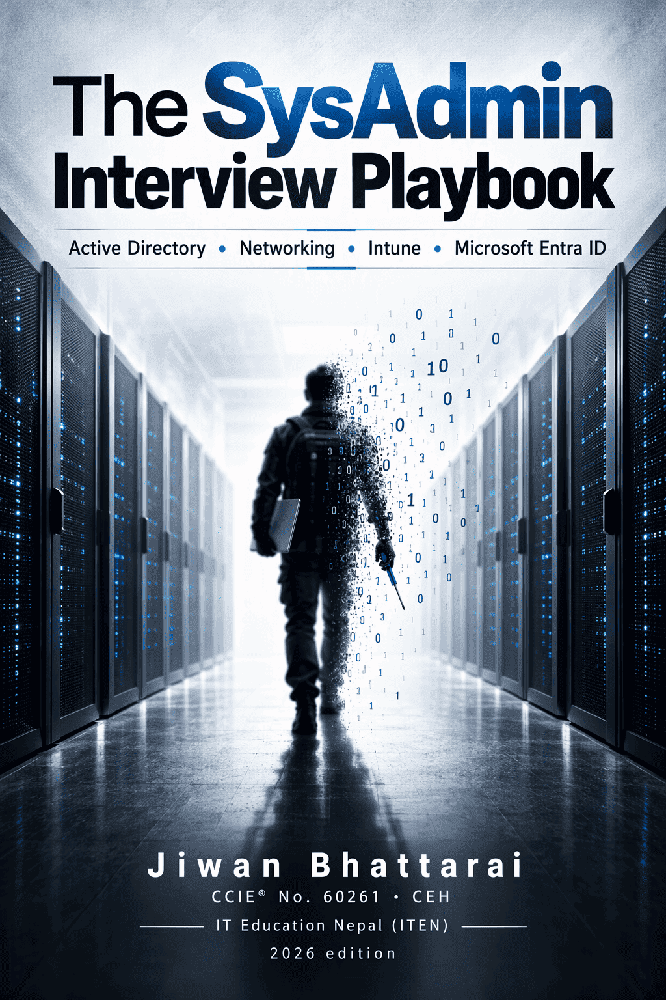

# The SysAdmin Interview Playbook

Interview questions · Model answers · Practical guidance

Active Directory · Networking · Intune · Microsoft Entra ID

**Jiwan Bhattarai**  
CCIE® No. 60261 · CEH  
IT Education Nepal (ITEN) · 2026 edition

[Start reading](#section-1) · [Contents](#contents) · [Scenario drills](#section-5) · [Rapid revision](#section-6) · [References](#references)

<p align="center">
  
</p>

<a name="contents"></a>

## Contents

- [About this book](#about-this-book)
- [Publication and license information](#publication-and-license)
- [About IT Education Nepal](#about-iten)
- [About the author](#about-the-author)
- [How to use this guide](#how-to-use)

- [Section 1: Active Directory and Windows Server fundamentals](#section-1)
- [Section 2: Core networking concepts](#section-2)
- [Section 3: Microsoft Intune](#section-3)
- [Section 4: Microsoft Entra ID and Microsoft 365](#section-4)
- [Section 5: Scenario drills from support desk to administrator](#section-5)
- [Section 6: Rapid revision](#section-6)

- [Words to know](#glossary)
- [References and verification](#references)

<a name="about-this-book"></a>

## About this book

This practical guide prepares you for IT support and system administrator interviews through four interconnected topics: Active Directory and Windows Server, core networking, Microsoft Intune, and Microsoft Entra ID with Microsoft 365. It explains key concepts, shows how to diagnose common faults, and provides clear model answers.

Each question has three answer sections: Short answer, In practice, and Suggested response. A follow-up question leads into the Suggested response. Practical notes and summaries explain what to check, why it matters, and how to verify the outcome. Eight scenarios develop the same reasoning, from the initial symptom to a safe, tested resolution.

The primary audience is entry-level applicants, help desk technicians, and junior administrators. More experienced candidates can use the scenario drills for review. This volume focuses on the four subjects listed above. Practice in a lab or an authorized test tenant using supported operating systems and tools. Before running a command in production, make sure you understand its effect and that you have the authority to run it.

<a name="publication-and-license"></a>

### Publication and license information

Published by IT Education Nepal (ITEN). This independent educational publication is not sponsored, endorsed, approved, or affiliated with Microsoft, Cisco, or any other vendor.

© 2026 IT Education Nepal (ITEN). Unless otherwise credited, original ITEN text and document artwork are licensed under the Creative Commons Attribution 4.0 International License (CC BY 4.0). Attribution must identify the creator, link to the license, and indicate changes. The license does not cover vendor trademarks or linked third-party materials; those remain subject to their own terms.

License details: [Creative Commons Attribution 4.0 International](https://creativecommons.org/licenses/by/4.0/)

Microsoft, Windows, Microsoft 365, Microsoft Entra, Intune, Cisco, and other product names are trademarks or registered trademarks of their respective owners. We use them here solely for descriptive purposes.

2026 edition

<a name="about-iten"></a>

## About IT Education Nepal

IT Education Nepal (ITEN), कम्प्युटर शिक्षा सबैका लागि (Computer Education for All), is a volunteer-driven, nonprofit initiative providing practical computer education to Nepali speakers worldwide. Founded on the principle that technology literacy is a universal right, it works to remove geographic, language, and financial barriers that keep many learners out of IT education.

Let us learn and grow together. संगै सिकौं, संगै बढौं!

Website: [iteducationnepal.org](https://iteducationnepal.org)

YouTube: [IT Education Nepal on YouTube](https://www.youtube.com/@iteducationnepal)

GitHub: [ITEN Non-Profit on GitHub](https://github.com/ITEN-Non-Profit)

LinkedIn: [IT Education Nepal on LinkedIn](https://www.linkedin.com/company/iteducationnepal)

Facebook community: [IT Education Nepal community](https://www.facebook.com/groups/iteducationnepal)

Telegram: [IT Education Nepal on Telegram](https://t.me/iteducationnepal)

<a name="about-the-author"></a>

## About the author

Jiwan Bhattarai holds the Cisco Certified Internetwork Expert (CCIE®) certification #60261 and the Certified Ethical Hacker (CEH) certification, along with several global IT certifications. He has worked in the international IT industry and mentors students and early-career engineers on technical skills and career growth.

LinkedIn: [Jiwan Bhattarai’s profile](https://www.linkedin.com/in/jiwanbhattarai)

Website: [Jiwan Bhattarai’s website](https://www.jiwanbhattarai.com)

Acknowledgments: Special thanks to [Alina Ghimire](https://www.linkedin.com/in/alina-ghimire/) for generously sharing her experience in system administration and security while writing this book.

<a name="how-to-use"></a>

## How to use this guide

Read the sections in order first, then revisit difficult topics using the question links in the contents or GitHub’s Outline.

**Short answer:** start with the direct answer. Most responses take about 20 to 40 seconds aloud; allow longer when a list or calculation needs explanation. Explain the idea in your own words.

**In practice:** connect the answer to a task, example, tool or test result. Tables, practical summaries and mentor notes sit within this section, beside the question they support.

Follow-up and Suggested response: practice the follow-up, then compare your reasoning with the model response. The follow-up is a question; Suggested response is the third answer section.

**Mentor note:** practical guidance on what to check first, when to involve a senior engineer, and how to confirm the result.

Use the contents, section question lists, or GitHub’s Outline to jump to a section, question, or scenario. Select a reference number to open its source entry, then its linked publication title to read the official documentation.

Level tags: Entry introduces a concept; Junior adds practical troubleshooting; Administrator requires broader operational judgment. Every question uses the same three answer sections. Read the practical detail after you can explain the short answer clearly.

For the last week of preparation, practice answers out loud, review the scenario drills, and test yourself with Rapid Revision. If you have not performed a task, state that and describe the safe steps you would take in a lab or with a senior engineer.

Scope and progression: the four domains prepare you for the interview topics named on the cover. They do not replace a full Windows Server, networking, endpoint-management, or cloud-security curriculum. Use the level tags to choose your depth, then test the corresponding scenario. When you lack direct experience, say so and describe an approved lab approach.

<a name="section-1"></a>

## Section 1: Active Directory and Windows Server fundamentals

<details>
<summary>Browse this section</summary>

- [Q1. What is Active Directory Domain Services (AD DS)? (Entry)](#s1-q1)
- [Q2. What is a domain controller, and what does it do? (Entry)](#s1-q2)
- [Q3. What is the difference between a workgroup and a domain? (Entry)](#s1-q3)
- [Q4. Why is DNS so important in Active Directory? (Entry + Junior)](#s1-q4)
- [Q5. What does DHCP do? (Entry)](#s1-q5)
- [Q6. What is Group Policy, and what is a Group Policy Object (GPO)? (Entry + Junior)](#s1-q6)
- [Q7. In what order are Group Policy Objects processed? (Junior + Administrator)](#s1-q7)
- [Q8. What is the difference between NTFS and share permissions? (Junior)](#s1-q8)
- [Q9. What are the FSMO roles? (Junior + Administrator)](#s1-q9)
- [Q10. What should you check if a user cannot log on to the domain? (Junior)](#s1-q10)
- [Q11. How do you check Active Directory health and replication? (Junior + Administrator)](#s1-q11)
- [Q12. Which PowerShell commands should an AD administrator know? (Junior)](#s1-q12)
- [Q13. How do you back up and restore a domain controller? (Administrator)](#s1-q13)
- [Q14. How do you harden Active Directory and Windows file services? (Administrator)](#s1-q14)
- [Quick recap: Active Directory](#section-1-recap)

</details>

Before you start: Know the difference between a user account and a computer account, a client and a server, an IP address and DNS, and basic Windows permissions. The glossary explains unfamiliar terms.

<a name="s1-q1"></a>

### Q1. What is Active Directory Domain Services (AD DS)? (Entry)

**Short answer:** AD DS is Microsoft’s directory service for Windows domains. It stores objects such as users, computers, and groups, supports authentication, and provides identity and group information for access decisions. Domain controllers (DCs) run AD DS, and Group Policy uses the directory to target settings.

**In practice:** The directory database is `NTDS.dit`. AD DS organizes objects into forests, domains, and organizational units (OUs). Clients locate domain services through DNS and query the directory using LDAP. Kerberos is the standard domain authentication protocol; NTLM can still be used where permitted. Writable DCs replicate directory changes among themselves. A read-only domain controller (RODC) receives a read-only replica; clients needing to write to the directory must use a writable DC.

**Active Directory structure**

1. Forest (top boundary)

2. Domain: `ad.example.com`

3. OUs: Sales | IT | Accounts

4. Users, computers, and groups

Note: A forest can contain multiple domains. OUs organize objects within a particular domain.

**Follow-up:** What is the difference between a forest, a domain, and an OU?

**Suggested response:** A forest is the AD security boundary and contains one or more domains that share a schema and configuration. A domain holds accounts and other objects. An OU organizes objects within a domain and supports delegated administration and Group Policy targeting.

References: [R01](#ref-r01) · [R02](#ref-r02) · [R05](#ref-r05) · [R38](#ref-r38)

[↑ Section contents](#section-1) · [↑ Book contents](#contents)

<a name="s1-q2"></a>

### Q2. What is a domain controller, and what does it do? (Entry)

**Short answer:** A domain controller runs AD DS and responds to directory and domain authentication requests. It stores the directory database and participates in replication. Writable DCs accept changes; an RODC receives a read-only copy and has additional credential-caching restrictions.

**In practice:** A Global Catalog holds a full copy of its own domain partition and a partial, read-only copy of other domain partitions, supporting forest searches and relevant logon checks. SYSVOL holds Group Policy files and logon scripts and is replicated separately using DFS Replication in supported modern domains. The five FSMO roles in Q9 assign specific operations to individual writable DCs.

**Follow-up:** Does every site need its own Global Catalog server?

**Suggested response:** No. In a multidomain forest, I would consider application needs, WAN reliability, and logon requirements. Universal group membership caching can reduce a small site’s dependency on a remote Global Catalog, but it requires initial population and refresh. In a single-domain forest, Microsoft recommends making all DCs Global Catalogs.

References: [R01](#ref-r01) · [R02](#ref-r02) · [R05](#ref-r05) · [R38](#ref-r38)

[↑ Section contents](#section-1) · [↑ Book contents](#contents)

<a name="s1-q3"></a>

### Q3. What is the difference between a workgroup and a domain? (Entry)

**Short answer:** In a workgroup, each computer manages its own local accounts and settings. A domain centralizes accounts, authentication, and policy through AD DS. A domain account can be used on authorized domain resources, subject to permissions, sign-in rights, and connectivity. I would choose the model based on management and application needs.

**In practice:** Workgroup computers can use Local Group Policy and local password policies. They do not receive AD domain GPOs or share a central domain account database. Domains provide centralized policy, delegated administration, and consistent account management across many computers.

**Follow-up:** When is a workgroup no longer sufficient?

**Suggested response:** When separate local accounts and manual settings become difficult to maintain across many computers. A domain provides central account management, consistent policy, and delegated administration as the environment grows.

References: [R01](#ref-r01) · [R02](#ref-r02) · [R05](#ref-r05) · [R38](#ref-r38)

[↑ Section contents](#section-1) · [↑ Book contents](#contents)

<a name="s1-q4"></a>

### Q4. Why is DNS so important in Active Directory? (Entry + Junior)

**Short answer:** AD DS depends on DNS to locate domain controllers and other domain services. A client needs more than a working internet name lookup: it must resolve the AD service records. Incorrect DNS is an important cause to investigate when domain discovery or logon fails.

In practice: Domain controllers publish DNS service records, including LDAP records such as `_ldap._tcp.dc._msdcs.<domain>`, which domain members use for DC discovery. Clients must query DNS infrastructure that can resolve the relevant AD zones, typically internal AD-integrated DNS servers. Pointing a domain computer directly to a public resolver will usually prevent discovery of private AD records unless that resolver has a deliberately configured route to the AD namespace. Before changing the account, I would check the active DNS servers, name resolution, and DC discovery.

**How a client finds a domain controller**

1. Client asks DNS

2. DNS returns SRV records

3. Client selects a suitable DC

4. Client contacts an available DC for authentication

**Practical note:** Client discovery depends on access to the domain's DNS records. An unrelated public resolver generally cannot answer private AD queries.

**Follow-up:** A client uses a public DNS resolver and cannot find a domain controller. What do you verify?

**Suggested response:** I would run `ipconfig /all` in PowerShell to check the client’s DNS settings. For the sample domain, I would run `Resolve-DnsName -Type SRV _ldap._tcp.dc._msdcs.ad.example.com` to query DC service records, replacing the sample domain with the actual domain. I would correct the DNS configuration if the evidence supports it, then verify DC discovery and a live logon. A DNS answer alone does not prove a DC is reachable.

References: [R03](#ref-r03) · [R04](#ref-r04) · [R15](#ref-r15) · [R70](#ref-r70)

[↑ Section contents](#section-1) · [↑ Book contents](#contents)

<a name="s1-q5"></a>

### Q5. What does DHCP do? (Entry)

**Short answer:** Dynamic Host Configuration Protocol (DHCP) automates IP configuration. DHCPv4 commonly provides an address, subnet mask, default gateway, and DNS servers, reducing manual work and configuration errors. Static addressing remains appropriate for some systems.

**In practice:** A new DHCPv4 client typically exchanges Discover, Offer, Request, and Acknowledgment messages (DORA). Lease duration is configurable. DHCPv4 uses UDP port 67 on servers and UDP port 68 on clients; a relay forwards traffic between subnets. When no usable lease is available, or the DHCP server is out of contact, a DHCP-configured Windows client may assign itself a 169.254.0.0/16 link-local address. However, it may continue using an existing valid lease. Windows DHCP failover coordinates supported IPv4 scopes between two servers.

**Initial DHCPv4 allocation: DORA**

| **Step** | **Message** | **Direction** | **Description** |
| --- | --- | --- | --- |
| 01 | Discover | Client → Server | Client broadcasts to locate available DHCP servers. |
| 02 | Offer | Server → Client | Server responds with an available IP address configuration offer. |
| 03 | Request | Client → Server | Client requests the offered address lease from the selected server. |
| 04 | ACK | Server → Client | Server confirms lease assignment and sends final parameters. |

**Practical note:** A 169.254.x.x address on a DHCP-configured Windows client is a strong clue to investigate DHCP, not proof that every DHCP server is down.

**Other DHCPv4 messages: conditional, not later DORA steps**

| **Message** | **Direction** | **When it is used** |
| --- | --- | --- |
| NAK | Server → Client | Server refuses the requested IP address (for example, if invalid or expired). |
| Decline | Client → Server | Client rejects the offered IP because it is already in use on the network. |
| Release | Client → Server | Client informs the server that it is giving up its assigned IP lease. |
| Inform | Client → Server | Client asks for network options (like DNS) without requesting an IP address. |

**Follow-up:** Two DHCP servers reply at the same time. Which offer is accepted?

**Suggested response:** The client selects an offer based on its implementation; the first suitable offer is common but not guaranteed. It broadcasts a DHCPREQUEST identifying the selected server. To avoid conflicts, I would use a coordinated failover pair or non-overlapping pools so that independent servers cannot allocate conflicting leases.

References: [R03](#ref-r03) · [R04](#ref-r04) · [R15](#ref-r15) · [R70](#ref-r70)

[↑ Section contents](#section-1) · [↑ Book contents](#contents)

<a name="s1-q6"></a>

### Q6. What is Group Policy, and what is a Group Policy Object (GPO)? (Entry + Junior)

**Short answer:** Group Policy lets administrators centrally configure and enforce settings for domain-joined users and computers. Examples include password policies, USB restrictions, desktop settings, Windows Update behavior, software deployment, and security configuration. Settings are stored in Group Policy Objects and linked to sites, domains, and OUs.

**In practice:** Computer Configuration is processed at startup, and User Configuration at logon. By default, member computers check for changes every 90 minutes plus a random offset of up to 30 minutes; DCs check computer policy every five minutes. Some extensions require startup or logon. `gpupdate /force` requests reapplication; it does not bypass filtering or replication. I would use `gpresult /r` or `gpresult /h report.html` to inspect the resultant policy.

**Follow-up:** The policy has not arrived after one hour. What do you do?

**Suggested response:** One hour may be within the normal refresh interval. I would check assignment, DC connectivity, and replication, then request a refresh if appropriate. I would review gpresult and Group Policy Operational events to see what applied or failed. I would verify the setting itself; some changes require sign-out or restart.

References: [R05](#ref-r05) · [R38](#ref-r38) · [R40](#ref-r40) · [R44](#ref-r44)

[↑ Section contents](#section-1) · [↑ Book contents](#contents)

<a name="s1-q7"></a>

### Q7. In what order are Group Policy Objects processed? (Junior + Administrator)

**Short answer:** Group Policy is normally processed in LSDOU order: Local, Site, Domain, then organizational unit, with parent OUs before child OUs. Applicable settings accumulate. For a conflicting setting, later policy normally takes precedence, subject to enforced links, inheritance, filtering and link order.

**In practice:** Block Inheritance on a domain or OU blocks inherited domain-based links, except enforced ones. An Enforced link prevents lower-level conflicting settings from overriding it and survives Block Inheritance. Security permissions and Windows Management Instrumentation (WMI) filters still affect applicability. Loopback Merge adds user settings from the computer’s location after the user’s normal policy; Replace uses the computer-based list instead. At one location, link order 1 has the highest precedence.

**Mentor note:** Trace one setting through the Local, Site, Domain and OU levels. Then explain how an enforced link or blocked inheritance changes the result. Use the resulting setting as evidence, rather than relying on the acronym alone.

**Group Policy: normal processing order**

| **Normal processing order** | **What is processed** |
| --- | --- |
| 1 · Local | Local policy on the device |
| 2 · Site | Applicable site-linked GPOs |
| 3 · Domain | Applicable domain-linked GPOs |
| 4 · OU, then child OU | Applicable links from parent to closest OU |

**Follow-up:** An OU policy and an Enforced domain policy give different values. Which one wins?

**Suggested response:** The Enforced domain policy wins. Enforced stops lower levels from overriding it. It also beats Block Inheritance.

References: [R05](#ref-r05) · [R38](#ref-r38) · [R40](#ref-r40) · [R44](#ref-r44)

[↑ Section contents](#section-1) · [↑ Book contents](#contents)

<a name="s1-q8"></a>

### Q8. What is the difference between NTFS and share permissions? (Junior)

**Short answer:** NTFS permissions apply to files and folders on an NTFS volume and protect the resource whether it is accessed locally or over the network. Share permissions apply only when a folder is accessed through its network share. When both are present, the effective access is the most restrictive combination of the two.

**In practice:** I would set both share and NTFS permissions deliberately, preferably using groups and the principle of least privilege. Broad share permissions with tighter NTFS permissions are a design choice, not a requirement. Within an ACL, allowed rights can accumulate across groups. Windows evaluates entries in order: explicit entries normally precede inherited ones and deny takes priority over allow at each inheritance level. “Deny always wins” is an unsafe shortcut. I would confirm effective access for the actual user and access path.

**Follow-up:** The share allows access, but the user is denied. Where should you look?

**Suggested response:** I would inspect NTFS permissions, inheritance, and the user’s current group token. Effective Access helps with the NTFS calculation; I would check share permissions separately and test the intended network path with that user. Copying or moving files can also change inherited permissions.

References: [R37](#ref-r37) · [R42](#ref-r42)

[↑ Section contents](#section-1) · [↑ Book contents](#contents)

<a name="s1-q9"></a>

### Q9. What are the FSMO roles? (Junior + Administrator)

**Short answer:** The five Flexible Single Master Operations (FSMO) roles are Schema Master, Domain Naming Master, RID Master, PDC Emulator and Infrastructure Master. Each role has one writable domain controller as its holder at the relevant forest or domain scope. Different DCs can hold different roles.

**In practice:** I would use netdom query fsmo to see the role holders and `dcdiag` to investigate health. A failed role holder does not necessarily stop logons immediately. I would transfer roles during planned maintenance; I would seize a role only as part of a documented recovery plan when the old role holder will not safely return. I would check the specific role's impact before changing ownership.

Schema Master (one per forest): controls changes to the AD schema.

Domain Naming Master (one per forest): controls adding and removing domains in the forest.

RID Master (one per domain): allocates relative identifier pools so DCs can create unique security principals.

PDC Emulator (one per domain): receives preferential password-change replication, helps process bad-password checks and lockouts, and participates in the domain time hierarchy.

Infrastructure Master (one per domain): maintains cross-domain object references where needed; its work changes when all DCs are Global Catalogs or AD Recycle Bin is enabled.

**Follow-up:** The PDC Emulator is offline for one day. What might fail?

**Suggested response:** Other DCs can still authenticate users, but bad-password referral, recent password-change handling, lockout processing, and time synchronization may be affected. The impact depends on replication, clock drift, and the services in use; there is no guaranteed failure order.

References: [R36](#ref-r36) · [R44](#ref-r44)

[↑ Section contents](#section-1) · [↑ Book contents](#contents)

<a name="s1-q10"></a>

### Q10. What should you check if a user cannot log on to the domain? (Junior)

**Short answer:** I would confirm the user’s identity, the exact error, the time, and who else is affected. I would check connectivity, AD DNS, and DC discovery, then account status, password expiration, and sign-in restrictions. I would review the relevant client and DC logs before changing the account. I would treat repeated or suspicious failures as a possible security incident.

**In practice:** I would check clock synchronization and the computer’s secure channel. The default Kerberos clock tolerance is five minutes, but I would verify the configured policy. From an elevated Windows prompt, `w32tm /query /status` shows local time-source information. `Test-ComputerSecureChannel -Verbose` requires elevation and tests a domain member’s trust, not a DC. I would investigate failures before an authorized repair. Cached credentials can permit offline sign-in without confirming that live domain authentication works.

**Mentor note:** Diagnose the cause before resetting a password. Start with the scope of the failure, then check the network path, DNS, account state, time, and the secure channel. Document which check supported your conclusion.

**Domain logon checks, in order**

1. Network connection (Can it reach the network?)

2. DNS (Can it find the server?)

3. Account state (Is the account active and unlocked?)

4. Clock time (Is the time correct?)

5. Secure channel (Is the computer trust valid?)

**Practical note**: Capture evidence before changing credentials. Check the configured Kerberos time tolerance rather than assuming five minutes is safe.

**Follow-up:** How do you determine why an account was locked out?

**Suggested response:** First, I would record the lockout time and review Security event 4740 on the relevant DCs; the PDC Emulator is a useful starting point. I would use the Caller Computer Name where present, then correlate failed logons and inspect the source for saved credentials, services, scheduled tasks, or applications. The source may be an intermediary rather than the original device. I would address the source before an authorized unlock, where possible. If urgent access restoration is approved, I would preserve evidence first, then continue investigating. I would confirm a successful sign-in and monitor for another lockout.

References: [R03](#ref-r03) · [R06](#ref-r06) · [R35](#ref-r35) · [R67](#ref-r67) · [R74](#ref-r74) · [R80](#ref-r80) · [R81](#ref-r81)

[↑ Section contents](#section-1) · [↑ Book contents](#contents)

<a name="s1-q11"></a>

### Q11. How do you check Active Directory health and replication? (Junior + Administrator)

**Short answer:** I would use `dcdiag` to test a domain controller's (DC) health. I would use `repadmin /replsummary` to see a replication summary. I would use `repadmin /showrepl` to see inbound replication partners and the result of each attempt. I would run these tools from an elevated prompt with an account that has the appropriate administrative permissions. These tools can run on a DC or on a Windows computer with the Remote Server Administration Tools (RSAT). A clean result is a good sign, but it doesn't prove every directory function is healthy.

**In practice**: `Get-ADDomainController -Filter *` lists the DCs. `Get-ADReplicationPartnerMetadata -Target DC01` shows the replication partners of the named server; I would replace DC01 with the target DC's name. I would look for errors and the time of the last successful replication. Then I would check the Directory Service, DNS, and System event logs, as well as the site and subnet settings. After fixing a problem, I would run the failed test again. Then I would verify that a change made on one DC appears on the others.

**Follow-up**: `dcdiag` shows an error you do not know. What do you do next?

**Suggested response:** First, I would read the name of the failed test and its full output. Then I would read the Directory Service event log on that server. I would not change any settings until I know which service has failed.

References: [R07](#ref-r07) · [R39](#ref-r39) · [R40](#ref-r40) · [R44](#ref-r44)

[↑ Section contents](#section-1) · [↑ Book contents](#contents)

<a name="s1-q12"></a>

### Q12. Which PowerShell commands should an AD administrator know? (Junior)

**Short answer:** I use `Get-ADUser` and `Get-ADComputer` to inspect accounts, `Search-ADAccount` to find locked accounts, and the replication cmdlets to investigate DCs. `Unlock-ADAccount` and `Set-ADAccountPassword` change state, so I use them only for an authorized, verified target after investigating the cause.

**In practice:** AD cmdlets require the ActiveDirectory module from Remote Server Administration Tools (RSAT), AD connectivity, and appropriate read or delegated change rights. These examples use Windows PowerShell 5.1. `Invoke-GPUpdate` also requires the GroupPolicy module, target administration rights and access through the remote scheduled-task firewall rules. I would replace sample identities and distinguished names. Queries return evidence; unlocks, resets, and refreshes change state.

#### Find a user

Read-only query; inspect account state.

**Example command:**

```powershell
Get-ADUser -Identity jdoe -Properties Enabled, LockedOut, PasswordExpired
```

#### List locked accounts

A list is evidence, not a reason to unlock all accounts.

**Example command:**

```powershell
Search-ADAccount -LockedOut -UsersOnly
```

#### Unlock one account

Delegated change right; investigate the source first.

**Example command:**

```powershell
Unlock-ADAccount -Identity jdoe
```

#### Reset one password

Delegated reset right; securely deliver the new credential and verify access.

**Example command:**

```powershell
Set-ADAccountPassword -Identity jdoe -Reset -NewPassword (Read-Host 'New password' -AsSecureString)
```

#### Find computers in an OU

Read-only query; replace the distinguished name.

**Example command:**

```powershell
Get-ADComputer -Filter * -SearchBase 'OU=Workstations,DC=corp,DC=example,DC=com'
```

#### Test the local member trust

Elevated Windows PowerShell; not a DC test. True means this test passed.

**Example command:**

```powershell
Test-ComputerSecureChannel -Verbose
```

#### List DCs

Read-only discovery; it does not certify health.

**Example command:**

```powershell
Get-ADDomainController -Filter *
```

#### Request remote Group Policy refresh.

Authorized remote task scheduling; validate completion on PC01.

**Example command:**

```powershell
Invoke-GPUpdate -Computer PC01 -Force -RandomDelayInMinutes 0
```

**Before and after a change:** Confirm the intended account or target before executing. An unlock does not remove the lockout source; a password reset may invalidate stored service credentials. Check the account state again and verify an authorized sign-in. Some policy changes require sign-out or restart; validate the specific target setting with gpresult and a functional check.

**Follow-up:** How do you list disabled accounts in one OU?

**Suggested response:** With the ActiveDirectory module and read permission, I would use `Get-ADUser -Filter 'Enabled -eq $false' -SearchBase 'OU=Sales,DC=corp,DC=example,DC=com'`. I would replace the distinguished name and confirm the results are within the intended OU. This is a read-only query.

References: [R07](#ref-r07) · [R39](#ref-r39) · [R40](#ref-r40) · [R44](#ref-r44)

[↑ Section contents](#section-1) · [↑ Book contents](#contents)

<a name="s1-q13"></a>

### Q13. How do you back up and restore a domain controller? (Administrator)

**Short answer:** I would use Windows Server Backup or a supported AD-aware backup product with a tested recovery plan. A non-authoritative restore receives newer replicated data; an authoritative restore makes selected restored AD objects authoritative. I would plan both directory recovery and whole-server recovery, then test the supported procedure in isolation.

**In practice:** With Windows Server Backup installed, appropriate Backup Operators, administrator or delegated rights, and an elevated prompt, an example is `wbadmin start systemstatebackup -backupTarget:F:`. I would replace F: with an approved, supported backup volume with sufficient space. I would check the job result and backup catalog, then test recovery in isolation. System state is not a substitute for a bare-metal or whole-server recovery plan. I would check backup age, deleted object and tombstone lifetimes, Directory Services Restore Mode (DSRM) access, and the supported restore method. An expired or unsuitable backup can cause replication problems. The AD Recycle Bin can recover eligible objects only if enabled before deletion. VM-GenerationID safeguards do not make arbitrary snapshot rollback a backup strategy. I would follow the forest recovery guide for major failures.

**Mentor note:** Perform a supported restore in a disposable test forest. Prepare a written recovery plan, identify the approver, and confirm AD replication and DNS after recovery. Production DC recovery is not a trial-and-error process.

**Follow-up:** You deleted an OU by mistake this morning. What do you try first?

**Suggested response:** I would confirm that the AD Recycle Bin was enabled before deletion and that the objects remain recoverable. I would restore the OU hierarchy and its children in the correct order using Active Directory Administrative Center or `Restore-ADObject` with the specific object identity and appropriate rights. I would verify membership, links, and access. Enabling the Recycle Bin after deletion does not recover previously deleted objects.

References: [R08](#ref-r08) · [R09](#ref-r09) · [R10](#ref-r10) · [R11](#ref-r11) · [R41](#ref-r41) · [R42](#ref-r42)

[↑ Section contents](#section-1) · [↑ Book contents](#contents)

<a name="s1-q14"></a>

### Q14. How do you harden Active Directory and Windows file services? (Administrator)

**Short answer:** I would use least privilege, protect administrative endpoints, and use Windows LAPS for managed local administrator passwords. I would audit LDAP clients before enforcing signing and applicable TLS channel binding. I would require SMB signing per the supported design, consider SMB encryption for sensitive traffic, and remove SMBv1 after checking dependencies. I would pilot changes and verify both protection and application compatibility.

**In practice:** LDAP signing protects message integrity for applicable Simple Authentication and Security Layer (SASL) LDAP connections; it does not encrypt directory data. Channel binding ties SASL authentication to the TLS session to prevent relay attacks. Event 2887 summarizes unsigned SASL binds and simple binds over unencrypted connections. Event 2889 can identify clients when the required diagnostic logging is enabled. Windows Server 2025 introduces stronger LDAP defaults, but upgrades and policies may vary. SMB signing provides integrity; SMB encryption provides confidentiality. I would restrict and audit Windows Local Administrator Password Solution (Windows LAPS) password retrieval.

**Follow-up:** Why not enforce LDAP signing immediately?

**Suggested response:** I would inventory clients, inspect directory service audit events, fix or replace incompatible binds, pilot on representative domain controllers, and then enforce with a rollback plan. Existing applications may fail if they cannot sign or protect their LDAP connections.

References: [R08](#ref-r08) · [R09](#ref-r09) · [R10](#ref-r10) · [R11](#ref-r11) · [R41](#ref-r41) · [R42](#ref-r42)

[↑ Section contents](#section-1) · [↑ Book contents](#contents)

<a name="section-1-recap"></a>

### Quick recap: Active Directory

#### Key ideas

- AD DS stores accounts, devices, and groups in a directory replicated between DCs. Access controls protect the directory; it is not a single copy in one place.

- AD DNS supports DC discovery and live domain authentication. Incorrect DNS can break these functions even when cached offline sign-in still works.

- DHCPv4 can provide an address, subnet mask, gateway and DNS servers from the configured scope and options.

- Normal Group Policy order is Local, Site, Domain, OU, then child OU. Check enforced links, inheritance, filtering and link order before deciding which conflicting setting wins.

- Access through a Windows network share is limited by both share and NTFS permissions. Test the actual account and access path.

- Maintain supported backups and a recovery plan for the directory and server. Test recovery in an isolated lab.

#### Remember

- Use `dcdiag` to run DC diagnostic tests. Investigate the failed test and related events; a clean result is not a guarantee of complete health.

- Use `repadmin /replsummary` for replication failures and latency, then inspect /showrepl and verify the affected change replicates.

- `Test-ComputerSecureChannel` tests a domain member’s trust from an elevated prompt. Use DC-specific diagnostics for a domain controller.

- For lockouts, review Security event 4740 on relevant DCs, starting with the PDC Emulator. Treat the caller name as a lead, which may be an intermediary; correlate failure events before an authorized unlock.

#### Common mistakes

- Pointing a domain-joined PC directly to a public DNS server like 8.8.8.8 instead of your internal DNS.

- Seizing an FSMO role from an offline server when there's still a chance that server will come back online.

- Restoring a domain controller backup that is older than the domain's tombstone lifetime.

<a name="section-2"></a>

## Section 2: Core networking concepts

<details>
<summary>Browse this section</summary>

- [Q1. What is the difference between an IP address and a MAC address? (Entry)](#s2-q1)
- [Q2. What are the OSI and TCP/IP models? (Entry)](#s2-q2)
- [Q3. What is subnetting, and how do you calculate hosts? (Junior)](#s2-q3)
- [Q4. What is the difference between a public IP address and a private IP address, and what is NAT? (Entry + Junior)](#s2-q4)
- [Q5. What is DNS? (Entry)](#s2-q5)
- [Q6. What is the default gateway? (Entry)](#s2-q6)
- [Q7. What is the difference between Ping, Tracert, and Nslookup? (Entry + Junior)](#s2-q7)
- [Q8. What is a VLAN? (Junior)](#s2-q8)
- [Q9. What is a VPN? (Junior)](#s2-q9)
- [Q10. What is the difference between TCP and UDP? (Entry + Junior)](#s2-q10)
- [Q11. Which port numbers should you know by heart? (Entry)](#s2-q11)
- [Q12. A user says, "I have no internet." What is your troubleshooting process? (Junior)](#s2-q12)
- [Q13. How do you troubleshoot a Wi-Fi connection problem? (Junior)](#s2-q13)
- [Q14. Which commands do you use most? (Entry + Junior)](#s2-q14)
- [Q15. What IPv6 essentials should you know? (Junior)](#s2-q15)
- [Quick recap: networking](#section-2-recap)

</details>

Before you start: Know the basics of IPv4 addresses, subnet masks, switches, routers, DNS, and DHCP. The subnetting question includes the arithmetic needed for this section.

<a name="s2-q1"></a>

### Q1. What is the difference between an IP address and a MAC address? (Entry)

**Short answer:** An Internet Protocol (IP) address is a logical network-layer address used for routing. A Media Access Control (MAC) address identifies an interface on an Ethernet or Wi-Fi link for local forwarding. MAC addresses can be manufacturer-assigned or changed by software, virtualization and privacy features.

**In practice:** Switches generally forward Ethernet frames using MAC addresses within a VLAN. Routers forward using IP addresses. For an off-subnet IPv4 destination, a host normally sends a frame to the next-hop router’s MAC address while retaining the ultimate IP destination. Address Resolution Protocol (ARP) resolves local IPv4 neighbor addresses; IPv6 uses Neighbor Discovery instead.

**Follow-up:** A PC reaches its gateway but not a server on another subnet. Which address does the router use?

**Suggested response:** The router uses the destination IP address to select a route. Each Ethernet link uses its own source and next-hop MAC addresses. The final IP destination normally stays the same unless translation is applied; gateway reachability alone does not prove the remote server is reachable.

References: [R46](#ref-r46) · [R50](#ref-r50) · [R69](#ref-r69) · [R71](#ref-r71)

[↑ Section contents](#section-2) · [↑ Book contents](#contents)

<a name="s2-q2"></a>

### Q2. What are the OSI and TCP/IP models? (Entry)

**Short answer:** The OSI model is a seven-layer framework: Physical, Data Link, Network, Transport, Session, Presentation, and Application. The TCP/IP model groups functions into Link, Internet, Transport, and Application layers. I would use these models to organize evidence rather than guessing from symptoms.

**In practice:** I would treat the layers as a diagnostic framework, not a rigid map of every implementation. Real TCP/IP systems combine functions that OSI separates. A successful ICMP echo shows a response to that test, not that every application or port works. For HTTPS, I would check DNS, TCP or QUIC reachability, TLS negotiation, proxy settings and the application response separately.

**OSI layers: a troubleshooting reference**

| **OSI layer** | **Function and useful evidence** |
| --- | --- |
| 7 · Application | Application protocols and service responses: DNS, HTTP(S), SMB or SSH, as appropriate. |
| 6 · Presentation | Data representation and encoding. Real implementations can combine this with application functions. |
| 5 · Session | Establishing and managing application conversations; not a rule that every login is a separate OSI session-layer protocol. |
| 4 · Transport | TCP/UDP ports, connection establishment, retransmissions or datagram delivery. |
| 3 · Network | IP addressing, routing and ICMP evidence. |
| 2 · Data link | Ethernet/Wi-Fi frames, MAC addresses and VLAN membership. |
| 1 · Physical | Cables, radio signal, transceivers and link state. |

Office example: a PC at 192.168.10.15/24 in VLAN 10 uses gateway 192.168.10.1 to reach a server at 192.168.20.10/24 in VLAN 20. Check the local link and VLAN, gateway and route, relevant port, then the service. A browser tests HTTP(S); an SSH client tests SSH; a file client tests SMB. The resolver uses DNS over UDP or TCP. One successful test does not establish that the others work.

**Follow-up:** Give one fault for layers 1 to 4.

**Suggested response:** Layer 1: a damaged cable. Layer 2: the wrong VLAN. Layer 3: the wrong default gateway. Layer 4: a blocked port.

References: [R46](#ref-r46) · [R50](#ref-r50) · [R69](#ref-r69) · [R71](#ref-r71)

[↑ Section contents](#section-2) · [↑ Book contents](#contents)

<a name="s2-q3"></a>

### Q3. What is subnetting, and how do you calculate hosts? (Junior)

**Short answer:** IPv4 subnetting divides an address block into smaller prefixes. A /24 leaves eight host bits: 2⁸ = 256 addresses, conventionally 254 host addresses after reserving network and broadcast addresses. For ordinary IPv4 broadcast subnets, usable hosts = 2ʰ − 2, where h is the host-bit count. A /31 point-to-point link can use both addresses; a /32 identifies one address. I would not apply the minus-two rule to IPv6.

**In practice:** I would split 192.168.1.0/24 into four equal subnets by borrowing two bits. The /26 networks start at .0, .64, .128, and .192. Each contains 64 addresses: the first is the network address, the last is the broadcast address, and the remaining 62 are host addresses. I would check both the mask and the boundary when calculating a range.

| **Prefix** | **Subnet mask** | **Total addresses** | **Usable hosts** | **Typical use** |
| --- | --- | --- | --- | --- |
| /24 | 255.255.255.0 | 256 | 254 | Small office network |
| /25 | 255.255.255.128 | 128 | 126 | Half of a /24 |
| /26 | 255.255.255.192 | 64 | 62 | One department or floor |
| /27 | 255.255.255.224 | 32 | 30 | Small server segment |
| /30 | 255.255.255.252 | 4 | 2 | Point-to-point router link |

**Mentor note:** Learn the block sizes 128, 64, 32, 16, 8, and 4. For each subnet, show the network, usable range, and broadcast address, then verify that the ranges neither overlap nor leave gaps.

**One /24 split into four /26 networks**

| **Network** | **Host range** | **Broadcast** | **Addresses / usable hosts** |
| --- | --- | --- | --- |
| 192.168.1.0/26 | .1 to .62 | .63 | 64 / 62 |
| 192.168.1.64/26 | .65 to .126 | .127 | 64 / 62 |
| 192.168.1.128/26 | .129 to .190 | .191 | 64 / 62 |
| 192.168.1.192/26 | .193 to .254 | .255 | 64 / 62 |

**Practical note:** Each /26 has 64 addresses and 62 usable hosts.

**Follow-up:** How many usable hosts are in a /27?

**Suggested response:** Thirty. A /27 has 32 addresses. I would subtract the network and broadcast addresses.

References: [R12](#ref-r12) · [R13](#ref-r13) · [R45](#ref-r45) · [R69](#ref-r69)

[↑ Section contents](#section-2) · [↑ Book contents](#contents)

<a name="s2-q4"></a>

### Q4. What is the difference between a public IP address and a private IP address, and what is NAT? (Entry + Junior)

**Short answer:** RFC 1918 private IPv4 addresses are intended for internal networks and are not globally routable on the public internet. A public address comes from globally routable space; actual reachability still depends on routing and filtering. NAT translates addresses. Its common many-to-one form, PAT or NAPT, also translates transport ports so several hosts can share a public address.

**In practice:** The table lists the three RFC 1918 ranges. The 169.254.0.0/16 link-local range and 127.0.0.0/8 loopback range are special-purpose ranges, not RFC 1918 private space. On a Windows client using DHCP, a link-local address suggests investigating lease acquisition. NAT alone is not a substitute for firewall rules or endpoint security.

| **Private range (RFC 1918)** | **Covers** |
| --- | --- |
| 10.0.0.0/8 | 10.0.0.0 to 10.255.255.255 |
| 172.16.0.0/12 | 172.16.0.0 to 172.31.255.255 |
| 192.168.0.0/16 | 192.168.0.0 to 192.168.255.255 |

**Follow-up:** Is 172.20.5.4 a public or private address?

**Suggested response:** Private. The 172.16.0.0/12 range extends from 172.16.0.0 to 172.31.255.255; it includes more than addresses starting with 172.16.

References: [R12](#ref-r12) · [R13](#ref-r13) · [R45](#ref-r45) · [R69](#ref-r69)

[↑ Section contents](#section-2) · [↑ Book contents](#contents)

<a name="s2-q5"></a>

### Q5. What is DNS? (Entry)

**Short answer:** DNS, the Domain Name System, translates human-readable names into IP addresses, so users can type microsoft.com instead of remembering numbers. It also works in reverse and carries service records that other systems depend on.

**In practice:** A record’s time to live (TTL) normally limits how long a resolver may treat a cached answer as valid; it can evict the answer earlier. Some resolvers support defined serve-stale behavior after expiration, so TTL is not a promise that every cache changes at one instant. Authoritative replication and negative caching also matter. I would use `Resolve-DnsName` or nslookup to query the configured resolver and, when permitted, the authoritative server. I would configure Windows DNS aging and scavenging cautiously to avoid deleting valid dynamic records.

| **Record type** | **Purpose** |
| --- | --- |
| A | Maps a name to an IPv4 address |
| AAAA | Maps a name to an IPv6 address |
| CNAME | Alias of one name to another name |
| MX | Mail servers for a domain |
| PTR | Reverse lookup, IP address to name |
| SRV | Location of a service, used by Active Directory |
| TXT | Text data, used for SPF and domain verification |

**Follow-up:** A DNS record points to an old address. Why?

**Suggested response:** The authoritative record may be stale, or a resolver may still be using a cached answer. I would compare the authoritative record with the configured resolver’s answer and remaining TTL. I would check replication, negative caching or supported serve-stale behavior where relevant before changing the record or clearing evidence.

References: [R14](#ref-r14) · [R43](#ref-r43) · [R44](#ref-r44) · [R68](#ref-r68) · [R69](#ref-r69) · [R82](#ref-r82) · [R83](#ref-r83)

[↑ Section contents](#section-2) · [↑ Book contents](#contents)

<a name="s2-q6"></a>

### Q6. What is the default gateway? (Entry)

**Short answer:** A default gateway is a next-hop router used when a host has no more specific route to a destination outside its directly connected network. Without a usable gateway or another suitable route, the host generally cannot reach off-subnet destinations.

**In practice:** I would inspect the subnet mask and routing table before replacing a gateway. A more specific route can override the default route. I would verify that the next hop is reachable on the intended interface, then test an approved off-subnet service.

**Follow-up:** The gateway is configured in a different subnet. What happens?

**Suggested response:** In a normal Ethernet design without a special on-link route, the host cannot reach that next hop. Same-subnet traffic may still work, while off-subnet traffic fails. I would check the mask and routing table, as well as the gateway address.

References: [R14](#ref-r14) · [R43](#ref-r43) · [R44](#ref-r44) · [R68](#ref-r68) · [R69](#ref-r69) · [R82](#ref-r82) · [R83](#ref-r83)

[↑ Section contents](#section-2) · [↑ Book contents](#contents)

<a name="s2-q7"></a>

### Q7. What is the difference between Ping, Tracert, and Nslookup? (Entry + Junior)

**Short answer:** Ping tests ICMP echo reachability and approximate round-trip time when ICMP is permitted. Tracert probes a path hop by hop, although filtering can hide some hops. Nslookup queries DNS. None of these tools alone proves that an application is functioning.

**In practice:** Pathping can help compare loss and delay over a path, but routers may rate-limit ICMP replies. `Test-NetConnection server.example.com -Port 443` checks whether a TCP connection to port 443 succeeds; it does not validate the TLS handshake, HTTP response, or application health. I would use the browser or a protocol-specific client for those checks.

**Follow-up:** Ping works, but the app on port 443 fails. What do you test?

**Suggested response:** I would run `Test-NetConnection server.example.com -Port 443` to check TCP connection establishment to the resolved endpoint. If it succeeds, I would test TLS and the application response separately. It does not test HTTP/3 over UDP or prove the app is healthy.

References: [R14](#ref-r14) · [R43](#ref-r43) · [R44](#ref-r44) · [R68](#ref-r68) · [R69](#ref-r69) · [R82](#ref-r82) · [R83](#ref-r83)

[↑ Section contents](#section-2) · [↑ Book contents](#contents)

<a name="s2-q8"></a>

### Q8. What is a VLAN? (Junior)

**Short answer:** A VLAN (Virtual LAN) logically separates devices into different networks while they share the same physical switches. Users, servers, printers, and guest Wi-Fi are commonly placed on different VLANs to improve security and reduce unnecessary broadcast traffic.

**In practice:** Different VLANs require routing to communicate. A layer 3 switch or firewall can route between them; ACLs and firewall policy decide which flows are permitted. An access port normally carries one untagged data VLAN, with supported voice-VLAN exceptions. An 802.1Q trunk carries multiple VLANs; native-VLAN traffic may be untagged depending on configuration. A wrong port VLAN can prevent DHCP or put a device on the wrong network.

**Follow-up:** Two PCs on one switch cannot reach each other, but both reach the internet. What do you suspect?

**Suggested response:** I would check the port VLANs, IP configuration, intended routing, and switch isolation. I would also check host firewalls and the actual application test. Internet access does not establish that direct communication between the PCs is allowed.

References: [R50](#ref-r50) · [R51](#ref-r51)

[↑ Section contents](#section-2) · [↑ Book contents](#contents)

<a name="s2-q9"></a>

### Q9. What is a VPN? (Junior)

**Short answer:** A VPN creates a logical connection over another network. Remote-access and site-to-site security VPNs normally encrypt traffic across an untrusted network. They provide only the routes and access permitted by the design; a remote user does not automatically receive unrestricted local-network access.

**In practice:** A remote-access VPN connects one device; a site-to-site VPN connects networks. IKEv2/IPsec and SSTP are Windows examples, while other products support protocols such as OpenVPN or WireGuard. Full tunneling directs traffic through the VPN subject to configured routes and exceptions. Split tunneling sends selected routes through it. I would check both IPv4 and IPv6 routing, DNS, capacity, and security requirements.

**Follow-up:** Full-tunnel VPN users report slow internet. Why, and what might help?

**Suggested response:** I would measure latency, packet loss, and VPN capacity or the capacity of the office internet connection first. Backhauling internet traffic may add delay. Split tunneling can reduce that load where approved, but requires suitable endpoint protection and traffic policy; it is not a fix for every VPN fault.

References: [R50](#ref-r50) · [R51](#ref-r51)

[↑ Section contents](#section-2) · [↑ Book contents](#contents)

<a name="s2-q10"></a>

### Q10. What is the difference between TCP and UDP? (Entry + Junior)

**Short answer:** TCP provides ordered, reliable byte-stream delivery with connection management and retransmission. UDP sends independent datagrams without built-in reliability or ordering, which can reduce protocol overhead. Application design, not UDP alone, determines speed or responsiveness. Email and many file transfers use TCP. HTTP/1.1 and HTTP/2 normally use TCP; HTTP/3 uses QUIC over UDP, with reliability provided by QUIC.

**In practice:** A stalled webpage is not automatically a TCP fault. I would check DNS, browser and proxy behavior, HTTPS over TCP 443, and, when applicable, HTTP/3 over UDP 443. Audio disruption may result from latency, packet loss, jitter, Wi-Fi contention, or server issues. I would select tests based on the transport actually used.

**Follow-up:** A backup needs ordered, reliable delivery. TCP or UDP?

**Suggested response:** TCP provides an ordered, reliable byte stream and is a suitable transport. UDP alone does not. An application can build reliability on top of UDP, as QUIC does. The backup application must still verify successful completion and data integrity.

References: [R16](#ref-r16) · [R17](#ref-r17) · [R48](#ref-r48) · [R49](#ref-r49) · [R73](#ref-r73) · [R74](#ref-r74)

[↑ Section contents](#section-2) · [↑ Book contents](#contents)

<a name="s2-q11"></a>

### Q11. Which port numbers should you know by heart? (Entry)

**Short answer:** Common defaults include DNS on UDP/TCP 53, DHCPv4 on UDP 67/68, Kerberos on UDP/TCP 88, LDAP on TCP 389, SMB on TCP 445, and HTTPS on TCP 443 or QUIC/UDP 443. Ports identify transport endpoints; the specific service and operation determine the complete firewall requirements.

**In practice:** I would read the transport and the number. DNS uses both UDP and TCP; HTTPS can use TCP or QUIC over UDP. Before proposing a firewall change, I would check the listener, direction, source, destination, and documented dependencies.

| **Port and transport** | **Common service** |
| --- | --- |
| 53 UDP and TCP | DNS |
| 67 server and 68 client UDP | DHCPv4 |
| 80 TCP | HTTP |
| 443 TCP or UDP | HTTPS over TCP; HTTP/3 uses QUIC over UDP |
| 88 UDP and TCP | Kerberos |
| 123 UDP | NTP |
| 389 TCP; UDP for DC locator | LDAP; CLDAP discovery |
| 636 TCP | LDAP over TLS |
| 445 TCP | SMB file sharing |
| 25 TCP | SMTP transport or relay |
| 587 TCP | SMTP message submission where configured |
| 3389 TCP and UDP | Remote Desktop where enabled |
| 5985 and 5986 TCP | WinRM over HTTP and HTTPS |

**Follow-up:** Which ports matter for AD logon?

**Suggested response:** DNS 53, Kerberos 88, LDAP 389, and SMB 445 are common. Other operations may require the RPC endpoint mapper (135) and dynamic RPC ports, Global Catalog (3268/3269), and time synchronization. I would verify the documented port requirements for the specific AD operation rather than treating a single list as complete.

References: [R16](#ref-r16) · [R17](#ref-r17) · [R48](#ref-r48) · [R49](#ref-r49) · [R73](#ref-r73) · [R74](#ref-r74)

[↑ Section contents](#section-2) · [↑ Book contents](#contents)

<a name="s2-q12"></a>

### Q12. A user says, "I have no internet." What is your troubleshooting process? (Junior)

**Short answer:** I would confirm the affected users and the exact application, then check the link, address, gateway, and DNS. I would test an approved destination, its name resolution, transport, and application response. I would record evidence before disruptive resets; a failed ping alone does not establish loss of internet access.

**In practice**: An IPv4 169.254.x.x address on a DHCP-configured Windows device suggests a lease acquisition issue; I would check the DHCP scope, relay, VLAN, and client state. Gateway reachability without external service access suggests an upstream path or policy issue; a failed ping alone cannot prove it. If an IP endpoint responds but the application name does not resolve, I would test the configured DNS server, the exact name and suffix, and other caches before concluding the root cause.

**Mentor note:** Turn a list of commands into a diagnostic story. State what the failing user reported, the test result that narrowed the scope, and the evidence that confirmed the final fix.

**No internet: test in this order**

1. Address: is it 169.254?

2. Gateway: can you ping it?

3. Name: does DNS resolve?

4. Service: test the required transport and application response

**Practical note:** Use each result to narrow the cause. ICMP can be blocked even when a service works.

**Follow-up:** The whole floor reports the fault at 9 in the morning. What changes?

**Suggested response:** I would compare representative clients and shared dependencies: the floor’s switch uplink, VLAN, DHCP scope or relay, gateway and DNS. I would also check recent changes. The wider scope suggests a common dependency, but I would use test results to identify which one failed.

References: [R43](#ref-r43) · [R44](#ref-r44) · [R52](#ref-r52) · [R70](#ref-r70)

[↑ Section contents](#section-2) · [↑ Book contents](#contents)

<a name="s2-q13"></a>

### Q13. How do you troubleshoot a Wi-Fi connection problem? (Junior)

**Short answer:** I would confirm the SSID (network name), signal quality, authentication status, IP configuration, DNS, and application reachability. I would distinguish a Wi-Fi association problem from 802.1X access rejection, DHCP failure, and an issue affecting only one application. I would recreate the profile or update the driver only after collecting useful evidence.

**In practice:** Enterprise Wi-Fi commonly uses 802.1X with Remote Authentication Dial-In User Service (RADIUS) for network admission. A device can associate with an access point yet fail Extensible Authentication Protocol (EAP) authentication. I would identify the EAP method and compare client, RADIUS, and certificate evidence, time, trust chains, and server-name validation. I would not disable certificate validation to bypass an error. Conditional Access governs supported cloud access, not Wi-Fi association. For intermittent faults, I would compare signal, interference, roaming, and channel utilization.

**Follow-up:** One laptop fails 802.1X, but an identical one works. What can differ?

**Suggested response:** The certificate, the clock, or the wireless profile on that laptop. I would compare the two devices setting by setting.

References: [R43](#ref-r43) · [R44](#ref-r44) · [R52](#ref-r52) · [R70](#ref-r70)

[↑ Section contents](#section-2) · [↑ Book contents](#contents)

<a name="s2-q14"></a>

### Q14. Which commands do you use most? (Entry + Junior)

**Short answer**: I use `ipconfig /all` or `Get-NetIPConfiguration` for addressing, `Resolve-DnsName` for DNS, ping for ICMP, `Test-NetConnection` for TCP testing, and tracert for visible route probes. I use gpresult to check applied policy. I choose the command based on the question and explain what its result establishes.

**In practice:** These examples target supported Windows clients or servers. I would use PowerShell or Command Prompt as shown; PowerShell can also run the listed Windows executables. AD and remote Group Policy tools require the Section 1 prerequisites. Computer-level gpresult and secure-channel tests require elevation. I would save reports to an approved writable path; reports and connection lists may contain sensitive information.

#### IP configuration

**Command Prompt example:**

```batch
ipconfig /all
```

**PowerShell example:**

```powershell
Get-NetIPConfiguration
```

#### ICMP reachability

**Command Prompt example:**

```batch
ping server.example.com
```

**PowerShell example:**

```powershell
Test-NetConnection server.example.com
```

#### TCP connection

**Command Prompt example:**

Use the PowerShell example

**PowerShell example:**

```powershell
Test-NetConnection server.example.com -Port 443
```

#### Visible route probes

**Command Prompt example:**

```batch
tracert server.example.com
```

**PowerShell example:**

```powershell
Test-NetConnection server.example.com -TraceRoute
```

#### Name resolution

**Command Prompt example:**

```batch
nslookup server.example.com
```

**PowerShell example:**

```powershell
Resolve-DnsName server.example.com
```

#### TCP connections

**Command Prompt example:**

```batch
netstat -ano
```

**PowerShell example:**

```powershell
Get-NetTCPConnection
```

#### Local policy refresh

**Command Prompt example:**

```batch
gpupdate /force
```

**PowerShell example:**

```powershell
gpupdate /force
```

#### Resultant policy report

**Command Prompt example:**

```batch
gpresult /h report.html
```

**PowerShell example:**

```powershell
gpresult /h report.html
```

#### Current identity and groups

**Command Prompt example:**

```batch
whoami /groups
```

**PowerShell example:**

```powershell
whoami /groups
```

#### Local host name

**Command Prompt example:**

```batch
hostname
```

**PowerShell example:**

```powershell
$env:COMPUTERNAME
```

**Follow-up:** How do you test a mail server connection?

**Suggested response:** If the server is configured for submission, I would use `Test-NetConnection` `mail.example.com` -Port 587; I would use port 25 for the relevant SMTP relay endpoint. A successful result confirms only TCP connectivity. I would use an SMTP-aware client and an authorized test message to verify TLS, authentication, relay policy, and delivery.

References: [R43](#ref-r43) · [R44](#ref-r44) · [R52](#ref-r52) · [R70](#ref-r70)

[↑ Section contents](#section-2) · [↑ Book contents](#contents)

<a name="s2-q15"></a>

### Q15. What IPv6 essentials should you know? (Junior)

**Short answer:** IPv6 uses 128-bit addresses written in hexadecimal, such as 2001:db8::1 (a documentation-only address). It uses multicast and anycast rather than IPv4 broadcast. Link-local addresses use fe80::/10. Globally routable unicast allocations are drawn from the current global unicast space, commonly 2000::/3; unique local addresses are in fc00::/7.

**In practice:** I would keep IPv6 enabled on supported Windows configurations unless a documented design requires otherwise. I would test both address families: name resolution, selected address, route, and application. Stateless Address Autoconfiguration (SLAAC) uses router advertisements. DHCPv6 can supply addresses or options, but default-router discovery normally comes from router advertisements. Unique local prefixes are fc00::/7, with locally generated prefixes using fd00::/8. IPv4 success does not establish IPv6 health.

**Follow-up:** A name returns an IPv6 address, and the app fails, but IPv4 works. What do you check?

**Suggested response:** I would inspect the AAAA record, the chosen destination, and the IPv6 route. I would use ping -6 for an ICMP test, and `Test-NetConnection` with the specific IPv6 address and TCP port for a transport check. I would test the application separately, preserving its intended host name for TLS. Address selection and fallback vary by client.

References: [R46](#ref-r46) · [R47](#ref-r47) · [R71](#ref-r71) · [R72](#ref-r72)

[↑ Section contents](#section-2) · [↑ Book contents](#contents)

<a name="section-2-recap"></a>

### Quick recap: networking

#### Key ideas

- MAC addresses are used for link-layer forwarding within a VLAN; IP addresses support routed communication.

- A /26 has 64 addresses and 62 usable hosts.

- RFC 1918 private IPv4 prefixes: 10.0.0.0/8, 172.16.0.0/12 and 192.168.0.0/16.

- A 169.254.x.x address suggests a DHCP lease problem on an IPv4 client configured for automatic addressing.

- Ping tests ICMP reachability. `Test-NetConnection` can test TCP port connectivity.

- DNS uses UDP and TCP, both on port 53.

#### Remember

- DORA: Discover, Offer, Request, Acknowledgment.

- Ports: DNS 53, Kerberos 88, LDAP 389, SMB 445, RDP 3389.

- `ipconfig /all` shows the address, gateway, and DNS at once.

- Tracert probes visible hops; Pathping samples ICMP replies. Filtering and rate limiting can hide or distort results.

#### Common mistakes

- Calling 172.20.5.4 a public address; it is within 172.16.0.0/12.

- Testing only by IP when the fault is DNS.

- Disabling IPv6 to fix a name problem.

<a name="section-3"></a>

## Section 3: Microsoft Intune

<details>
<summary>Browse this section</summary>

- [Q1. What is Microsoft Intune? (Entry)](#s3-q1)
- [Q2. What is the difference between MDM and MAM? (Entry)](#s3-q2)
- [Q3. How can devices be enrolled in Intune? (Junior)](#s3-q3)
- [Q4. What is a compliance policy? (Entry + Junior)](#s3-q4)
- [Q5. What happens when a device becomes noncompliant? (Junior)](#s3-q5)
- [Q6. What is Windows Autopilot? (Junior)](#s3-q6)
- [Q7. What is the difference between Entra registered, Entra joined, and hybrid Entra joined devices? (Junior)](#s3-q7)
- [Q8. How do you deploy an application through Intune? (Junior)](#s3-q8)
- [Q9. What are detection rules? (Junior + Administrator)](#s3-q9)
- [Q10. A device is not receiving an Intune policy. What should you check? (Junior)](#s3-q10)
- [Q11. What is an app protection policy? (Entry + Junior)](#s3-q11)
- [Q12. How would you troubleshoot a failed app deployment? (Junior + Administrator)](#s3-q12)
- [Q13. What is the difference between a configuration policy and a compliance policy? (Junior)](#s3-q13)
- [Quick recap: Intune](#section-3-recap)

</details>

Before you start: Know what a user account, group, managed device, application, and security policy are. Distinguish between company-owned and personally owned devices.

<a name="s3-q1"></a>

### Q1. What is Microsoft Intune? (Entry)

**Short answer:** Microsoft Intune is a cloud-based endpoint management service for supported Windows, macOS, iOS/iPadOS, Android, and other device scenarios. It manages enrollment, configuration, application deployment, and compliance, and integrates with Microsoft Entra Conditional Access for access decisions. Intune itself does not grant application access simply by marking a device compliant.

**In practice:** I would check the applicable user, device, or suite license and platform requirements. Eligible Microsoft 365 Business Premium and E3/E5 plans include Intune capabilities; some features require additional plans. Device-only licensing supports specific device-targeted scenarios and does not include user-based app protection or Conditional Access features. It is not a substitute for user licensing in every deployment. Managed devices communicate with the cloud service over the internet.

**Follow-up:** What can Group Policy do that Intune cannot, and vice versa?

**Suggested response:** Group Policy provides detailed control of domain-joined Windows devices, including settings Intune does not support. Intune manages supported devices and apps over the internet, including those used by remote staff. Organizations can use both, but must establish which service controls each setting.

References: [R53](#ref-r53) · [R54](#ref-r54) · [R55](#ref-r55)

[↑ Section contents](#section-3) · [↑ Book contents](#contents)

<a name="s3-q2"></a>

### Q2. What is the difference between MDM and MAM? (Entry)

**Short answer:** Mobile Device Management (MDM) enrolls and manages supported devices, including settings, compliance, and remote actions. Mobile Application Management (MAM) uses app protection policies to safeguard corporate data within supported applications. MAM without enrollment is often appropriate for personal phones when the organization needs app-level protection but not device administration.

**In practice:** I would choose the management scope based on ownership, platform, and business needs. I would verify which supported apps hold work data, and test selective removal on an approved device. App data wipe is different from retiring management or erasing an entire device.

**Follow-up:** A personal phone owner leaves the company. What data can you remove using app protection without device enrollment?

**Suggested response**: I would use a selective wipe of organizational data in supported managed apps. MAM cannot erase the user's personal photos or manage the entire phone.

References: [R53](#ref-r53) · [R54](#ref-r54) · [R55](#ref-r55)

[↑ Section contents](#section-3) · [↑ Book contents](#contents)

<a name="s3-q3"></a>

### Q3. How can devices be enrolled in Intune? (Junior)

**Short answer:** Enrollment depends on platform and ownership. Windows supports Entra join and Intune automatic enrollment, Windows Autopilot provisioning, Company Portal or Settings, and specific Group Policy or Configuration Manager paths. Apple company devices may use Automated Device Enrollment; personally owned iOS/iPadOS devices can use Apple User Enrollment. Android Enterprise offers personally owned work profiles and company-owned management modes.

**In practice:** Enrollment restrictions can control which platforms, OS versions, and ownership categories are supported. I would state the ownership model, enrollment method, and assignment scope together. MAM without enrollment is a separate option and does not make the device a fully Intune-managed endpoint.

**Follow-up:** An employee's personal iPad needs Outlook, but the company must not administer the entire device. Which would you choose?

**Suggested response:** If supported for the use case, I would protect work data using Intune app protection without enrollment. Apple User Enrollment is a separate, privacy-aware MDM approach with limited management scope; it is not the same as MAM-only.

References: [R53](#ref-r53) · [R54](#ref-r54) · [R55](#ref-r55)

[↑ Section contents](#section-3) · [↑ Book contents](#contents)

<a name="s3-q4"></a>

### Q4. What is a compliance policy? (Entry + Junior)

**Short answer:** A compliance policy evaluates assigned security requirements and reports device status. Depending on the platform, it may check encryption, operating system version, password settings, security software, or whether a device is rooted or jailbroken. Available settings vary by platform and supported version.

**In practice:** Compliance is evaluated by the platform based on assigned settings and may feed into a Conditional Access grant requirement. Built-in actions include marking noncompliance and, where supported, notifying the user, remotely locking the device, or placing it on a retire list. Available actions vary by platform. Adding a device to a retire list does not automatically retire it; an administrator initiates the retirement. Wipe is a separate administrative device action.

**Follow-up:** A device passes its Windows compliance policy, yet the user is still blocked. How?

**Suggested response:** Another assigned policy may mark the device noncompliant. Or a Conditional Access rule may fail on a different signal, such as sign-in risk or platform.

References: [R18](#ref-r18) · [R28](#ref-r28) · [R84](#ref-r84)

[↑ Section contents](#section-3) · [↑ Book contents](#contents)

<a name="s3-q5"></a>

### Q5. What happens when a device becomes noncompliant? (Junior)

**Short answer:** When Intune evaluates an enrolled device as noncompliant, the device status changes. Cloud access is blocked only if an applicable Conditional Access or other access policy requires a compliant device. Noncompliance alone doesn't block all applications.

**In practice:** I would check the failing setting, last check-in, policy evaluation, and relevant sign-in result. I would remediate the issue, request a sync, then verify status and access after evaluation. I would prefer a supported fix or another compliant device. If a temporary exception is necessary, I would obtain security approval, document its scope and end time, and explicitly remove it: a normal Conditional Access exclusion does not expire on its own.

**From device check to access decision**

1. First, Intune checks whether the device meets compliance requirements.

2. Intune reports the evaluated state; this can also be Not evaluated, in a grace period, or affected by configuration errors.

3. Applicable Conditional Access policies evaluate the device signal alongside other sign-in conditions.

4. A compliant-device requirement can permit or block access; other controls can still apply.

**Practical note:** This is an access-decision example. Compliance reporting includes more states than a simple pass/fail, and Intune compliance alone does not grant access.

**Follow-up:** The policy requires a specific OS version, but the traveler’s laptop doesn't meet it. What do you do?

**Suggested response:** I would check the requirement and the device’s current OS version, then either apply the approved update or provide a compliant replacement device. If the device must be used temporarily, I would obtain risk acceptance, record a clear end date, and verify removal or a fix. I would not assume the exception will end automatically unless that has already been set up.

References: [R18](#ref-r18) · [R28](#ref-r28) · [R84](#ref-r84)

[↑ Section contents](#section-3) · [↑ Book contents](#contents)

<a name="s3-q6"></a>

### Q6. What is Windows Autopilot? (Junior)

**Short answer:** Windows Autopilot provisions supported Windows devices using deployment policies rather than a custom image. Classic Autopilot normally uses a device identity registered by an OEM or reseller, or by importing a hardware hash. Windows Autopilot device preparation is a separate approach that does not require advance hardware-hash registration in its supported scenarios.

**In practice:** Classic Autopilot includes user-driven, self-deploying, and pre-provisioned scenarios, each with different requirements. The classic Enrollment Status Page (ESP) tracks device preparation, device setup, and account setup, and the phases vary by scenario. Windows Autopilot device preparation is also the name of a separate deployment approach, so I would keep that product name distinct from the ESP phase and verify the current supported modes and prerequisites.

**Mentor note:** Use a supported test device and a properly licensed lab tenant. A virtual machine can help with several classic flows, but self-deploying and pre-provisioning have specific Trusted Platform Module (TPM) and hardware requirements. State the mode you tested rather than presenting all modes as identical.

**Classic Autopilot: user-driven example**

1. Register the device hardware identity.

2. Assign and confirm the deployment profile.

3. The user signs in during the user-driven setup.

4. The Enrollment Status Page (ESP) tracks the applicable preparation and setup phases.

5. Verify the required apps, settings and intended user task on the desktop.

**Practical note:** Other classic modes differ. Windows Autopilot device preparation is a separate approach; do not confuse its name with the ESP device-preparation phase.

**Follow-up:** What does the Enrollment Status Page do?

**Suggested response:** It shows provisioning progress and can restrict access to the desktop until the required apps and settings are complete. When a deployment stalls, I would inspect the device and account stages.

References: [R19](#ref-r19) · [R20](#ref-r20) · [R21](#ref-r21) · [R53](#ref-r53) · [R77](#ref-r77) · [R78](#ref-r78) · [R87](#ref-r87)

[↑ Section contents](#section-3) · [↑ Book contents](#contents)

<a name="s3-q7"></a>

### Q7. What is the difference between Entra registered, Entra joined, and hybrid Entra joined devices? (Junior)

**Short answer:** Entra registered devices have a work or school device identity, often alongside a personal sign-in. Entra-joined Windows devices use a cloud organization account for sign-in. Hybrid-joined devices retain AD domain membership and also have an Entra device identity. These identity states do not, in themselves, establish Intune enrollment or compliance.

**In practice:** I would verify device identity, Intune enrollment, and compliance separately. On Windows, I would run `dsregcmd /status` in the context of the affected signed-in user: Device State reports join flags, while User State includes that user’s work-account registration. The output does not prove successful policy delivery. I would compare the device ID with the admin center record.

| **Device identity** | **Typical use and Windows sign-in** | **Management is separate** |
| --- | --- | --- |
| Microsoft Entra registered | Commonly personal; local or personal sign-in with work access | May have app protection or MDM enrollment |
| Microsoft Entra joined | Cloud organization account for Windows sign-in | Intune only if separately enrolled |
| Microsoft Entra hybrid joined | AD domain sign-in plus Entra device identity | GPO; ConfigMgr or Intune when configured |

**Follow-up:** A hybrid-joined laptop is overseas. What can IT still manage?

**Suggested response:** If it is Intune-enrolled and online, cloud-delivered management and supported remote actions can still work. Traditional Group Policy requires connectivity to domain resources, such as a corporate VPN, and does not refresh just because the device appears in Entra.

References: [R19](#ref-r19) · [R20](#ref-r20) · [R21](#ref-r21) · [R53](#ref-r53) · [R77](#ref-r77) · [R78](#ref-r78) · [R87](#ref-r87)

[↑ Section contents](#section-3) · [↑ Book contents](#contents)

<a name="s3-q8"></a>

### Q8. How do you deploy an application through Intune? (Junior)

**Short answer**: I would choose the correct app type in the Intune admin center. Win32 installers generally require an Intune Win32 package, install and uninstall commands, requirements, detection rules, and assignments. Microsoft Store and Microsoft 365 app types use their supported workflows. I would monitor deployment results and the device logs appropriate to the app type.

**In practice:** Required apps install automatically when prerequisites and assignment conditions are met. Available apps allow eligible users to install on demand, often through Company Portal. User and device targeting behave differently across app types; a device assignment does not guarantee installation before the first user signs in. For provisioning-critical apps, I would configure and verify the applicable ESP behavior.

**Follow-up:** Intune reports the app as installed, but the user cannot find it. What do you check?

**Suggested response:** I would confirm the report’s device and user, detection result, install context, executable location, and shortcut creation. A detection rule can report installed even without a usable shortcut. For Company Portal visibility, I would also check applicability, assignment, and the signed-in user. Required apps need not be offered as available apps.

References: [R22](#ref-r22) · [R23](#ref-r23) · [R56](#ref-r56) · [R55](#ref-r55)

[↑ Section contents](#section-3) · [↑ Book contents](#contents)

<a name="s3-q9"></a>

### Q9. What are detection rules? (Junior + Administrator)

**Short answer:** Detection rules let Intune determine whether a Win32 application is present and whether deployment should be treated as successful. Rules can check MSI product codes, files, registry values, or a custom script, depending on the app and installation context.

**In practice:** I would check installer and Intune Management Extension (IME) logs, architecture, path, version, and context. A custom detection script must exit with code 0 and write a value to standard output (`STDOUT`); a nonzero exit code or output to standard error (`STDERR`) means not detected. All configured manual rules must match. I would test both installed and absent states. Detection establishes the configured condition, not application health.

**Follow-up**: A required app has been removed, but Intune still shows it as installed. What next?

**Suggested response**: I would compare the actual installation with the detection result, trigger an appropriate device sync or recheck, and examine IME logs. Reinstallation depends on assignment, detection, and the management cycle; it is not necessarily immediate.

References: [R22](#ref-r22) · [R23](#ref-r23) · [R56](#ref-r56) · [R55](#ref-r55)

[↑ Section contents](#section-3) · [↑ Book contents](#contents)

<a name="s3-q10"></a>

### Q10. A device is not receiving an Intune policy. What should you check? (Junior)

**Short answer:** I would verify Intune enrollment, the applicable user or device entitlement, assignment and exclusions, platform support, connectivity, and last check-in. Then I would inspect the setting status, conflicts, and relevant logs. I would confirm which management service owns the setting before changing the policy.

**In practice:** Windows’ built-in MDM client processes standard configuration policies. The Intune Management Extension (IME) handles tasks such as Win32 apps, PowerShell scripts, and Remediations. For those failures, I would inspect `C:\ProgramData\Microsoft\IntuneManagementExtension\Logs`.

For standard MDM policy errors, I would look under Event Viewer &gt; Applications and Services Logs &gt; Microsoft &gt; Windows &gt; DeviceManagement-Enterprise-Diagnostics-Provider &gt; Admin.

**Mentor note:** Always separate core Windows MDM platform logs from Intune Management Extension (IME) logs, depending on whether you are troubleshooting a configuration setting or a deployed app/script. Document the policy name, device ID, user ID, error code, and timestamp in your ticket.

**Policy not received: check in this order**

1. Entitlement: Verify the applicable user or device license and its feature limits.

2. Enrollment: Confirm the device is active and enrolled in Intune.

3. Assignment: Check whether the policy targets the user or device group.

4. Exclusion: Verify the group is not included in policy exclusions.

5. Last sync: Check when the device last checked in with Intune.

Practical note: Check the last sync time before changing any policy settings.

**Follow-up: The last device check-in was three days ago. What is your first step?**

**Suggested response:** I would verify connectivity and request a device sync via Company Portal or Settings &gt; Accounts &gt; Access work or school &gt; the work account &gt; Info &gt; Sync on supported Windows versions. I would check the updated timestamp and relevant logs. I would confirm communication before changing policy settings.

References: [R22](#ref-r22) · [R23](#ref-r23) · [R56](#ref-r56) · [R55](#ref-r55)

[↑ Section contents](#section-3) · [↑ Book contents](#contents)

<a name="s3-q11"></a>

### Q11. What is an app protection policy? (Entry + Junior)

**Short answer:** An Intune app protection policy restricts how supported managed applications handle organizational data, even when the personal device is not enrolled in MDM. Controls can include app PINs, data transfer restrictions, and selective removal of corporate data from the managed app.

**In practice:** I would pair supported app protection policies with the Conditional Access Require app protection policy control when licensing and application support permit. Microsoft’s migration guidance places the legacy Require approved client app control and policies using it into a read-only state from June 30, 2026. New policies should use app protection. Existing enabled policies can continue enforcement; administrators can turn off or delete them. I would not recommend the legacy control for a new deployment.

**Follow-up:** Legal asks for a full wipe of a former employee’s personal phone. What do you say?

**Suggested response:** MAM without enrollment can selectively remove organizational data from supported apps. It cannot erase the whole phone. A full-device wipe requires a supported MDM management mode and explicit authority; enrollment alone doesn't guarantee a full wipe is available or appropriate.

References: [R18](#ref-r18) · [R22](#ref-r22) · [R24](#ref-r24) · [R28](#ref-r28) · [R54](#ref-r54) · [R56](#ref-r56)

[↑ Section contents](#section-3) · [↑ Book contents](#contents)

<a name="s3-q12"></a>

### Q12. How would you troubleshoot a failed app deployment? (Junior + Administrator)

**Short answer:** For a Windows Win32 app, I would confirm the app's assignment and error code in Intune. I would check platform requirements, package content, install and uninstall commands, dependencies, return codes, detection rules, and the device's IME logs. I would determine whether the Win32 app is configured to run in User or System context, and test in the same context on an approved test device.

**In practice:** Silent installers can stall in System context if they expect user interaction. A working installation in an admin's interactive session does not guarantee it will work as SYSTEM or as a standard user. I would reproduce the exact command, installation context, architecture, environment, and reboot requirements before changing deployment settings.

**Follow-up:** The installer works by hand but fails through Intune. What is different?

**Suggested response:** The context. A Win32 app can install as SYSTEM or the signed-in user, with silent switches, and often from a different working folder. I would test the exact command in the same context the policy uses.

References: [R18](#ref-r18) · [R22](#ref-r22) · [R24](#ref-r24) · [R28](#ref-r28) · [R54](#ref-r54) · [R56](#ref-r56)

[↑ Section contents](#section-3) · [↑ Book contents](#contents)

<a name="s3-q13"></a>

### Q13. What is the difference between a configuration policy and a compliance policy? (Junior)

**Short answer:** A configuration policy applies supported device settings; a compliance policy evaluates whether defined requirements are met. A configuration can fail or conflict, so a device is not automatically compliant just because it received a profile. Conditional Access can use a compliant-device grant to allow or block access when the policy applies.

**In practice:** I would troubleshoot each layer independently: configuration assignment and status, compliance evaluation, and the relevant Entra sign-in and Conditional Access result. In co-managed Windows environments, Configuration Manager and Intune workloads can be assigned separately, so I would confirm which service owns the setting.

**Follow-up:** Which of configuration, compliance, and Conditional Access blocks cloud access in this design?

**Suggested response:** Configuration applies settings, compliance reports the evaluated state, and an applicable Conditional Access policy can block the sign-in. Other security or application controls can also deny access, so I would read the actual sign-in result.

References: [R18](#ref-r18) · [R22](#ref-r22) · [R24](#ref-r24) · [R28](#ref-r28) · [R54](#ref-r54) · [R56](#ref-r56)

[↑ Section contents](#section-3) · [↑ Book contents](#contents)

<a name="section-3-recap"></a>

### Quick recap: Intune

- MDM controls device settings and actions on supported devices. MAM protects organizational data in supported managed apps.

- Compliance evaluates assigned requirements. Applicable Conditional Access policies use that signal alongside other conditions.

- Classic Autopilot uses device preregistration, while device preparation uses a different workflow.

- Required assignments trigger automatic installation when applicability and assignment conditions are met. Available assignments allow eligible users to choose to install.

- Detection rules check whether an app is installed.

- A stale sync time helps you quickly spot missing policies.

#### Remember

- IME logs are located in `C:\ProgramData\Microsoft\IntuneManagementExtension\Logs`.

- Classic Enrollment Status Page phases are device preparation, device setup and account setup; the phases shown depend on the scenario.

- Request a sync through Company Portal or supported Windows Settings, then verify the timestamp, policy state and application access.

- Win32 app content is packaged as .intunewin; commands, requirements, detection and assignments still need validation.

#### Common mistakes

- Assuming MAM can wipe an entire personal phone. Selective app-data removal and whole-device actions have different scope and authority.

- Choosing user or device targeting without checking the app type, installation context and required availability.

- Changing five settings at once while troubleshooting.

<a name="section-4"></a>

## Section 4: Microsoft Entra ID and Microsoft 365

<details>
<summary>Browse this section</summary>

- [Q1. What is Microsoft Entra ID? (Entry)](#s4-q1)
- [Q2. What is the difference between Active Directory and Microsoft Entra ID? (Entry)](#s4-q2)
- [Q3. What is hybrid identity, and how do Microsoft Entra Connect and password hash synchronization work? (Junior + Administrator)](#s4-q3)
- [Q4. What is MFA? (Entry)](#s4-q4)
- [Q5. What is Conditional Access? (Junior + Administrator)](#s4-q5)
- [Q6. What is the difference between MFA and Conditional Access? (Entry + Junior)](#s4-q6)
- [Q7. What is Single Sign-On (SSO)? (Junior)](#s4-q7)
- [Q8. What is the difference between a Shared Mailbox, a Distribution List, and a Microsoft 365 Group? (Entry + Junior)](#s4-q8)
- [Q9. A user cannot access Microsoft 365. What would you check? (Junior)](#s4-q9)
- [Q10. What do Microsoft Entra sign-in logs show? (Junior)](#s4-q10)
- [Q11. What is a guest user in Microsoft Entra ID? (Entry + Junior)](#s4-q11)
- [Q12. Which Microsoft Entra ID license tier provides which feature? (Junior)](#s4-q12)
- [Quick recap: Entra ID and Microsoft 365](#section-4-recap)

</details>

Before you start: Understand user accounts, DNS, a Windows domain and a cloud tenant. Authentication factors are knowledge, possession and inherence; two prompts do not necessarily use two factors. A tenant is an organization’s separate cloud service environment. Review the glossary as needed.

<a name="s4-q1"></a>

### Q1. What is Microsoft Entra ID? (Entry)

**Short answer:** Microsoft Entra ID (formerly Azure Active Directory) is Microsoft’s cloud identity and access service for Microsoft 365 and other integrated services. It supports users, groups, single sign-on, multifactor authentication, Conditional Access, and device identity. Feature availability depends on licenses and configuration.

**In practice:** I would distinguish identity and access from the service being accessed. A user may authenticate successfully yet lack an application assignment, permission or workload license. I would verify the correct tenant, identity, resource and applicable policy rather than treating every access failure as a password problem.

**Follow-up:** Is Entra ID just Azure AD with a new name?

**Suggested response:** Microsoft renamed Azure Active Directory to Microsoft Entra ID in 2023. This was a name change, not a new tenant, and it did not change existing identities. Features and licenses can still change over time, so I would use the current product documentation.

References: [R25](#ref-r25) · [R26](#ref-r26) · [R34](#ref-r34) · [R57](#ref-r57) · [R58](#ref-r58) · [R85](#ref-r85)

[↑ Section contents](#section-4) · [↑ Book contents](#contents)

<a name="s4-q2"></a>

### Q2. What is the difference between Active Directory and Microsoft Entra ID? (Entry)

**Short answer:** AD DS is primarily a directory and authentication service for domain-joined Windows environments and traditional enterprise applications. Microsoft Entra ID is a cloud identity platform for modern applications, OAuth/OpenID Connect, and SAML federation. Entra ID is not a direct cloud-hosted replacement for every AD DS protocol or Group Policy feature.

**In practice:** AD DS runs on Windows Server domain controllers, on-premises or in hosted infrastructure such as Azure virtual machines. Entra ID is a Microsoft-operated cloud service with different protocols and administration. For PHS users, `CloudPasswordPolicyForPasswordSyncedUsersEnabled` can also enforce cloud password expiration; I would check the configured policy and eligible writeback before resetting a password.

| **Area** | **Active Directory (AD DS)** | **Microsoft Entra ID** |
| --- | --- | --- |
| Location | Windows Server DCs, on premises or hosted virtual machines | Cloud service run by Microsoft |
| Protocols | Kerberos, NTLM, LDAP | OAuth 2.0, OpenID Connect, SAML |
| Structure | Forests, domains, OUs | Tenants, flat user and group structure |
| Policy | Group Policy | Conditional Access for access; Intune separately manages endpoints |
| Designed for | Windows networks and legacy apps | Microsoft 365, cloud apps, modern authentication |

**Follow-up:** Who controls passwords for cloud-only and synchronized users?

**Suggested response**: Cloud-only accounts use Entra password policies. With password hash synchronization (PHS), on-premises AD typically remains the password authority. If configured, password writeback can send a cloud reset to AD. I would verify the sign-in method and password policy before making a change.

References: [R25](#ref-r25) · [R26](#ref-r26) · [R34](#ref-r34) · [R57](#ref-r57) · [R58](#ref-r58) · [R85](#ref-r85)

[↑ Section contents](#section-4) · [↑ Book contents](#contents)

<a name="s4-q3"></a>

### Q3. What is hybrid identity, and how do Microsoft Entra Connect and password hash synchronization work? (Junior + Administrator)

**Short answer:** Hybrid identity synchronizes defined user and group objects from AD DS to Microsoft Entra ID. Microsoft Entra Connect Sync and Microsoft Entra Cloud Sync are two supported synchronization approaches, each with different capabilities and requirements. Password hash synchronization (PHS) lets Entra ID validate cloud sign-ins using a derived hash from the on-premises password hash; it does not store a cleartext password.

**In practice:** Connect Sync normally checks for password-hash changes every two minutes; object synchronization follows a separate schedule. Pass-through authentication (PTA) validates passwords through on-premises agents, while federation uses the configured identity provider. A staged Connect Sync server imports and synchronizes locally but does not normally export changes, run PHS, or perform password writeback. I would verify that the intended server is active. Password writeback requires an eligible license and configuration; it flows in the opposite direction.

**Mentor note:** Set up a test OU and a synchronized test user in an isolated lab using a supported synchronization method. Observe a sign-in and password change, then inspect synchronization status and logs. Do not assume that Cloud Sync and Connect Sync offer identical features.

**Hybrid identity: two separate decisions**

1. Identify the AD objects and attributes to synchronize.

2. Select a supported synchronization tool and verify its active configuration.

3. Confirm the intended objects appear in the correct Entra tenant.

4. Verify the selected sign-in method: PHS, pass-through authentication or federation, with its own prerequisites.

**Practical note:** An object-sync timestamp does not prove that password authentication works. Check which service is active and which system validates the password.

**Follow-up:** PHS or pass-through authentication for a small organization?

**Suggested response:** PHS is often simpler and allows cloud sign-ins to continue during an on-premises outage for synchronized passwords already in the cloud. I would check business, security, and compliance requirements before choosing.

References: [R25](#ref-r25) · [R26](#ref-r26) · [R34](#ref-r34) · [R57](#ref-r57) · [R58](#ref-r58) · [R85](#ref-r85)

[↑ Section contents](#section-4) · [↑ Book contents](#contents)

<a name="s4-q4"></a>

### Q4. What is MFA? (Entry)

**Short answer:** Multifactor authentication (MFA) requires proof from at least two different factor categories: knowledge (such as a password), possession (such as a security key), or inherence (such as biometrics). Two prompts or two passwords from the same category do not constitute MFA. Phishing-resistant methods, such as FIDO2 passkeys, provide stronger protection than a basic push notification.

**In practice:** I would review allowed methods, authentication strength, and secure recovery before enforcement. Two possession prompts are not automatically two factors. I would use the approved identity-verification process for method recovery, and test a registered backup or an authorized Temporary Access Pass without leaving a lost method active.

**Follow-up:** A user loses their phone at an airport. What do you do?

**Suggested response:** I would verify identity through the approved recovery process, assess device and account exposure, and remove or disable the lost authentication method. I would revoke relevant sessions and contain access if compromise is credible. I would use a registered backup method or an authorized, short-lived Temporary Access Pass (where enabled) to register a replacement. I would review logs and confirm the new method; I would not simply add a phone while leaving the lost method active.

References: [R27](#ref-r27) · [R28](#ref-r28) · [R59](#ref-r59) · [R60](#ref-r60) · [R65](#ref-r65) · [R79](#ref-r79)

[↑ Section contents](#section-4) · [↑ Book contents](#contents)

<a name="s4-q5"></a>

### Q5. What is Conditional Access? (Junior + Administrator)

**Short answer:** Conditional Access evaluates configured signals and policies during a supported sign-in and applies an access decision, such as blocking, requiring a specific authentication strength, or requiring a compliant device. It is an authorization policy engine, not a replacement for identity verification or an endpoint firewall.

**In practice:** Conditional Access generally requires Entra ID P1 for users benefiting from the policies; risk-based controls can require P2. I would keep at least two cloud-only emergency accounts in the tenant’s `onmicrosoft.com` domain, with permanent Global Administrator assignments, phishing-resistant methods, and secure credential custody. I would exclude them from policies that block or restrict sign-in, monitor all use, and test at least every 90 days. Tenant exclusions do not remove Microsoft’s service-enforced MFA requirements. I would pilot normal-user policies in report-only mode before enforcement.

**Mentor note:** Explain how you would prevent an administrative lockout: assess licensing and scope, use report-only evaluation, test the target population, and verify emergency access. Do not apply all-user blocking policies without an approved change plan.

**Conditional Access in one line**

1. Signals: user, device, location, risk

2. Policy evaluates the signals

3. Result: allow, apply extra control, or block

**Practical note:** MFA is one possible control. The policy makes the decision.

**Follow-up:** How do you require MFA without locking out all administrators?

**Suggested response:** I would use scoped, tested policies; I would maintain at least two independent emergency access accounts excluded from potentially blocking requirements; I would secure and monitor them; then confirm sign-in logs and emergency access tests before general rollout.

References: [R27](#ref-r27) · [R28](#ref-r28) · [R59](#ref-r59) · [R60](#ref-r60) · [R65](#ref-r65) · [R79](#ref-r79)

[↑ Section contents](#section-4) · [↑ Book contents](#contents)

<a name="s4-q6"></a>

### Q6. What is the difference between MFA and Conditional Access? (Entry + Junior)

**Short answer:** MFA verifies identity using more than one factor category. Conditional Access evaluates policies and can require MFA or other controls, such as a compliant device, for an applicable resource. MFA can also be required through mechanisms other than Conditional Access.

**In practice:** A policy can require a compliant device without including an MFA grant. I would check whether multiple selected controls require all controls or only one, then review the actual sign-in result. Service-enforced MFA or another applicable policy can still require MFA.

**Follow-up:** Can Conditional Access work without MFA?

**Suggested response:** Yes. It can require a compliant device, block older sign-in methods, or limit the session. MFA is one control, not the only one.

References: [R27](#ref-r27) · [R28](#ref-r28) · [R59](#ref-r59) · [R60](#ref-r60) · [R65](#ref-r65) · [R79](#ref-r79)

[↑ Section contents](#section-4) · [↑ Book contents](#contents)

<a name="s4-q7"></a>

### Q7. What is Single Sign-On (SSO)? (Junior)

**Short answer:** Single Sign-On lets a user sign in once and access multiple approved applications without repeatedly entering credentials. In Entra ID, you connect applications as enterprise applications using modern protocols.

**In practice**: SAML 2.0 conveys federation assertions for sign-in. OpenID Connect is an authentication layer built on OAuth 2.0. OAuth 2.0 authorizes access to resources; it supports both delegated and application access and is not itself a user-authentication protocol. I would choose SAML or OpenID Connect based on the application’s supported integration and requirements.

**Follow-up:** A vendor asks for your SAML metadata. Where do you get it?

**Suggested response:** In the Microsoft Entra admin center, I would open the relevant enterprise application’s SAML single sign-on configuration. I would use its App Federation Metadata URL and current signing certificate, and verify the vendor’s required identifiers and certificate rollover process.

References: [R29](#ref-r29) · [R30](#ref-r30) · [R61](#ref-r61) · [R76](#ref-r76) · [R86](#ref-r86)

[↑ Section contents](#section-4) · [↑ Book contents](#contents)

<a name="s4-q8"></a>

### Q8. What is the difference between a Shared Mailbox, a Distribution List, and a Microsoft 365 Group? (Entry + Junior)

**Short answer**: A shared mailbox provides a common inbox via delegated permissions. A distribution list delivers messages to members without maintaining a shared mailbox. A Microsoft 365 Group includes a group mailbox, calendar, and connected SharePoint resources; it can support a Team, but creating a group does not automatically create one.

**In practice:** A shared mailbox can typically hold up to 50 GB without its own Exchange Online license, while delegates require eligible Exchange Online licenses. Higher capacity and features such as hold or archiving may require additional licensing. I would keep direct sign-in blocked. Full Access allows opening the mailbox; Send As or Send on Behalf is a separate permission. I would configure `MessageCopyForSentAsEnabled` and/or `MessageCopyForSendOnBehalfEnabled` to save sent copies, then test the selected Outlook client.

**Shared mailbox, list, or group?**

| **Capability** | **Shared mailbox** | **Distribution list** | **Microsoft 365 Group** |
| --- | --- | --- | --- |
| Keeps mail | Yes (received mail; sent copies require setting) | No | Yes |
| Shared calendar | Yes | No | Yes |
| Files | Attachments; no group file workspace | No | Yes, in SharePoint |
| Best for | Team inbox | Announcements | Teamwork |

**Practical note:** Choose a shared mailbox for a team inbox; verify delegate and Sent Items settings.

**Follow-up:** Five finance staff need a single address and a shared record of replies. What would you use?

**Suggested response:** I would use a shared mailbox, grant the required delegate permissions, and verify that copies of sent messages are stored in its Sent Items folder. A distribution list does not provide a shared mailbox history.

References: [R29](#ref-r29) · [R30](#ref-r30) · [R61](#ref-r61) · [R76](#ref-r76) · [R86](#ref-r86)

[↑ Section contents](#section-4) · [↑ Book contents](#contents)

<a name="s4-q9"></a>

### Q9. A user cannot access Microsoft 365. What would you check? (Junior)

**Short answer:** First, I would clarify what is failing: sign-in, Outlook, a specific app, or an entire service. I would check the account and required license, Microsoft 365 service health, network and client conditions, Entra sign-in errors, and any Conditional Access results. I would compare browser and desktop clients to isolate where the failure occurs.

**In practice:** For a synchronized account, I would examine hybrid identity and PHS or pass-through health as appropriate. An Outlook-only failure does not prove the account or Conditional Access policy is healthy: client-app conditions, token state, local profiles, proxy/TLS, or app restrictions can produce different results. I would use specific sign-in events to distinguish them.

**Follow-up:** Outlook on the web works, but desktop Outlook repeatedly prompts. What does it suggest?

**Suggested response:** I would focus on client-specific sign-in events and Conditional Access results, then inspect the local profile, authentication broker, cached credentials, network, and client updates. I would avoid resetting the user password without evidence.

References: [R28](#ref-r28) · [R31](#ref-r31) · [R32](#ref-r32) · [R62](#ref-r62) · [R63](#ref-r63) · [R64](#ref-r64)

[↑ Section contents](#section-4) · [↑ Book contents](#contents)

<a name="s4-q10"></a>

### Q10. What do Microsoft Entra sign-in logs show? (Junior)

**Short answer:** Microsoft Entra provides sign-in logs for interactive and noninteractive user sign-ins, service principals, and managed identities, subject to the log category and available licensing. Records can include status, app, IP address, client, authentication details, and Conditional Access outcomes. IP-based geography is approximate.

**In practice:** I would filter by identity and time, inspect authentication and failure details, and review Conditional Access results where available. I would use an account with appropriate log-reading permissions. Default Entra audit and sign-in retention is seven days for Free and 30 days for P1/P2; risky-sign-in and exported-log retention differ. Microsoft 365 Unified Audit Log retention is separate. I would export incident evidence promptly and retain correlation or request IDs for support.

**Follow-up:** Sign-ins appear from distant countries close together. What next?

**Suggested response:** I would treat this as a possible indicator, not proof. I would check VPN/proxy and travel context, MFA and token details, then contain the account promptly if the evidence supports compromise under the incident-response process.

References: [R28](#ref-r28) · [R31](#ref-r31) · [R32](#ref-r32) · [R62](#ref-r62) · [R63](#ref-r63) · [R64](#ref-r64)

[↑ Section contents](#section-4) · [↑ Book contents](#contents)

<a name="s4-q11"></a>

### Q11. What is a guest user in Microsoft Entra ID? (Entry + Junior)

**Short answer:** A guest account typically represents an external collaborator invited via Microsoft Entra business-to-business (B2B) collaboration. Guests typically authenticate with their home identity; the resource tenant governs access through sharing, permissions, and applicable policies. Guest access must be scoped to the required collaboration.

**In practice:** I would review the enterprise app’s assignment requirements, allowed groups, application permissions, and external-user settings. I would test with an actual guest and the intended resource. A successful restriction in one application does not ensure that every other sharing route is closed.

**Follow-up:** How do you stop a guest from accessing an internal enterprise app?

Suggested response: I would require application assignment where appropriate, assign only authorized groups, review app permissions and external-user settings, apply scoped Conditional Access, and test the restriction with an actual guest identity.

References: [R28](#ref-r28) · [R31](#ref-r31) · [R32](#ref-r32) · [R62](#ref-r62) · [R63](#ref-r63) · [R64](#ref-r64)

[↑ Section contents](#section-4) · [↑ Book contents](#contents)

<a name="s4-q12"></a>

### Q12. Which Microsoft Entra ID license tier provides which feature? (Junior)

**Short answer:** Microsoft Entra Free provides foundational identity features. P1 adds features such as Conditional Access and dynamic groups; P2 adds Identity Protection risk-based capabilities and Privileged Identity Management. Microsoft Intune device management is licensed separately or included in eligible Microsoft 365 bundles. I would review the current feature terms to see which users benefit from premium controls.

**In practice:** I would check the feature-specific terms for the users who benefit from a control. A premium license somewhere in the tenant does not license every user. Eligible suites or Governance plans may provide specific features; I would verify the exact plan and current requirements before a rollout.

| **Tier** | **Key features for interviews** |
| --- | --- |
| Free | Core identity and reporting features |
| Premium P1 | Conditional Access, password writeback, hybrid identity health, dynamic groups |
| Premium P2 | P1 plus risk-based Identity Protection and PIM; eligible Governance plans can also license PIM |
| Intune (separate) | Device management, compliance evaluation, application deployment |

**Mentor note:** Keep authentication and authorization separate: one verifies identity, the other determines permitted access. Then identify the policy and the evidence supporting the specific access decision.

**Follow-up:** A Conditional Access policy is not working as expected. What do you verify?

**Suggested response:** I would confirm that the relevant users have eligible P1/P2 or suite licenses, then review permissions, policy state, target scope, and sign-in evidence. I would not assume that a missing feature is always a tenant-wide license problem.

References: [R28](#ref-r28) · [R31](#ref-r31) · [R32](#ref-r32) · [R62](#ref-r62) · [R63](#ref-r63) · [R64](#ref-r64)

[↑ Section contents](#section-4) · [↑ Book contents](#contents)

<a name="section-4-recap"></a>

### Quick recap: Entra ID and Microsoft 365

#### Key ideas

- Entra ID is a Microsoft cloud identity service. AD DS runs on Windows Server DCs, either on-premises or in hosted virtual machines.

- Connect Sync normally checks for password-hash changes every two minutes; this is not an end-to-end delivery guarantee.

- MFA adds factors to identity verification. Conditional Access can require MFA and other controls.

- A shared mailbox stores mail. A list only forwards mail.

- Sign-in logs often show failure details. Review relevant events before resetting credentials.

- Guests generally use an external identity. Effective access depends on permissions and tenant policies.

#### Remember

- User Conditional Access generally needs P1; user and sign-in risk policies need P2 or an eligible bundle.

- Sign-in logs: 7 days on the free tier, 30 days with P1 or P2.

- Protect, monitor, and test emergency accounts; exclude them from policies that block or restrict their use.

- A shared mailbox under 50 GB typically needs no separate mailbox license, subject to feature requirements.

#### Common mistakes

- Turning on a Conditional Access policy for all users at once.

- Resetting a password before reviewing the sign-in log.

- Giving a guest broad access to complete a small task.

<a name="section-5"></a>

## Section 5: Scenario drills from support desk to administrator

<details>
<summary>Browse this section</summary>

- [Scenario 1: A whole branch office cannot log on after the weekend](#scenario-1)
- [Scenario 2: A Group Policy does not apply to one OU](#scenario-2)
- [Scenario 3: New staff on a new floor receive no IP address](#scenario-3)
- [Scenario 4: The CEO's laptop is marked noncompliant an hour before a flight](#scenario-4)
- [Scenario 5: Users reach a file server by IP address but not by name](#scenario-5)
- [Scenario 6: You suspect an account is compromised](#scenario-6)
- [Scenario 7: Windows service fails after an approved update](#scenario-7)
- [Scenario 8: A Microsoft 365 message never reaches the recipient](#scenario-8)

</details>

Use each drill to practice scope, evidence, an approved decision and action, verification, and prevention. Capture time, affected users, the exact error, tests, changes and outcome in the ticket. Escalate when impact, uncertainty or authority exceeds your role. Adapt the sequence to urgency: preserve evidence alongside immediate containment when compromise is credible.

**Mentor note:** Explain your reasoning and what each result changes. State when you would escalate. In an active security incident, do not postpone urgent containment to finish a diagnostic checklist.

<a name="scenario-1"></a>

### Scenario 1: A whole branch office cannot log on after the weekend

**Scope:** I would confirm which branch users and devices are affected, when the failure started, and whether it affects live domain sign-in or only a single resource. A whole-site issue suggests shared dependencies rather than separate account faults.

**Evidence:** On a Windows host with the AD DS tools, I would use an elevated prompt to run `ipconfig /all` and `nltest /dsgetdc:ad.example.com /force`, replacing the domain. The force option requests fresh DC discovery. I would inspect the returned server and flags; I would test DNS and authentication services, site DC health, time, and WAN connectivity. I would check DHCP-provided DNS and AD Sites and Services subnet mappings. Cached credentials may explain apparent sign-in success on isolated clients.

**Decision and action:** I would restore the dependency confirmed to be failing through the approved procedure. I would escalate DC recovery or WAN changes beyond my authority; I would not reset many user accounts to address a shared service failure.

**Verification:** I would require successful live domain sign-in for representative affected users, then verify resource access and expected Group Policy processing. DC discovery and secure-channel tests provide supporting evidence; they do not replace the live user outcome.

**Prevention:** I would record the cause and change, and monitor the site DC, DNS, and WAN so the team can detect the failure before users report it.

References: [R03](#ref-r03) · [R04](#ref-r04) · [R15](#ref-r15) · [R35](#ref-r35) · [R38](#ref-r38) · [R44](#ref-r44)

[↑ Section contents](#section-5) · [↑ Book contents](#contents)

<a name="scenario-2"></a>

### Scenario 2: A Group Policy does not apply to one OU

**Scope:** I would identify the exact user or computer, OU, and setting affected. I would compare a working target and determine whether the problem followed a recent change.

**Evidence:** I would run `gpresult /h report.html` on the affected computer in the appropriate context, then save it to an approved path. I would review Group Policy Operational events, OU membership, link enablement, LSDOU order, inheritance, enforced links, permissions, and WMI filters, and consider loopback for user settings. I would check replication.

**Decision and action**: I would distinguish a processing failure from a conflicting setting. I would repair only the confirmed link, scope, filter, or setting through the approved change process, with rollback where appropriate.

**Verification:** I would request the appropriate refresh, allowing sign-out or restart if required. I would regenerate the report and verify the actual target setting and user outcome; the GPO’s presence alone does not prove success.

**Prevention:** I would record the confirmed cause, change, and functional result. I would test future changes in a representative OU before broader rollout.

References: [R03](#ref-r03) · [R04](#ref-r04) · [R15](#ref-r15) · [R35](#ref-r35) · [R38](#ref-r38) · [R44](#ref-r44)

[↑ Section contents](#section-5) · [↑ Book contents](#contents)

<a name="scenario-3"></a>

### Scenario 3: New staff on a new floor receive no IP address

**Scope:** I would confirm whether all new devices on the floor fail or only a single endpoint. I would check that the client is configured for DHCP; a 169.254.x.x address indicates no usable lease, not proof that every DHCP server is down.

**Evidence:** I would verify the intended VLAN, subnet, scope pool, exclusions, leases, and relay destination. I would check whether requests reach the server and inspect service and failover status. I would compare a working client on the same segment.

**Decision and action:** If the scope is exhausted, I would reclaim demonstrably unused addresses or make an approved address-plan change. I would expand a pool only within the actual subnet; otherwise, I would resize the subnet or provide a new routed VLAN and scope. Shortening leases does not instantly create free addresses. I would repair a confirmed VLAN, relay, or service fault instead when that is the cause.

**Verification**: I would test representative affected clients for a valid lease, correct mask, gateway, and DNS. Then I would test the required application, rather than stopping at an assigned address.

**Prevention:** I would document the cause and any address-plan change. I would monitor scope utilization and failover health, and review capacity before adding another floor.

References: [R03](#ref-r03) · [R04](#ref-r04) · [R15](#ref-r15) · [R35](#ref-r35) · [R38](#ref-r38) · [R44](#ref-r44)

[↑ Section contents](#section-5) · [↑ Book contents](#contents)

<a name="scenario-4"></a>

### Scenario 4: The CEO's laptop is marked noncompliant an hour before a flight

**Scope:** I would confirm the device, user, blocked application, and departure deadline. I would determine whether the noncompliant state is actually causing an applicable access policy to block access.

**Evidence**: I would use Company Portal, the Intune admin center, and the relevant Entra sign-in to identify the failing requirement, last check-in, and access decision. I would distinguish a real security failure from a stale or incomplete evaluation.

**Decision and action:** I would apply an approved, supported fix, such as enabling encryption, updating security software, or correcting the OS version. If time is insufficient, I would provide a compliant loaner device or approved alternative. A temporary exclusion requires security approval, a narrow scope, a removal deadline, and a named owner; a normal Conditional Access exclusion has no automatic expiration.

**Verification:** I would request a check-in, allow for evaluation delays, then confirm compliance and the user’s actual application access. For an exception, I would verify its removal and the restoration of normal protection at the recorded deadline.

**Prevention**: I would record the requirement, decision, approval, and outcome. I would resolve the underlying device issue and review travel-readiness checks rather than retaining an indefinite exception.

References: [R18](#ref-r18) · [R28](#ref-r28) · [R42](#ref-r42) · [R43](#ref-r43) · [R65](#ref-r65) · [R66](#ref-r66)

[↑ Section contents](#section-5) · [↑ Book contents](#contents)

<a name="scenario-5"></a>

### Scenario 5: Users reach a file server by IP address but not by name

**Scope:** I would define “works by IP” as an ICMP reply, a TCP 445 connection, or successful SMB share access. I would compare the same affected account, client, server, and intended share.

**Evidence:** I would use `Resolve-DnsName` for the exact name, and inspect configured resolvers, suffixes, A/AAAA or CNAME records, hosts-file overrides, and relevant caches. I would test TCP 445 and the exact UNC path. I would compare permitted `\\server\share` access with IP-based access where appropriate. Named and IP-based SMB attempts can use different authentication paths, so a difference is not automatic proof of a DNS fault. I would inspect permissions, Kerberos service principal names (SPNs), and alias configuration. I would preserve evidence before flushing caches.

**Decision and action**: I would correct the DNS, name-based authentication, or permission issue identified by the tests, using the approved procedure. I would avoid changing multiple possible causes at once.

**Verification:** I would validate the same share by its intended production name with the affected account, including the required read or write task.

**Prevention:** I would document the confirmed cause and change. I would review stale-record handling or alias configuration and monitor for recurrence.

References: [R18](#ref-r18) · [R28](#ref-r28) · [R42](#ref-r42) · [R43](#ref-r43) · [R65](#ref-r65) · [R66](#ref-r66)

[↑ Section contents](#section-5) · [↑ Book contents](#contents)

<a name="scenario-6"></a>

### Scenario 6: You suspect an account is compromised

**Scope:** I would confirm the alert, affected identities, devices, and the time window. Impossible travel or repeated MFA prompts are indicators, not proof alone. I would follow the incident-response procedure and escalate when the scope or authority exceeds my role.

**Decision and action:** For credible or active compromise, I would promptly block sign-in or disable the account with the required authority, revoke sessions, and secure affected endpoints. I would preserve logs and timestamps alongside containment; I would not delay an urgent block for a complete investigation. I would coordinate on-premises and cloud identities. I would reset credentials at the proper authority and secure authentication methods. Revocation may not immediately end every existing token or application session; I would check the application’s session behavior.

**Evidence:** I would review sign-in, audit, authentication-method, and application-consent activity, the earliest suspicious event, and possible persistence. I would check privileged-role changes, app consents, mailbox forwarding, rules, delegation, and other affected systems. I would preserve required evidence using the approved process while containment continues.

**Verification:** I would restore access only after the account and relevant persistence paths are secured. I would confirm a clean sign-in, intended access, and effective containment across affected applications; I would continue monitoring.

**Prevention:** I would document the incident, approvals, and recovery. I would apply the agreed improvements, such as phishing-resistant MFA and appropriately scoped Conditional Access, and verify their operation.

References: [R18](#ref-r18) · [R28](#ref-r28) · [R42](#ref-r42) · [R43](#ref-r43) · [R65](#ref-r65) · [R66](#ref-r66)

[↑ Section contents](#section-5) · [↑ Book contents](#contents)

<a name="scenario-7"></a>

### Scenario 7: Windows service fails after an approved update

**Scope:** I would identify the service, its dependencies and host role, the first failure time, and the effect on users. I would correlate the failure with the approved update without assuming causation.

**Evidence:** On the affected Windows host, I would run `Get-Service -Name Spooler` to query the status; I would replace Spooler with the actual service name. I would inspect Services, System, and Application events; service logs; account; dependencies; free disk space; and update history. Local output does not indicate a different server. Read-only inspection typically does not require service-change rights, but protected status or logs may require elevation or delegated access. Service state alone does not establish application health.

**Decision and action:** I would check dependencies and change evidence before an authorized restart, repair, or rollback. A restart may disrupt users. I would not reset service credentials, alter permissions, or uninstall updates speculatively; I would escalate if the evidence or recovery plan is insufficient.

**Verification**: I would confirm sustained service operation and an end-to-end user task. I would recheck dependencies and monitoring after repair or rollback.

**Prevention:** I would record the cause, recovery, and user result. I would complete the required update, testing, or capacity follow-up.

References: [R33](#ref-r33) · [R44](#ref-r44) · [R75](#ref-r75)

[↑ Section contents](#section-5) · [↑ Book contents](#contents)

<a name="scenario-8"></a>

### Scenario 8: A Microsoft 365 message never reaches the recipient

**Scope:** I would confirm sender, recipient, time window, message ID where available and whether other messages or users are affected.

**Evidence:** With appropriate Exchange permissions, I would use the Exchange admin center’s Mail flow &gt; Message trace for the exact addresses and time. I would check service health and compare the trace with the non-delivery report (NDR), quarantine and applicable mail-flow rules. Service-side delivery does not prove the recipient saw the message.

**Decision and action:** I would follow the trace or NDR into recipient settings, filtering, rules, connectors or DNS as appropriate. If no trace exists, I would verify submission and search criteria. I would never bypass malware filtering or release quarantine simply to make a test pass.

**Verification:** I would confirm the destination-mailbox result or obtain the external recipient’s outcome. I would send a controlled test where authorized and compare it with trace evidence.

**Prevention:** I would document the cause and approved change. I would preserve message identifiers and timestamps, and add monitoring or rule review where needed.

References: [R33](#ref-r33) · [R44](#ref-r44) · [R75](#ref-r75)

[↑ Section contents](#section-5) · [↑ Book contents](#contents)

<a name="section-6"></a>

## Section 6: Rapid revision

<details>
<summary>Browse this section</summary>

- [The night before the interview](#night-before)
- [Log and report locations worth knowing](#log-locations)
- [Rapid self-test](#rapid-self-test)
- [Self-test answer key](#answer-key)

</details>

<a name="night-before"></a>

### The night before the interview

- Practice each short answer aloud. Explain the idea rather than memorizing every sentence.

- Prepare an evidence-based story for at least one real or lab troubleshooting case in each subject area.

- Revisit the port, subnet, and log-location tables. Know what each command proves and what it does not prove.

- Be transparent about work you have not performed. Explain how you would verify the procedure, who could approve a production change, and how you would confirm success.

<a name="log-locations"></a>

### Log and report locations worth knowing

| **Need** | **Where to look** |
| --- | --- |
| Applied Group Policy | `gpresult /r`, or `gpresult /h report.html` |
| AD replication health | `repadmin /replsummary` and the Directory Service event log |
| Domain controller health | `dcdiag`, plus DNS and System event logs |
| Account lockout source | Security event 4740 on relevant DCs; the PDC Emulator is a useful starting point. Correlate caller and failure events. |
| Intune Win32 app deployment on Windows | `C:\ProgramData\Microsoft\IntuneManagementExtension\Logs` |
| Intune policy errors on Windows | Event Viewer &gt; Applications and Services Logs &gt; Microsoft &gt; Windows &gt; DeviceManagement-Enterprise-Diagnostics-Provider &gt; Admin |
| Cloud sign-in failures | Microsoft Entra admin center: sign-in logs, with failure reason and Conditional Access tab |
| Microsoft 365 incidents | Microsoft 365 admin center: Health, Service health |

<a name="rapid-self-test"></a>

### Rapid self-test

1. Explain why a domain member requires DNS that can resolve AD service records, and describe how you would test DC discovery.

2. Split 192.168.10.0/24 into four subnets and state the number of usable hosts in each subnet.

3. Name the three RFC 1918 ranges without hesitation.

4. Give the LSDOU order and explain how Enforced changes the result.

5. A device is noncompliant, and mail stops. Explain which product measures, which decides, and which blocks.

6. A password changed on-premises does not work in Microsoft 365. Name the first two things you check.

<a name="answer-key"></a>

### Self-test answer key

<details>
<summary>Show the self-test answer key</summary>

1. Domain members must query DNS infrastructure able to resolve the appropriate AD SRV records. Verify DNS settings and a DC discovery query; a public-only DNS setting commonly prevents discovery of private AD zones.

2. Four /26 networks: .0, .64, .128, and .192. Each one has 62 usable hosts.

3. 10.0.0.0/8, 172.16.0.0/12, and 192.168.0.0/16.

4. Local, Site, Domain, OU, then child OUs. An enforced higher-level link survives blocked inheritance and prevents conflicting lower-level settings from overriding it; filtering still applies.

5. Intune compliance evaluates device requirements; an applicable Entra Conditional Access policy can block app access when a compliant-device grant is required.

6. Confirm the account and configured sign-in method first. For PHS, check the active synchronization service, password-hash health and recent password change. For PTA or federation, check the corresponding agent or identity-provider path; a directory sync timestamp alone does not verify password authentication.

</details>

<a name="glossary"></a>

## Words to know

Use these concise definitions alongside the questions. Technical abbreviations are included to help you read commands, policies and logs without guessing.

**Access control list (ACL):** entries that allow or deny rights to a resource; evaluate the actual identity, inheritance and access path.

**Active Directory Domain Services (AD DS):** the directory service for Windows domains, including accounts, computers, groups and domain authentication.

**Address Resolution Protocol (ARP):** resolves an on-link IPv4 neighbor’s address to its link-layer address; IPv6 uses Neighbor Discovery.

**B2B collaboration:** Microsoft Entra business-to-business access for external collaborators under resource-tenant controls.

**Compliance:** whether a device meets the rules your organization sets.

**Conditional Access:** Microsoft Entra policies that evaluate sign-in conditions and enforce an applicable access decision.

**Default gateway:** the router a host normally uses when no more specific route reaches a remote network.

**DHCP:** the service that automatically assigns IP addresses to devices.

**Directory Services Restore Mode (DSRM):** a Windows Server recovery mode used for supported AD DS maintenance and recovery tasks.

**DNS**: a distributed naming system that publishes address, service, mail, and other records.

**Domain (AD DS):** a directory partition and administrative scope for accounts and other objects within a forest.

**Domain controller (DC**): a server running AD DS that handles directory and domain authentication requests.

**EAP and RADIUS:** Extensible Authentication Protocol is a framework that supports different authentication methods; RADIUS carries network admission requests and results between network devices and an authentication service.

**Emergency access account (break-glass):** a separately protected and monitored cloud-only administrator account reserved for tenant recovery.

**Enrollment:** establishing supported device management with a service such as Intune; separate from Entra registration or join.

**Forest: the top level of AD.** One forest can hold one or more domains.

**FSMO roles:** two forest roles and three per domain, each held by one writable DC at a time.

**Group Policy:** Windows settings managed locally or through AD-linked GPOs for users and computers.

**Intune Management Extension (IME):** the Windows agent for supported Intune workloads such as Win32 apps and scripts, distinct from the built-in MDM client.

**IP address:** a logical address assigned to an interface for IP communication; a device can have several.

**Kerberos:** a ticket-based network authentication protocol used by AD DS.

**LDAP:** a protocol for querying and modifying directory data, subject to permissions and server capabilities.

**MAC address:** a Media Access Control address used for forwarding on Ethernet and Wi-Fi links; it can be changed or randomized.

**Microsoft Entra ID:** the Microsoft cloud identity service. Its former name was Azure AD.

**Microsoft Intune:** the Microsoft cloud service for managing devices and apps.

**Multifactor authentication (MFA):** identity verification using two or more distinct factor categories, not simply two prompts.

**NAT and PAT:** network address translation changes IP addressing; port address translation also translates transport ports, commonly allowing many internal hosts to share an address.

**NTFS:** the Windows file system that provides file and folder access controls discussed in this book.

**NTLM:** a Windows authentication protocol family that may still be used where permitted; assess dependencies before restricting it.

**NTP:** Network Time Protocol, used for time synchronization; Windows domain time-source selection also follows the configured hierarchy.

**OAuth 2.0 and OpenID Connect:** OAuth authorizes resource access; OpenID Connect adds an authentication layer. They serve different purposes.

**Organizational unit (OU):** an AD container used to organize objects, delegate administration and target Group Policy.

**Password hash synchronization (PHS):** uses a derived form of the AD password hash for cloud password validation, rather than copying a cleartext password.

**RSAT:** Remote Server Administration Tools, including Windows administrative tools and PowerShell modules installed for supported roles.

**SASL:** Simple Authentication and Security Layer, a framework used by supported LDAP authentication mechanisms; signing and encryption are separate properties.

**Service principal name (SPN):** a service identifier used in Kerberos authentication; incorrect names or aliases can affect access to the service.

**Sign-in logs:** records of supported sign-in activity and outcomes, across the available identity categories.

**Single sign-on (SSO):** reusing an authenticated session to access integrated applications, subject to policy.

**SLAAC:** Stateless Address Autoconfiguration, through which IPv6 hosts form addresses using router advertisements and local configuration.

**Subnet:** a smaller part of a network with its own address range.

**Tenant:** an organization’s separate cloud service environment that contains its identities and service configuration.

**TLS:** Transport Layer Security, which protects supported connections; certificate identity and trust must also be validated.

**TPM:** Trusted Platform Module, providing hardware-backed security capabilities required by certain Windows deployment modes.

**VLAN:** a logical Layer 2 broadcast domain that can span connected switches.

**VPN:** a virtual network connection, typically encrypted for remote access or site-to-site security; endpoints, identities, and policy also affect its protection.

**Windows LAPS:** Windows Local Administrator Password Solution, which manages and protects local administrator passwords with controlled retrieval.

**WMI:** Windows Management Instrumentation, used by management tools and optional Group Policy filters.

<a name="references"></a>

## References and verification

Use the reference numbers beneath each question or scenario to open the corresponding source entry below. The linked title opens the official publication. Microsoft guidance outlines supported products and current service behavior; IETF RFCs define the relevant protocols. Sources were reviewed in November 2026.

<a name="source-map"></a>

### Source map

| **Book location** | **Behavior or procedure** | **Sources** |
| --- | --- | --- |
| 1 Q1 to Q3 | Directory replicas, Global Catalog and local versus domain policy | [R01](#ref-r01) [R02](#ref-r02) [R05](#ref-r05) [R38](#ref-r38) |
| 1 Q4 to Q5 | DC discovery, DHCPv4 leases and link-local fallback | [R03](#ref-r03) [R04](#ref-r04) [R15](#ref-r15) [R70](#ref-r70) |
| 1 Q6 to Q7 | Refresh, LSDOU, filtering, enforced links and loopback | [R05](#ref-r05) [R38](#ref-r38) [R40](#ref-r40) [R44](#ref-r44) |
| 1 Q8 | Share and NTFS access and explicit versus inherited entries | [R37](#ref-r37) [R42](#ref-r42) |
| 1 Q9 | FSMO scope and PDC dependencies | [R36](#ref-r36) [R44](#ref-r44) |
| 1 Q10 | Lockout evidence, time, member secure channel and Kerberos | [R03](#ref-r03) [R06](#ref-r06) [R35](#ref-r35) [R67](#ref-r67) [R74](#ref-r74) [R80](#ref-r80) [R81](#ref-r81) |
| 1 Q11 to Q12 | Health and replication checks and AD command syntax | [R07](#ref-r07) [R39](#ref-r39) [R40](#ref-r40) [R44](#ref-r44) |
| 1 Q13 to Q14 | Backup and recovery, LDAP, SMB and Windows LAPS | [R08](#ref-r08) [R09](#ref-r09) [R10](#ref-r10) [R11](#ref-r11) [R41](#ref-r41) [R42](#ref-r42) |
| 2 Q1 to Q2 | Link and network addresses and layered diagnosis | [R46](#ref-r46) [R50](#ref-r50) [R69](#ref-r69) [R71](#ref-r71) |
| 2 Q3 to Q4 | IPv4 subnet arithmetic, private ranges and NAT versus PAT | [R12](#ref-r12) [R13](#ref-r13) [R45](#ref-r45) [R69](#ref-r69) |
| 2 Q5 to Q7 | DNS caching, routing and diagnostic limits | [R14](#ref-r14) [R43](#ref-r43) [R44](#ref-r44) [R68](#ref-r68) [R69](#ref-r69) [R82](#ref-r82) [R83](#ref-r83) |
| 2 Q8 to Q9 | VLANs, trunks and VPN routing | [R50](#ref-r50) [R51](#ref-r51) |
| 2 Q10 to Q11 | TCP, UDP, HTTP/3, ports and AD dependencies | [R16](#ref-r16) [R17](#ref-r17) [R48](#ref-r48) [R49](#ref-r49) [R73](#ref-r73) [R74](#ref-r74) |
| 2 Q12 to Q14 | Scope, Wi-Fi admission and Windows diagnostics | [R43](#ref-r43) [R44](#ref-r44) [R52](#ref-r52) [R70](#ref-r70) |
| 2 Q15 | IPv6 addresses, router advertisements and Windows support | [R46](#ref-r46) [R47](#ref-r47) [R71](#ref-r71) [R72](#ref-r72) |
| 3 Q1 to Q3 | Licenses, management scope and enrollment choices | [R53](#ref-r53) [R54](#ref-r54) [R55](#ref-r55) |
| 3 Q4 to Q5 | Compliance, supported noncompliance actions and access | [R18](#ref-r18) [R28](#ref-r28) [R84](#ref-r84) |
| 3 Q6 to Q7 | Autopilot, ESP and identity versus enrollment | [R19](#ref-r19) [R20](#ref-r20) [R21](#ref-r21) [R53](#ref-r53) [R77](#ref-r77) [R78](#ref-r78) [R87](#ref-r87) |
| 3 Q8 to Q10 | Win32 content, detection, targeting, context and logs | [R22](#ref-r22) [R23](#ref-r23) [R56](#ref-r56) [R55](#ref-r55) |
| 3 Q11 to Q13 | App protection, retired control and configuration versus compliance | [R18](#ref-r18) [R22](#ref-r22) [R24](#ref-r24) [R28](#ref-r28) [R54](#ref-r54) [R56](#ref-r56) |
| 4 Q1 to Q3 | Identity services, PHS, cloud password policy and staging | [R25](#ref-r25) [R26](#ref-r26) [R34](#ref-r34) [R57](#ref-r57) [R58](#ref-r58) [R85](#ref-r85) |
| 4 Q4 to Q6 | MFA, method recovery, emergency access and Conditional Access | [R27](#ref-r27) [R28](#ref-r28) [R59](#ref-r59) [R60](#ref-r60) [R65](#ref-r65) [R79](#ref-r79) |
| 4 Q7 to Q8 | SSO protocols, mailbox delegation, licenses and sent copies | [R29](#ref-r29) [R30](#ref-r30) [R61](#ref-r61) [R76](#ref-r76) [R86](#ref-r86) |
| 4 Q9 to Q12 | Sign-in investigation, retention, B2B and feature licenses | [R28](#ref-r28) [R31](#ref-r31) [R32](#ref-r32) [R62](#ref-r62) [R63](#ref-r63) [R64](#ref-r64) |
| Scenarios 1 to 3 | DC discovery, Group Policy, DHCP and scope capacity | [R03](#ref-r03) [R04](#ref-r04) [R15](#ref-r15) [R35](#ref-r35) [R38](#ref-r38) [R44](#ref-r44) |
| Scenarios 4 to 6 | Compliance, named SMB access and account containment | [R18](#ref-r18) [R28](#ref-r28) [R42](#ref-r42) [R43](#ref-r43) [R65](#ref-r65) [R66](#ref-r66) |
| Scenarios 7 to 8 | Service health evidence and Exchange delivery investigation | [R33](#ref-r33) [R44](#ref-r44) [R75](#ref-r75) |
| Recaps and glossary | Condensed definitions use the same sources as their questions | See the matching subject rows above |

<a name="official-sources"></a>

### Official sources

<a name="ref-r01"></a>

**R01 ·** [AD DS replication and read-only replicas](https://learn.microsoft.com/en-us/windows-server/identity/ad-ds/get-started/replication/active-directory-replication-concepts)

<a name="ref-r02"></a>

**R02 ·** [Global Catalog placement and group membership caching](https://learn.microsoft.com/en-us/windows-server/identity/ad-ds/plan/planning-global-catalog-server-placement)

<a name="ref-r03"></a>

**R03 ·** [Domain controller discovery through DNS](https://learn.microsoft.com/en-us/windows-server/identity/ad-ds/manage/dc-locator)

<a name="ref-r04"></a>

**R04 ·** [Windows Server DHCP overview](https://learn.microsoft.com/en-us/windows-server/networking/technologies/dhcp/dhcp-top)

<a name="ref-r05"></a>

**R05 ·** [Group Policy overview](https://learn.microsoft.com/en-us/windows-server/identity/ad-ds/manage/group-policy/group-policy-overview)

<a name="ref-r06"></a>

**R06 ·** [`Test-ComputerSecureChannel` scope and permissions](https://learn.microsoft.com/en-us/powershell/module/microsoft.powershell.management/test-computersecurechannel)

<a name="ref-r07"></a>

**R07 ·** [AD replication partner metadata](https://learn.microsoft.com/en-us/powershell/module/activedirectory/get-adreplicationpartnermetadata)

<a name="ref-r08"></a>

**R08 ·** [System state backup command](https://learn.microsoft.com/en-us/windows-server/administration/windows-commands/wbadmin-start-systemstatebackup)

<a name="ref-r09"></a>

**R09 ·** [LDAP signing](https://learn.microsoft.com/en-us/windows-server/identity/ad-ds/ldap-signing)

<a name="ref-r10"></a>

**R10 ·** [LDAP channel binding](https://learn.microsoft.com/en-us/windows-server/identity/ad-ds/ldap-channel-binding)

<a name="ref-r11"></a>

**R11 ·** [Windows LAPS](https://learn.microsoft.com/en-us/windows-server/identity/laps/laps-overview)

<a name="ref-r12"></a>

**R12 ·** [RFC 1918 private IPv4 addresses](https://www.rfc-editor.org/info/rfc1918)

<a name="ref-r13"></a>

**R13 ·** [RFC 3021 IPv4 point-to-point prefixes](https://www.rfc-editor.org/info/rfc3021)

<a name="ref-r14"></a>

**R14 ·** [RFC 1034 DNS concepts](https://www.rfc-editor.org/info/rfc1034)

<a name="ref-r15"></a>

**R15 ·** [RFC 2131 DHCPv4](https://www.rfc-editor.org/info/rfc2131)

<a name="ref-r16"></a>

**R16 ·** [RFC 9000 QUIC transport](https://www.rfc-editor.org/info/rfc9000)

<a name="ref-r17"></a>

**R17 ·** [RFC 9114 HTTP/3](https://www.rfc-editor.org/info/rfc9114)

<a name="ref-r18"></a>

**R18 ·** [Intune actions for noncompliance](https://learn.microsoft.com/en-us/intune/device-security/compliance/configure-noncompliance-actions)

<a name="ref-r19"></a>

**R19 ·** [Windows Autopilot device preparation](https://learn.microsoft.com/en-us/autopilot/device-preparation/overview)

<a name="ref-r20"></a>

**R20 ·** [Enrollment Status Page](https://learn.microsoft.com/en-us/intune/device-enrollment/windows/setup-status-page)

<a name="ref-r21"></a>

**R21 ·** [Microsoft Entra registered devices](https://learn.microsoft.com/en-us/entra/identity/devices/concept-device-registration)

<a name="ref-r22"></a>

**R22 ·** [Win32 app installation and detection rules](https://learn.microsoft.com/en-us/intune/app-management/deployment/add-win32)

<a name="ref-r23"></a>

**R23 ·** [Intune app assignments](https://learn.microsoft.com/en-us/intune/app-management/deployment/assign-groups)

<a name="ref-r24"></a>

**R24 ·** [Approved client app migration and June 2026 restriction](https://learn.microsoft.com/en-us/entra/identity/conditional-access/migrate-approved-client-app/)

<a name="ref-r25"></a>

**R25 ·** [Password hash synchronization overview](https://learn.microsoft.com/en-us/entra/identity/hybrid/connect/whatis-phs)

<a name="ref-r26"></a>

**R26 ·** [Connect Sync password hashes and cloud password policy](https://learn.microsoft.com/en-us/entra/identity/hybrid/connect/how-to-connect-password-hash-synchronization)

<a name="ref-r27"></a>

**R27 ·** [Emergency access accounts](https://learn.microsoft.com/en-us/entra/identity/role-based-access-control/security-emergency-access)

<a name="ref-r28"></a>

**R28 ·** [Conditional Access overview](https://learn.microsoft.com/en-us/entra/identity/conditional-access/overview)

<a name="ref-r29"></a>

**R29 ·** [Shared mailbox licensing and sign-in](https://learn.microsoft.com/en-us/microsoft-365/admin/email/about-shared-mailboxes)

<a name="ref-r30"></a>

**R30 ·** [Shared mailbox Sent Items settings](https://learn.microsoft.com/en-us/troubleshoot/exchange/user-and-shared-mailboxes/sent-mail-is-not-saved)

<a name="ref-r31"></a>

**R31 ·** [Microsoft Entra sign-in log categories](https://learn.microsoft.com/en-us/entra/identity/monitoring-health/concept-sign-ins)

<a name="ref-r32"></a>

**R32 ·** [Microsoft Entra log retention](https://learn.microsoft.com/en-us/entra/identity/monitoring-health/reference-reports-data-retention)

<a name="ref-r33"></a>

**R33 ·** [Exchange Online mail delivery troubleshooting](https://learn.microsoft.com/en-us/troubleshoot/exchange/email-delivery/email-delivery-issues)

<a name="ref-r34"></a>

**R34 ·** [Connect Sync staging mode](https://learn.microsoft.com/en-us/entra/identity/hybrid/connect/how-to-connect-sync-staging-server)

<a name="ref-r35"></a>

**R35 ·** [Event 4740 and caller computer evidence](https://learn.microsoft.com/en-us/previous-versions/windows/it-pro/windows-10/security/threat-protection/auditing/event-4740)

<a name="ref-r36"></a>

**R36 ·** [FSMO roles and role placement](https://learn.microsoft.com/en-us/windows-server/identity/ad-ds/manage/understand-fsmo-roles)

<a name="ref-r37"></a>

**R37 ·** [Access control entry evaluation order](https://learn.microsoft.com/en-us/windows/win32/secauthz/order-of-aces-in-a-dacl)

<a name="ref-r38"></a>

**R38 ·** [Group Policy processing and refresh](https://learn.microsoft.com/en-us/windows-server/identity/ad-ds/manage/group-policy/group-policy-processing)

<a name="ref-r39"></a>

**R39 ·** [ActiveDirectory PowerShell command reference](https://learn.microsoft.com/en-us/powershell/module/activedirectory/)

<a name="ref-r40"></a>

**R40 ·** [`Invoke-GPUpdate` and remote refresh scheduling](https://learn.microsoft.com/en-us/powershell/module/grouppolicy/invoke-gpupdate)

<a name="ref-r41"></a>

**R41 ·** [Active Directory forest recovery procedures](https://learn.microsoft.com/en-us/windows-server/identity/ad-ds/manage/forest-recovery-guide/ad-forest-recovery-guide)

<a name="ref-r42"></a>

**R42 ·** [SMB signing and integrity protection](https://learn.microsoft.com/en-us/windows-server/storage/file-server/smb-signing-overview)

<a name="ref-r43"></a>

**R43 ·** [`Test-NetConnection` syntax and TCP tests](https://learn.microsoft.com/en-us/powershell/module/nettcpip/test-netconnection)

<a name="ref-r44"></a>

**R44 ·** [Windows command reference](https://learn.microsoft.com/en-us/windows-server/administration/windows-commands/windows-commands)

<a name="ref-r45"></a>

**R45 ·** [RFC 2663 NAT and port translation terminology](https://www.rfc-editor.org/info/rfc2663/)

<a name="ref-r46"></a>

**R46 ·** [RFC 4291 IPv6 address architecture](https://www.rfc-editor.org/info/rfc4291/)

<a name="ref-r47"></a>

**R47 ·** [IPv6 guidance for Windows](https://learn.microsoft.com/en-us/troubleshoot/windows-server/networking/configure-ipv6-in-windows)

<a name="ref-r48"></a>

**R48 ·** [RFC 9293 TCP reliable byte streams](https://www.rfc-editor.org/info/rfc9293/)

<a name="ref-r49"></a>

**R49 ·** [IANA service names and transport ports](https://www.iana.org/assignments/service-names-port-numbers)

<a name="ref-r50"></a>

**R50 ·** [Cisco VLAN access and trunk interfaces](https://www.cisco.com/c/en/us/td/docs/switches/datacenter/nexus3000/sw/layer2/92X/configuration/guide/b-cisco-nexus-3000-nx-os-layer-2-configuration-guide-92x/b-cisco-nexus-3000-nx-os-layer-2-configuration-guide-92x_chapter_0101.pdf)

<a name="ref-r51"></a>

**R51 ·** [Windows VPN routing and tunnel choices](https://learn.microsoft.com/en-us/windows/security/operating-system-security/network-security/vpn/vpn-routing)

<a name="ref-r52"></a>

**R52 ·** [Wireless and 802.1X troubleshooting](https://learn.microsoft.com/en-us/troubleshoot/windows-server/networking/troubleshoot-wireless-technologies)

<a name="ref-r53"></a>

**R53 ·** [Intune enrollment by platform and ownership](https://learn.microsoft.com/en-us/intune/device-enrollment/guide)

<a name="ref-r54"></a>

**R54 ·** [Intune app protection with and without enrollment](https://learn.microsoft.com/en-us/intune/app-management/protection/overview)

<a name="ref-r55"></a>

**R55 ·** [Microsoft Intune licensing](https://learn.microsoft.com/en-us/intune/fundamentals/licensing)

<a name="ref-r56"></a>

**R56 ·** [Intune Management Extension and sync behavior](https://learn.microsoft.com/en-us/intune/device-management/tools/management-extension-windows)

<a name="ref-r57"></a>

**R57 ·** [Microsoft Entra ID naming and scope](https://learn.microsoft.com/en-us/entra/fundamentals/new-name)

<a name="ref-r58"></a>

**R58 ·** [Hybrid identity synchronization tools](https://learn.microsoft.com/en-us/entra/identity/hybrid/sync-tools)

<a name="ref-r59"></a>

**R59 ·** [MFA and phishing-resistant authentication](https://learn.microsoft.com/en-us/entra/identity/authentication/overview-authentication)

<a name="ref-r60"></a>

**R60 ·** [Temporary Access Pass for method registration](https://learn.microsoft.com/en-us/entra/identity/authentication/howto-authentication-temporary-access-pass)

<a name="ref-r61"></a>

**R61 ·** [OAuth 2.0 and OpenID Connect roles](https://learn.microsoft.com/en-us/entra/identity-platform/v2-protocols)

<a name="ref-r62"></a>

**R62 ·** [Microsoft Entra B2B collaboration](https://learn.microsoft.com/en-us/entra/external-id/what-is-b2b)

<a name="ref-r63"></a>

**R63 ·** [Enterprise application assignment and access](https://learn.microsoft.com/en-us/entra/identity/enterprise-apps/assign-user-or-group-access-portal)

<a name="ref-r64"></a>

**R64 ·** [Microsoft Entra licensing by feature](https://learn.microsoft.com/en-us/entra/fundamentals/licensing)

<a name="ref-r65"></a>

**R65 ·** [Emergency user access revocation and token limits](https://learn.microsoft.com/en-us/entra/identity/users/users-revoke-access)

<a name="ref-r66"></a>

**R66 ·** [Responding to a compromised Microsoft 365 account](https://learn.microsoft.com/en-us/defender-office-365/responding-to-a-compromised-email-account)

<a name="ref-r67"></a>

**R67 ·** [RFC 4120 Kerberos authentication](https://www.rfc-editor.org/info/rfc4120/)

<a name="ref-r68"></a>

**R68 ·** [RFC 1035 DNS records and message transport](https://www.rfc-editor.org/info/rfc1035/)

<a name="ref-r69"></a>

**R69 ·** [RFC 1122 Internet host layers and routing](https://www.rfc-editor.org/info/rfc1122/)

<a name="ref-r70"></a>

**R70 ·** [RFC 3927 IPv4 link-local addressing](https://www.rfc-editor.org/info/rfc3927/)

<a name="ref-r71"></a>

**R71 ·** [RFC 4861 IPv6 neighbor and router discovery](https://www.rfc-editor.org/info/rfc4861/)

<a name="ref-r72"></a>

**R72 ·** [RFC 4193 IPv6 unique local addresses](https://www.rfc-editor.org/info/rfc4193/)

<a name="ref-r73"></a>

**R73 ·** [RFC 768 UDP datagrams](https://www.rfc-editor.org/info/rfc768/)

<a name="ref-r74"></a>

**R74 ·** [AD network ports and firewall requirements](https://learn.microsoft.com/en-us/troubleshoot/windows-server/active-directory/config-firewall-for-ad-domains-and-trusts)

<a name="ref-r75"></a>

**R75 ·** [Windows service inspection with `Get-Service`](https://learn.microsoft.com/en-us/powershell/module/microsoft.powershell.management/get-service?view=powershell-5.1)

<a name="ref-r76"></a>

**R76 ·** [Single sign on protocols and application requirements](https://learn.microsoft.com/en-us/entra/identity/enterprise-apps/saml-vs-oidc-decision-guide)

<a name="ref-r77"></a>

**R77 ·** [Microsoft Entra joined devices](https://learn.microsoft.com/en-us/entra/identity/devices/concept-directory-join)

<a name="ref-r78"></a>

**R78 ·** [Microsoft Entra hybrid joined devices](https://learn.microsoft.com/en-us/entra/identity/devices/concept-hybrid-join)

<a name="ref-r79"></a>

**R79 ·** [Mandatory MFA for admin portals and emergency accounts](https://learn.microsoft.com/en-us/entra/identity/authentication/concept-mandatory-multifactor-authentication)

<a name="ref-r80"></a>

**R80 ·** [Kerberos clock tolerance policy](https://learn.microsoft.com/en-us/windows/security/threat-protection/security-policy-settings/maximum-tolerance-for-computer-clock-synchronization)

<a name="ref-r81"></a>

**R81 ·** [Windows Time service tools and status queries](https://learn.microsoft.com/en-us/windows-server/networking/windows-time-service/windows-time-service-tools-and-settings)

<a name="ref-r82"></a>

**R82 ·** [RFC 2181: DNS TTL and caching](https://www.rfc-editor.org/rfc/rfc2181.html)

<a name="ref-r83"></a>

**R83 ·** [RFC 8767: serving stale DNS data](https://www.rfc-editor.org/rfc/rfc8767.html)

<a name="ref-r84"></a>

**R84 ·** [Monitor Intune device compliance and reporting states](https://learn.microsoft.com/en-us/intune/device-security/compliance/monitor-policy)

<a name="ref-r85"></a>

**R85 ·** [Deploy AD DS in an Azure virtual machine](https://learn.microsoft.com/en-us/windows-server/identity/ad-ds/deploy/virtual-dc/adds-on-azure-vm)

<a name="ref-r86"></a>

**R86 ·** [Teams, channels and Microsoft 365 Groups](https://learn.microsoft.com/en-us/microsoftteams/teams-channels-overview)

<a name="ref-r87"></a>

**R87 ·** [Inspect Microsoft Entra device state with dsregcmd](https://learn.microsoft.com/en-us/entra/identity/devices/troubleshoot-device-dsregcmd)

[↑ Book contents](#contents)
